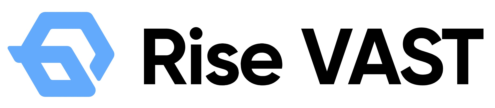
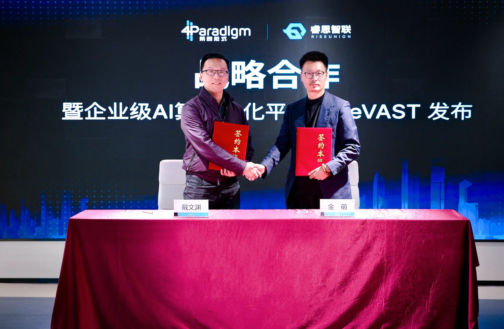

[简体中文](./README.md) · [All articles](../../README.en.md) · [Read on the website](https://www.theriseunion.com/en/blog/riseunion-4paradigm-strategic-partner.html)

# Breaking: RiseUnion and 4Paradigm to Create New AI Computing Ecosystem

RiseUnion · January 01, 2025 at 08:00 (UTC+08:00)

RiseUnion and 4Paradigm form strategic partnership to launch Rise VAST enterprise AI computing platform. Using vGPU virtualization, it saves 80% hardware costs and increases GPU utilization by 5-10x, maximizing heterogeneous computing potential.

Summary: RiseUnion and 4Paradigm have reached a strategic partnership, focusing on AI computing resource management and model training optimization. By integrating HAMi's computing scheduling capabilities with 4Paradigm's AI platform advantages, they will provide end-to-end AI infrastructure solutions for enterprises.

On November 1, 2024, RiseUnion and 4Paradigm officially signed a strategic partnership agreement to jointly launch an enterprise-level AI computing resource pooling platform: [Rise VAST (Virtualized AI Computing Scalability Technology, the HAMi Enterprise Edition)](https://www.theriseunion.com/en/product/vast.html).

Rise VAST, built upon the **HAMi open-source version**, is an enterprise edition that incorporates numerous enterprise-level features, including super-scaling of computing power and memory, computing power expansion and preemption, computing power specification definition, nvlink topology awareness, differentiated scheduling strategies, enterprise-level isolation, resource quota control, multi-cluster management, audit logs, high availability assurance, and fine-grained operational analysis, among many other core functionalities. By providing unified management, shared allocation, on-demand distribution, and rapid scheduling of computing power clusters, Rise VAST fully unleashes the potential of heterogeneous computing, accelerating the modernization and intelligent transformation of AI infrastructure. The founders and CEOs of RiseUnion, Jin Meng, and 4Paradigm, Dai Wenyan, represented both parties at [the signing ceremony](https://mp.weixin.qq.com/s/PQtrr6bG-M5pih4y-Fl3YA).

## Rise VAST Platform Introduction

Rise VAST, as RiseUnion's flagship product, is built on vGPU virtualization technology. The platform can significantly improve the utilization rate and execution efficiency of AI computing resources, helping enterprises save up to **80%** in hardware investment costs while increasing GPU comprehensive utilization by **5-10 times**.

## Key Advantages of Rise VAST

- **Computing Power Deployment and Management**: Rise VAST fully adapts to both domestic and international computing resources, supporting NVIDIA, Huawei Ascend, Hygon, Cambricon, Iluvatar, Moore Threads, and others, ensuring smooth transition and efficient management in the process of domestic technology adoption.
- **Efficient Computing Power Reuse**: Through virtualization technology, Rise VAST achieves "one card, multiple uses" functionality, allowing multiple AI tasks to share the same GPU simultaneously, greatly improving hardware utilization efficiency and reducing computing costs.
- **Fine-grained Resource Management**: Through proportional allocation of GPU resources and memory settings, Rise VAST ensures that AI task resource usage does not exceed set limits, meeting enterprise needs for fine-grained computing power management. The system supports 1% computing power precision division and MiB-level memory management to accommodate flexible resource allocation for different business scenarios.

## Strategic Significance

As an innovative leader in AI computing power optimization and orchestration, RiseUnion is committed to building an autonomous and controllable IT infrastructure architecture and open ecosystem, empowering AI infrastructure and innovative software layers to provide more efficient and convenient AI deployment and user experience, comprehensively promoting the sustainable development of domestic applications and the AI industry.

As large model applications accelerate their industry deployment, enterprise demands for AI computing power are becoming increasingly complex and diverse. The collaboration between RiseUnion and 4Paradigm originated from their technical co-creation in the **[HAMi open-source community](https://www.theriseunion.com/en/blog/project-hami.html)**, continuously driving HAMi's leading innovation in heterogeneous AI computing. This strategic partnership will further expand into the enterprise AI computing market, aiming to solve the problems of low heterogeneous computing power utilization and high AI model adaptation costs through the Rise VAST platform, providing more efficient and economical computing solutions for the AI industry and helping enterprises address increasingly complex AI computing challenges.

---

[Read this article on the RiseUnion website](https://www.theriseunion.com/en/blog/riseunion-4paradigm-strategic-partner.html) · [Explore more articles](https://www.theriseunion.com/en/blog.html)
