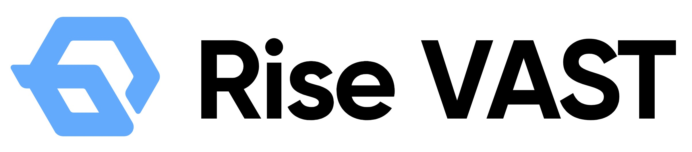
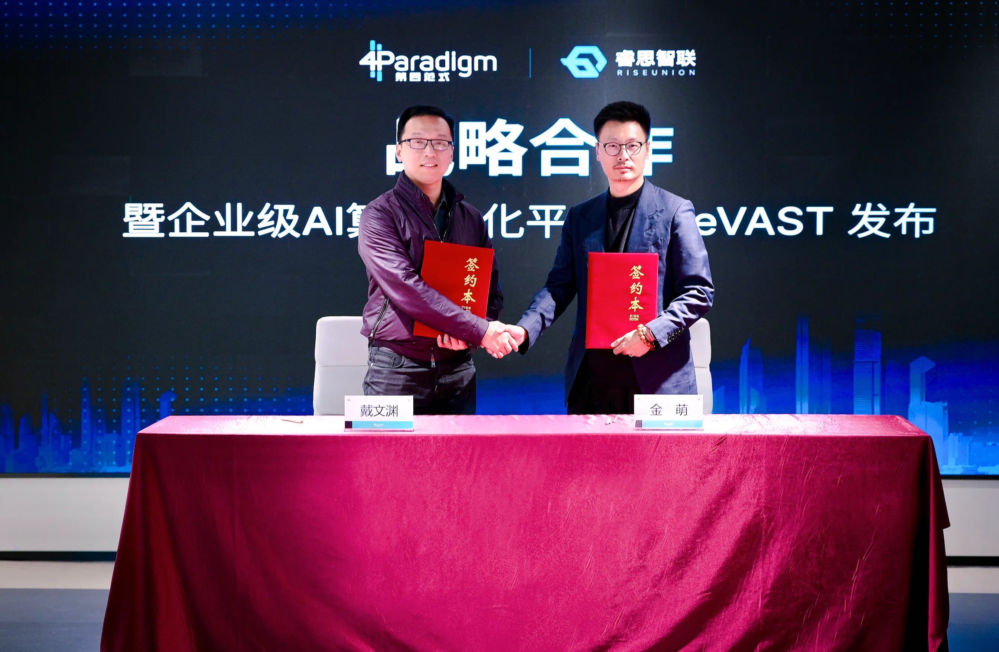

[English](./README.en.md) · [文章目录](../../README.md) · [官网阅读](https://www.theriseunion.com/zh/blog/riseunion-4paradigm-strategic-partner.html)

# 重磅：睿思智联携手第四范式，共创 AI 算力新生态

睿思智联 · 2025/01/01 08:00（北京时间）

睿思智联与第四范式达成战略合作，共同推出企业级AI算力池化平台Rise VAST。通过vGPU虚拟化技术，可节省80%硬件投资，提升GPU利用率5-10倍，全面释放异构算力潜能。

摘要：睿思智联与第四范式达成战略合作，双方将在 AI 算力资源管理、模型训练优化等方面展开深度合作。通过整合 HAMi 的算力调度能力和第四范式的 AI 平台优势，为企业提供端到端的 AI 基础设施解决方案。

2024年11月1日，睿思智联 与 第四范式 正式签署战略合作协议，双方将携手推出企业级AI算力池化平台：[Rise VAST（Virtualized AI Computing Scalability Technology，HAMi企业版）](https://www.theriseunion.com/zh/product/vast.html)。

Rise VAST 是在 [**HAMi 开源版**](https://www.theriseunion.com/zh/blog/project-hami.html) 的基础之上，推出的[HAMi 企业版](https://www.theriseunion.com/zh/product/vast.html)，增加了诸多企业级特性，包括算力和显存的超分、算力扩充和抢占、算力规格定义、nvlink 拓扑感知、差异化调度策略、企业级隔离性、资源配额控制、多集群管理、审计日志、高可用性保障、精细化运营分析等诸多核心功能。通过对算力集群的统一管理、算力资源共享、按需分配和快速调度，全面释放异构算力的潜能，加速AI基础设施的现代化和智能化转型。睿思智联创始人兼CEO金萌与第四范式创始人兼CEO戴文渊代表双方出席 [HAMi 企业版签约仪式](https://mp.weixin.qq.com/s/PQtrr6bG-M5pih4y-Fl3YA)。

## Rise VAST平台介绍

Rise VAST 作为睿思智联的旗舰产品，基于vGPU虚拟化技术打造。该平台可大幅提升AI算力资源的利用率和执行效率，帮助企业在硬件投资上节约最多**80%**的成本，同时将GPU的综合利用率提升至**5-10倍**。

## Rise VAST的主要优势

- **算力部署与管理**：Rise VAST全面适配国产/非国产算力，支持英伟达、华为昇腾、海光、寒武纪、天数智芯、沐曦和摩尔线程等，确保企业在国产化替代进程中的平稳过渡与高效管理。
- **算力高效复用**：通过虚拟化技术，Rise VAST实现了"一卡多用"的功能，即多个AI任务可同时共享同一张显卡，极大地提高了硬件利用效率，降低了算力成本。
- **精细化资源管理**：通过按比例分配GPU资源、设定显存值，Rise VAST能够确保AI任务的资源使用不会超过设定限额，满足企业对精细化算力管理的需求。系统支持1%的算力精度切分，并支持Mib级别的显存管理，以满足不同业务场景的灵活资源调配。

## 战略意义

睿思智联作为AI算力优化与编排的创新引领者，致力于构建自主可控的IT底层架构和开放生态，赋能AI基础设施和创新的软件层，以提供更加高效、便捷的AI部署与使用体验，全面助推国产化应用和 AI 产业的长期可持续发展。

随着大模型应用在行业的加速落地，企业对AI算力的需求变得更加复杂多样化。睿思智联与第四范式的合作，缘起于双方在 **[HAMi 开源社区](https://www.theriseunion.com/zh/blog/project-hami.html)** 的技术共创，持续推动了 HAMi 在异构 AI 计算领域的领先创新。本次双方的战略合作，将进一步拓展到人工智能企业算力市场，旨在通过 Rise VAST 平台解决企业面临的异构算力利用率低下和AI模型适配成本高的问题，为 AI 产业提供更高效、经济的算力解决方案，助力企业应对日益复杂的AI计算挑战。

---

[在睿思智联官网阅读本文](https://www.theriseunion.com/zh/blog/riseunion-4paradigm-strategic-partner.html) · [浏览更多文章](https://www.theriseunion.com/zh/blog.html)
