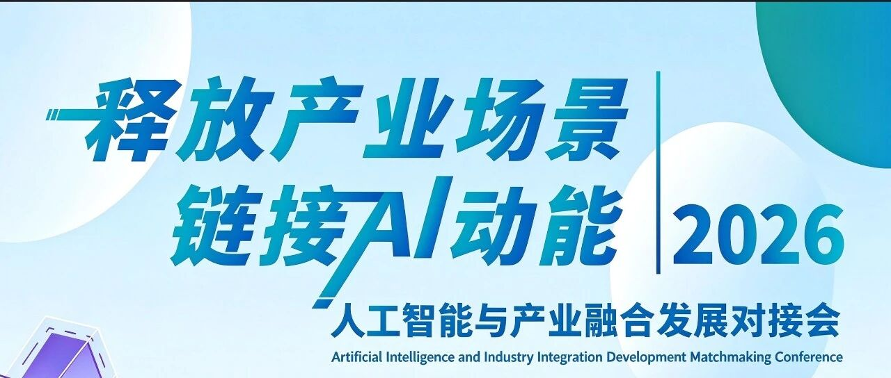
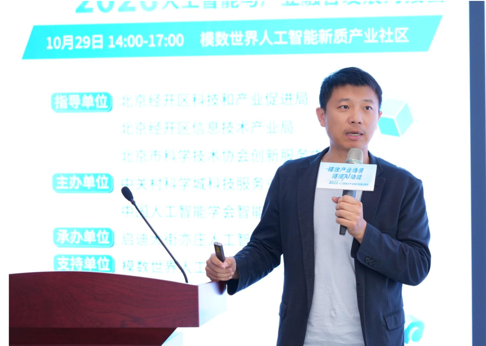

[简体中文](./README.md) · [All articles](../../README.en.md) · [Read on the website](https://www.theriseunion.com/en/blog/riseunion-ai-industry-integration-2026.html)

# Compute Infrastructure Becomes Key to Industrial AI Adoption: RiseUnion at the 2026 AI and Industry Integration Matchmaking Event

RiseUnion · November 03, 2026 at 09:39 (UTC+08:00) · [Original WeChat article (Chinese)](https://mp.weixin.qq.com/s/gJQaJydvCfU04KkZdLCgGw)

RiseUnion presented solutions for compute allocation and cost management at the 2026 AI and Industry Integration Matchmaking Event.

> **Summary** | As AI moves from technological breakthroughs to deployment at scale, compute is no longer a nice-to-have: it is the foundation that enables industrial applications to run. On October 30, the 2026 AI and Industry Integration Matchmaking Event, themed "Unlocking Industrial Scenarios, Connecting AI Momentum," was held at the Moshu World AI New Quality Industrial Community. Invited as a solution provider in AI computing infrastructure, RiseUnion presented a dedicated infrastructure optimization solution through Fu Shuai, its head of presales. Addressing the compute allocation and cost management challenges common to industrial AI deployments, the presentation offered an infrastructure-level approach—one already delivering results in real business settings, including policy banks and leading futures companies.

## 01 Real Problems Take the Stage: A Matchmaking Event without Speeches

This event was different: instead of general speeches, each meeting table became a place to work through a concrete problem.

Its purpose was clear: to focus on presenting original AI innovations and connecting them with opportunities for commercialization. The organizers had conducted extensive industry research across AI, embodied intelligence, autonomous driving and intelligent manufacturing, identifying enterprises' actual technical challenges, gaps in application scenarios and supporting requirements. Buyers, suppliers and service providers then sat together, **"working through one real problem at each table."**

## 02 Compute Provides the Foundation: An Essential Prerequisite for AI Adoption

In her opening remarks, Ge Rile, deputy director of the Beijing Economic-Technological Development Area's Science, Technology and Industry Promotion Bureau, highlighted a key question: **Once an application scenario has been identified, who will actually support the technology?**

The answer is compute. AI is at a critical stage of moving from technological breakthroughs to large-scale deployment, and **efficient, low-cost computing infrastructure is an essential prerequisite for bringing AI into countless industrial applications.** Biomedicine, advanced manufacturing, wind energy, robotics—whatever the sector, real operational needs ultimately depend on a stable, flexible and economical compute foundation.

## 03 Concrete Solutions: Compute Allocation and Cost Management

Fu Shuai, RiseUnion's head of presales, was invited to speak during the session on enabling applications through computing infrastructure.

Fu Shuai, Head of Presales, RiseUnion

Addressing two practical challenges common to industrial AI projects—**difficult compute allocation and difficult cost control**—RiseUnion showcased a dedicated computing infrastructure optimization solution. Its systematic approach provided participating enterprises with an infrastructure-level reference for intelligent transformation and AI project development: **taking compute from "available to buy" to "used appropriately, affordably and under control."**

For organizations seeking solutions, this addressed the most practical question: whether an AI project can be deployed often depends less on how intelligent the model is than on whether compute can support it reliably at a reasonable cost.

## 04 Real Customer Practice

These solutions are more than a conference blueprint. RiseUnion has already produced verifiable answers to compute allocation and cost control challenges in actual industrial production environments.

Autonomous driving: Tackling the toughest R&D challenge—long-running training

Autonomous driving was a key focus of this matchmaking event and is among the first fields to hit the compute wall. At a leading new energy vehicle company, training large models for intelligent driving had long faced three constraints:

- Tightly coupled distributed nodes: A single unready node left the entire cluster waiting, causing costly compute resources to sit idle;

- High fault-tolerance costs for long training runs: Training often lasted weeks, and occasional failures forced jobs to restart from scratch, wasting substantial compute investment;

- An imbalance between storage I/O and cost: Highly concurrent throughput for massive volumes of road-collected data pushed storage procurement against budget limits.

For this scenario, RiseUnion introduced Volcano collaborative scheduling through Rise CAMP, scheduling jobs in groups based on network topology and priority. Combined with job timeouts and automatic retries, this changed "restart training after failure" into "keep training running smoothly." At the data layer, a two-tier architecture combined all-flash storage for highly concurrent reads and writes with hybrid-flash storage for warm and cold data, sustaining I/O throughput within the available budget. The result was less compute fragmentation and fewer interruptions, significantly shortening the end-to-end iteration cycle of intelligent driving models.

Industrial quality inspection: Breaking down multi-chip silos on a fully domestic compute stack

Deployment on exclusively domestic compute presents another test of engineering capability. At an electronics research institute under the Ministry of Industry and Information Technology, multimodal defect detection and industrial quality models needed to run privately on a fully domestic infrastructure stack, with support for full versions of open-source large models. Domestic chips from multiple vendors coexisted on site, with fragmented ecosystems that could easily become disconnected compute silos.

Using Rise CAMP and Rise VAST, RiseUnion brought heterogeneous domestic compute from multiple vendors into a unified resource pool, enabling fine-grained partitioning of compute and GPU memory. High-speed supernode interconnects overcame the compute density limits of individual machines. At the upper layer, a unified API gateway consolidated heterogeneous underlying interfaces, making mainstream models available out of the box and enabling a complete vertical-domain fine-tuning workflow in the same environment. Each chip type no longer needed its own platform: multiple departments shared one resource pool and one set of accounts, bringing total domestic compute investment under control.

## Closing Thoughts

A matchmaking event is only the starting point; project delivery is the ultimate goal.

After the on-site meetings, the organizers stated that they would establish dedicated service records for each expression of interest, continuing to organize technical exchanges, site visits and solution discussions to turn today's intentions into tomorrow's projects as quickly as possible.

Connecting technology and application scenarios in both directions is key to unlocking new quality productive forces. RiseUnion will continue developing solutions for core industrial deployment challenges such as compute allocation and cost management, bringing practices already validated in real settings to more industry partners. By providing compute support that helps scenarios find technology and technology find scenarios, the company aims to deepen the integration of AI capabilities with industrial applications and jointly unlock new quality productive forces in the AI industry.

### About RiseUnion

Beijing RiseUnion Technology Co., Ltd. (RiseUnion) focuses on AI compute management and scheduling. It has completed compatibility certifications with more than 10 domestic chip platforms and is a core contributor to HAMi, a CNCF Sandbox open-source project. A National High-Tech Enterprise, a Beijing specialized and innovative SME, and chair of the AIIC Compute Pooling Working Group, the company has achieved large-scale production deployments across finance, government and enterprise, defense, transportation and healthcare.

RiseUnion is committed to making compute as readily available as water and electricity, building an intelligent, controllable and efficient computing foundation for enterprise AI transformation.

For more information, visit **riseunion.ai** or contact **400-605-2336.**

---

[Read this article on the RiseUnion website](https://www.theriseunion.com/en/blog/riseunion-ai-industry-integration-2026.html) · [Explore more articles](https://www.theriseunion.com/en/blog.html)
