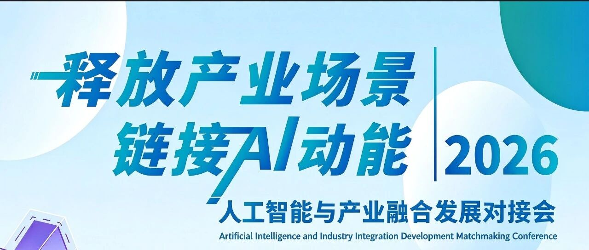
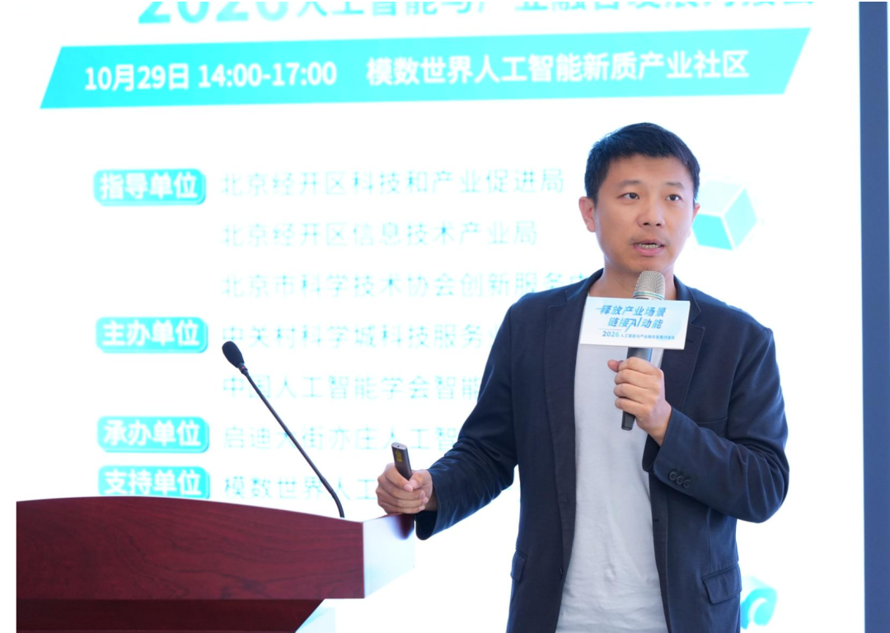

[English](./README.en.md) · [文章目录](../../README.md) · [官网阅读](https://www.theriseunion.com/zh/blog/riseunion-ai-industry-integration-2026.html)

# 算力底座，正在成为产业AI落地的关键变量 睿思智联亮相2026人工智能与产业融合发展对接会

睿思智联 · 2026/11/03 09:39（北京时间） · [微信公众号原文](https://mp.weixin.qq.com/s/gJQaJydvCfU04KkZdLCgGw)

睿思智联亮相2026人工智能与产业融合发展对接会，分享算力调配与成本管控的专项解决方案。

> **摘要**｜当AI从技术突破走向规模化落地，算力不再是"锦上添花"，而是产业场景真正跑起来的底座。10月30日，以"释放产业场景 链接AI动能"为主题的2026人工智能与产业融合发展对接会在模数世界人工智能新质产业社区举办。作为AI算力基础设施领域的解决方案提供商，睿思智联受邀参会，售前负责人傅帅登台分享了算力基础设施优化方向的专项方案，围绕产业AI落地中普遍面临的算力调配、成本管控难题，给出底层算力层面的解题思路——而这些思路，早已在政策性银行、头部期货公司等真实业务场景中跑出实绩。

## 01 真问题上台：一场不设演讲的对接会

这次对接会有点不一样——没有泛泛的演讲，只有一张张变成"解题现场"的会议桌。

活动定位清晰：聚焦人工智能原始创新成果的发布与转化对接。主办方前期做了扎实的产业调研，覆盖人工智能、具身智能、自动驾驶、智能制造等重点赛道，梳理出企业真实的技术痛点、场景缺口和配套需求。于是，需求方、供给方、服务方同场而坐，**"一张桌子拆解一个真问题"**。

## 02 算力底座托底：AI落地绕不开的前提

会上，北京经开区科技和产业促进局副局长格日乐在致辞中点明了一个关键判断：**场景找到了，谁来把技术真正"托"起来？**

答案是算力。人工智能正处在从技术突破迈向规模化落地的关键时期，而**高效、低成本的算力基础设施，是AI技术走向万千产业场景的重要前提**。生物医药、高端制造、风电能源、机器人……无论赛道如何，产业场景的真实需求，最终都要落在稳定、灵活、经济的算力底座之上。

## 03 真方案出手：算力调配与成本管控

正是在"算力底座赋能"环节，睿思智联售前负责人傅帅受邀登台。

睿思智联售前负责人 傅帅

针对产业AI项目落地过程中普遍面临的**算力调配难、成本管控难**这两大现实问题，睿思智联带来了算力基础设施优化方向的专项解决方案展示。方案以系统化的思路，为现场企业开展智能化改造、AI项目建设提供了底层算力层面的参考——**把算力从"买得到"做到"用得对、用得起、管得住"**。

对需求方而言，这恰好回应了那个最实际的问题：AI项目能不能落地，很多时候不取决于模型多聪明，而取决于算力能不能以合理成本、稳定供给地支撑起来。

## 04 真客户实践

这些方案并不只是会上的一张蓝图。算力调配与成本管控的难题，睿思智联已经在真实的工业生产场景里，交出了可复算的答案。

自动驾驶：攻克研发侧最难啃的“长周期训练”

自动驾驶是本次对接会重点聚焦的赛道，也是最先撞上算力墙的领域。在某头部新能源汽车企业，智驾大模型训练长期面临三重掣肘：

- 分布式节点强耦合：单点未就绪导致集群全局等待，昂贵算力严重闲置；   

- 长周期容错成本高：训练动辄数周，偶发故障导致任务推倒重来，沉没算力成本巨大；   

- 存储IO与成本失衡：海量路采数据的高并发吞吐，使存储采购面临预算天花板。   

针对该场景，睿思智联通过Rise CAMP平台引入Volcano协同调度机制，实现任务按网络拓扑与优先级成组调度；配合任务超时与自动重试策略，将“故障推倒重来”转变为“训练平滑不中断”。在数据层，构建全闪（承接高并发读写）与混闪（温冷数据沉淀）两级分层架构，在既定预算下稳稳撑住 IO 吞吐。最终有效减少算力碎片与中断，显著缩短了智驾模型的端到端迭代周期。   

工业质检：破解全栈国产算力下的“多芯孤岛”

纯国产算力下的落地，则是另一道考验工程能力的考题。在工业和信息化部某电子研究所，多模态缺陷检测与工业质量大模型需要在完全国产化的底座上私有化运行，且要求跑满血版开源大模型。现场多厂商国产芯片并存、生态割裂，极易形成互不连通的算力孤岛。

睿思智联依托Rise CAMP与Rise VAST，将多厂商国产异构算力纳管为统一资源池，实现算力与显存的细粒度切分，并依托超节点高速互联突破单机算力密度限制；在上层，通过统一 API 网关将底层异构接口彻底收敛，实现主流模型开箱即用，并在同一套环境内闭环完成垂直场景微调。一种芯片不必再配一套平台，多部门共用一张池、一笔账，让国产算力的综合投入真正“管得住”。

## 写在最后

一场对接会只是起点，项目落地才是最终目标。

现场对接结束后，主办方明确表示，将针对活动产生的各项对接意向建立专项服务台账，持续组织技术交流、实地走访、方案研讨等配套服务，推动今天的"意向"尽快落地为明天的"项目"。

技术与场景双向奔赴，是释放新质生产力的关键所在。睿思智联也将持续围绕算力调配、成本管控等产业落地的核心难题深耕方案能力，把已经在真实场景验证过的做法带到更多产业伙伴身边，做好"为场景找技术、为技术找场景"的算力支撑力量，推动AI动能与产业场景深度耦合，共同释放人工智能产业的新质生产力。

### 关于睿思智联

北京睿思智联科技有限公司（RiseUnion）专注于AI 算力管理与调度，已完成 10+ 国产芯片兼容认证，是 CNCF Sandbox 开源项目 HAMi 的核心贡献者之一。公司是国家高新技术企业、北京市专精特新中小企业、AIIC 算力池化工作组组长单位，在金融、政企军工、交通、医疗等行业实现大规模生产级落地。

睿思智联致力于让算力像水电一样随取随用，为企业 AI 转型构建智能、可控、高效的算力底座。

了解更多详细信息，欢迎访问官网：**riseunion.ai** 或联系：**400-605-2336**。

---

[在睿思智联官网阅读本文](https://www.theriseunion.com/zh/blog/riseunion-ai-industry-integration-2026.html) · [浏览更多文章](https://www.theriseunion.com/zh/blog.html)
