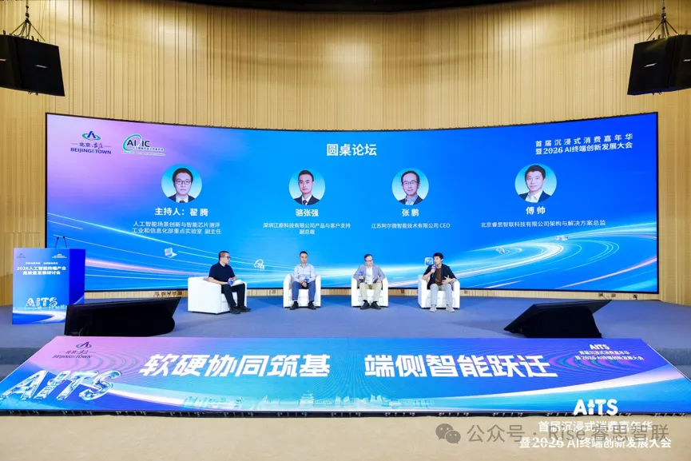

[简体中文](./README.md) · [All articles](../../README.en.md) · [Read on the website](https://www.theriseunion.com/en/blog/riseunion-ai-terminal-industry-seminar-2026.html)

# Bringing AI into Real Business Operations | RiseUnion at the 2026 AI Terminal Industry Seminar

RiseUnion · October 13, 2026 at 10:20 (UTC+08:00) · [Original WeChat article (Chinese)](https://mp.weixin.qq.com/s/_BI1UwrJvE7Wo6ANXsLjQg)

RiseUnion shared its approach to on-device AI, cloud-edge collaboration and industry deployments at the 2026 AI Terminal Industry Seminar.

The 2026 Seminar on High-Quality Development of the AI Terminal Industry recently took place in Beijing's Yizhuang district. The China Software Testing Center released authoritative assessment standards and a testing platform, while Huawei, iFLYTEK, the Beijing Academy of Artificial Intelligence, RiseUnion and other industry partners gathered to discuss one central question: as large models leave the laboratory, how can they establish a reliable presence in **factories, substations and everyday offices**, becoming **"digital employees"** that can truly take on business responsibilities?

01 Conference Focus: Bringing On-Device Intelligence into Real Operations\

At the conference's central roundtable, **Fu Shuai**, RiseUnion's solution director, joined participants from across the industry value chain for an in-depth discussion of practical intelligent terminal deployments.

▲ Roundtable forum

💬 Fu Shuai said: "Whether a device is good and its compute responsive cannot be judged solely by laboratory benchmark scores. What matters is whether it can **complete tasks on site, respond quickly enough and continue working when the network goes down**."

Addressing the challenges of bringing intelligence into operational settings, the roundtable examined three major obstacles and their solutions:

Challenge 01 Edge compute is inherently limited; compressing models alone is not enough

**The on-site challenge:** Edge devices have inherent compute and memory limitations. Simply compressing model parameters to fit hardware often sacrifices essential accuracy. Combined with data movement and memory bottlenecks during operation, heavy loads can easily cause overheating and throttling, disrupting business operations.

**RiseUnion's approach: Overcome memory bottlenecks through hardware-software collaboration, using compute partitioning and fine-grained scheduling to maximize energy efficiency.** Work with chip ecosystem partners to validate combinations of devices, drivers, inference engines and models, selecting suitable models based on the scenario, GPU type and configuration. Replace reliance on paper benchmarks with real task response times, energy use per task and long-term stability. Build validated hardware-software combinations with hardware partners and adapt and optimize models through an open-source domestic technology model community, extracting the greatest productivity from limited edge resources.

Challenge 02 With so many devices, does changing brands mean starting over?

**The on-site challenge:** With numerous chip and device vendors, changing a model or production batch often requires the entire software and algorithm stack to be debugged again from scratch, trapping enterprises in endless adaptation work.

**RiseUnion's approach: Make it as simple as downloading software from an app store.** RiseUnion builds a neutral underlying system that supports mainstream chips below and provides a standard application store above, letting business users distribute intelligent models quickly to different devices with a single click.

Challenge 03 What happens when hundreds or thousands of distributed devices lose connectivity?

**The on-site challenge:** Once devices are deployed outdoors, in factories or across dispersed sites, network instability can interrupt operations. Later, operations teams struggle to update models across the fleet.

**RiseUnion's approach: Make decisions locally and upgrade remotely with one click.** Even when on-site fiber links or network connections fail, devices retain independent processing and local alerting capabilities. For subsequent improvements, administrators can silently update thousands of devices nationwide from the headquarters console with a single click.

02 Ready to Use: An Intelligent Experience as Simple as Using a Computer

To make advanced large models more accessible, RiseUnion has introduced hardware-software solutions for operational environments:

🖥️ Intelligent Computing Desktop Workstation

**Plug in and use:** It runs quietly beside an office desk, without requiring specialist IT staff to wrestle with complex code and installation environments. Business users can access an AI assistant as soon as they switch it on.

**Keep core secrets on premises:** Contract reviews, specialized document Q&A and coding assistance all take place locally, eliminating the risk of business secrets leaking at the source.

🌐 Unified Cloud-Edge Collaboration Platform (Rise Edge)

**Broad compatibility with mainstream chips and hardware brands**, combined with compute partitioning and oversubscription, enables a single card or device to run multiple business models concurrently, multiplying hardware utilization and value for money.

With **decentralized resilience and edge autonomy**, local nodes can continue operating and issuing alerts independently even when communications fail in remote outdoor environments, protecting business continuity under extreme conditions.

Built-in **application store and automated OTA mechanisms** enable one-click batch distribution of algorithms, just like installing apps. Administrators can centrally manage thousands of unattended sites nationwide through the central console, without travel or physical contact.

03 Real Results: Proven in Demanding Industrial Environments

Across multiple demanding deployments, RiseUnion has put on-site intelligence through real engineering tests using a division of responsibilities: **"endpoint collection, edge autonomy and cloud operations."**

📷 Lightweight data collection at the front end (terminals)

On-site cameras and inspection drones capture images and sensor data locally, working nimbly without carrying heavy algorithmic workloads.

⚙️ Autonomous on-site analysis and response (edge · Rise Edge / VAST)

Edge nodes equipped with internally developed compute management capabilities process multiple audio and video streams locally, running several algorithms in parallel without lag. Even when severe weather completely cuts off external connectivity, local nodes can still identify hazards independently and **raise alerts within milliseconds**, maintaining the safety baseline.

🛰️ Easy management from afar (cloud · CAMP / Rise Edge)

Headquarters oversees overall operations and compute bills. When new capabilities are needed, administrators can **push new algorithms in batches with one click**, just like distributing phone updates, sparing engineers journeys to remote sites.\

We welcome more ecosystem partners to join us in opening a new chapter of intelligence!

### About RiseUnion

Beijing RiseUnion Technology Co., Ltd. (RiseUnion) focuses on AI compute management and scheduling. It has completed compatibility certifications with more than 10 domestic chip platforms and is a core contributor to HAMi, a CNCF Sandbox open-source project. A National High-Tech Enterprise, a Beijing specialized and innovative SME, and chair of the AIIC Compute Pooling Working Group, the company has achieved large-scale production deployments across finance, government and enterprise, defense, transportation and healthcare.

RiseUnion is committed to making compute as readily available as water and electricity, building an intelligent, controllable and efficient computing foundation for enterprise AI transformation.

For more information, visit **riseunion.ai** or contact **400-605-2336**.

---

[Read this article on the RiseUnion website](https://www.theriseunion.com/en/blog/riseunion-ai-terminal-industry-seminar-2026.html) · [Explore more articles](https://www.theriseunion.com/en/blog.html)
