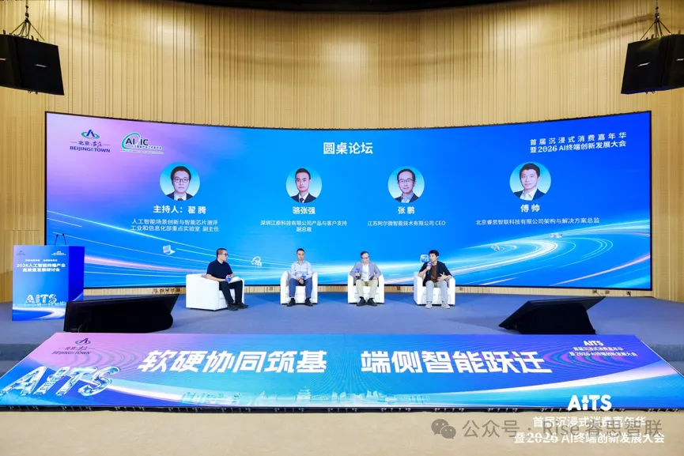

[English](./README.en.md) · [文章目录](../../README.md) · [官网阅读](https://www.theriseunion.com/zh/blog/riseunion-ai-terminal-industry-seminar-2026.html)

# 让 AI 真正走进业务现场｜睿思智联亮相2026人工智能终端产业研讨会

睿思智联 · 2026/10/13 10:20（北京时间） · [微信公众号原文](https://mp.weixin.qq.com/s/_BI1UwrJvE7Wo6ANXsLjQg)

睿思智联亮相2026人工智能终端产业研讨会，分享端侧智能、云边协同与行业落地实践。

日前，2026人工智能终端产业高质量发展研讨会在北京亦庄举行。中国软件评测中心发布权威评测标准与测试平台，华为、科大讯飞、智源研究院以及睿思智联等产业伙伴齐聚一堂。大家共同探讨的核心议题只有一个：当大模型走出实验室，怎样才能在**工厂、变电站和日常办公中稳定扎根**，成为真正扛得起业务的"**数字员工**"？

01 会议聚焦：端侧智能走向真实业务\

在大会核心圆桌论坛上，睿思智联解决方案总监**傅帅**与产业上下游嘉宾同台，围绕智能终端如何真正落地展开了深度对话。

▲ 圆桌论坛

💬 傅帅指出："设备好不好、算力灵不灵，不能只看实验室里的跑分，而是要看它在现场能不能**把任务办成、反应够不够快、断了网能不能继续干活**。"

围绕智能走向现场的痛点，圆桌讨论深入剖析了制约落地的三大挑战及解法：

挑战 01边缘算力先天偏小，不能只靠"压缩模型"硬抗

**现场困境**：边缘设备天然存在算力与内存限制，但若只靠压缩模型参数来迁就硬件，往往会牺牲核心精度；加上运行中数据搬运与内存瓶颈，高负载下极易发热降频，导致业务卡顿。

**睿思解法：软硬协同破局内存瓶颈，以算力切分与精细调度压榨极致能效**。与芯片生态伙伴共建"设备—驱动—推理引擎—模型"验证组合，根据场景需求、GPU型号和配置选择适配的模型；摒弃单一纸面跑分，以"真实任务响应时延、单位能耗与长期稳定性"为标准，与硬件伙伴共建经过验证的软硬组合，通过开源信创模型社区对模型进行适配优化，把有限的边缘资源压榨出最大生产力。

挑战 02设备五花八门，换个牌子就得重做？

**现场困境**：芯片和设备厂商林立，往往换一个型号或批次，整套软件和算法就得从头调试一遍，企业陷入无休止的适配泥潭。

**睿思解法：像在应用商店下软件一样简单**。睿思打造中立的底层系统，向下包容兼容各种主流芯片，向上提供标准应用商店，让业务人员只需一键点击，就能把智能模型快速分发到不同设备上。

挑战 03铺到各地几百上千台，断网失联怎么办？

**现场困境**：设备一旦放到野外、工厂或分散场站，网络一抖动业务就停滞；后期想要批量更新模型，运维团队往往要疲于奔命。

**睿思解法：就地自主决策，千里之外一键升级**。即使现场光纤断开、网络失联，设备依然保留独立思考与本地报警能力；后续优化时，管理员在总部后台点一下，就能完成全国成千上万台设备的静默远程更新。

02 开箱即用：像用电脑一样简单的智能新体验

为了让前沿大模型不再高深莫测，睿思智联推出了面向业务现场的软硬件落地成果：

🖥️ 智算桌面工作台

**插电即用**：放在办公桌旁就能安静运转，无需专业IT人员折腾复杂的代码与安装环境，业务人员开机就能调出 AI 助手。

**核心机密不出门**：所有合同审阅、专业资料问答和代码辅助全在本地完成，从根源上杜绝商业秘密泄露风险。

🌐 全域云边协同平台（Rise Edge）

**全面兼容主流芯片与各品牌硬件**，依托算力切分超分技术，让单张卡、单台设备即可并发运行多业务模型，硬件利用率与性价比倍增。

具备**去中心化的边缘自治韧性**，即使身处偏远野外遭遇通信中断，本地节点依然能自主预警、持续运转，守住极端环境下的业务连续性底线。

内置**应用商店与自动化 OTA 机制**，支持算法像装 App 一样一键批量下发，管理者在中心后台即可对全国成千上万个无人值守场站实现"免奔赴、零接触"的远程统一管控。

03 真实成效：经受住严苛工业现场的实战检验

在多个严苛现场的实战中，睿思智联通过"**端点采集、边缘自治、云端运管**"的分工体系，让现场智能真正经受住了工程检验：

📷 前端只管轻巧采集（终端）

现场摄像头与巡检无人机就地捕捉图像与传感器数据，无需背负沉重算法，轻装上阵、敏捷作业。

⚙️ 现场自主分析与处置（边缘 · Rise Edge / VAST）

搭载自研算力管理能力的边缘节点就地处理多路音视频，多套算法并行分析却不卡顿；即便遭遇恶劣天气导致外部网络完全断开，本地依然能自主甄别隐患、**毫秒级拉响警报**，守住安全底线。

🛰️ 千里之外轻松打理（云端 · CAMP / Rise Edge）

总部统揽全局运行与算力账单；当需要升级新技能时，管理人员在后台像下发手机更新一样**一键批量推送新算法**，免去工程师奔赴野外现场的奔波之苦。\

欢迎更多生态伙伴与我们同行，共同开启智能新篇章！

### 关于睿思智联

北京睿思智联科技有限公司（RiseUnion）专注于AI 算力管理与调度，已完成 10+ 国产芯片兼容认证，是 CNCF Sandbox 开源项目 HAMi 的核心贡献者之一。公司是国家高新技术企业、北京市专精特新中小企业、AIIC 算力池化工作组组长单位，在金融、政企军工、交通、医疗等行业实现大规模生产级落地。

睿思智联致力于让算力像水电一样随取随用，为企业 AI 转型构建智能、可控、高效的算力底座。

了解更多详细信息，欢迎访问官网：**riseunion.ai** 或联系：**400-605-2336**。

---

[在睿思智联官网阅读本文](https://www.theriseunion.com/zh/blog/riseunion-ai-terminal-industry-seminar-2026.html) · [浏览更多文章](https://www.theriseunion.com/zh/blog.html)
