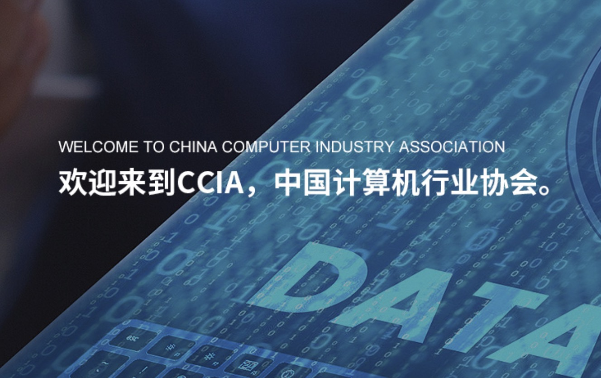

[简体中文](./README.md) · [All articles](../../README.en.md) · [Read on the website](https://www.theriseunion.com/en/blog/riseunion-aiic-1.html)

# AI Committee & RiseUnion: New Strategic Cooperation Chapter

RiseUnion · January 01, 2025 at 08:00 (UTC+08:00)

AI Industry Committee and RiseUnion establish strategic partnership, collaborating on industry standards and technological innovation. RiseUnion will leverage HAMi platform to participate in standard setting and promote AI industry development.

Summary: The AI Industry Committee and RiseUnion have reached a strategic partnership, collaborating comprehensively in industry standard setting and technological innovation. RiseUnion will leverage HAMi platform's technical advantages in AI computing management to participate in establishing industry standards and promote healthy development of the AI industry.'

On July 19, 2024, the Secretariat of the Artificial Intelligence Industry Committee (AIIC) of China Computer Federation held a discussion meeting with Beijing RiseUnion Technology Co., Ltd., focusing on the development of domestic intelligent computing ecosystem.

During the meeting, Jin Meng from Beijing RiseUnion Technology introduced the current status of the domestic intelligent computing ecosystem, while Ai Wensi from the AIIC Secretariat briefly introduced the background and working approach of the committee. Both parties then discussed the development path and methods for building the domestic intelligent computing ecosystem.

Finally, Secretary-General Gao Hongling of AIIC pointed out that the committee, serving as a bridge and link for industry-academia-research-application in the industry, has advantages in resource aggregation. The committee will work closely with enterprises to orderly advance the development of the domestic intelligent computing ecosystem.

> Source: [AIIC Secretariat Holds Discussion Meeting with Beijing RiseUnion Technology](https://mp.weixin.qq.com/s/_GUGO4I3zcy5b4wtS6zisw)

---

[Read this article on the RiseUnion website](https://www.theriseunion.com/en/blog/riseunion-aiic-1.html) · [Explore more articles](https://www.theriseunion.com/en/blog.html)
