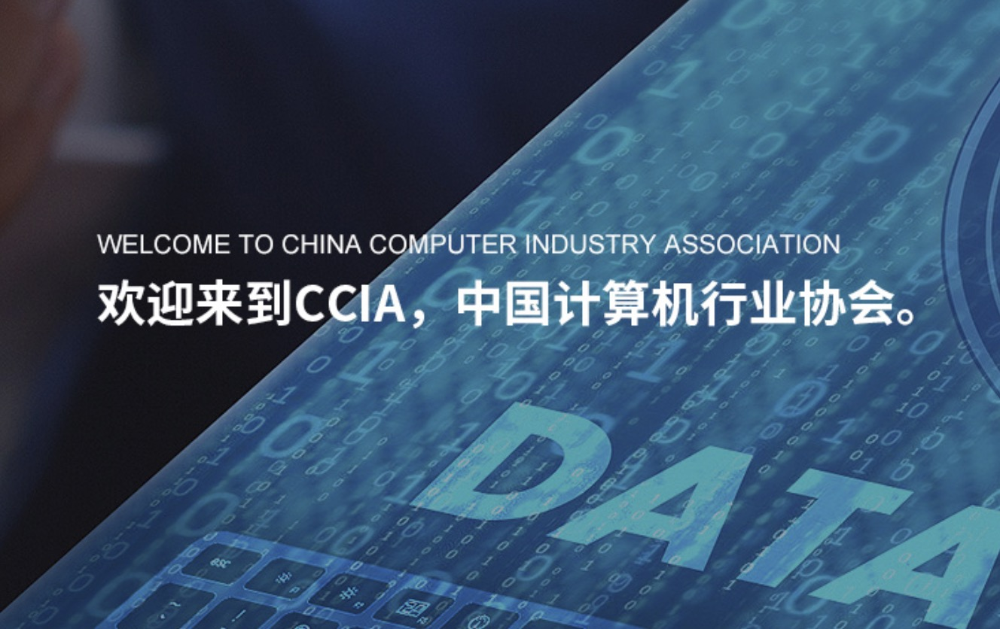

[English](./README.en.md) · [文章目录](../../README.md) · [官网阅读](https://www.theriseunion.com/zh/blog/riseunion-aiic-1.html)

# 共谋发展：AI 产业工委会与睿思智联开启战略合作新篇章

睿思智联 · 2025/01/01 08:00（北京时间）

AI产业工委会与睿思智联达成战略合作，双方将在产业标准制定、技术创新等方面展开全面合作。睿思智联将发挥HAMi平台优势，参与制定行业标准，推动AI产业健康发展。

摘要：AI 产业工委会与睿思智联达成战略合作，双方将在产业标准制定、技术创新等方面展开全面合作。睿思智联将发挥 HAMi 平台在 AI 算力管理领域的技术优势，参与制定行业标准，推动 AI 产业健康发展。

2024 年 7 月 19 日，中国计算机行业协会人工智能产业工委会秘书处与北京睿思智联科技有限公司举行座谈会，围绕国内智能计算生态建设开展讨论。

会上，北京睿思智联科技有限公司金萌介绍了国内智能计算生态现状，人工智能产业工委会秘书处艾文思对工委会的成立背景及工作思路进行了简要介绍。然后，双方围绕国内智能计算生态建设路径及建设方法开展探讨。

最后，人工智能产业工委会高宏玲秘书长指出，工委会作为行业内产学研用的桥梁和纽带，具有资源聚合优势。工委会将与企业紧密合作，有序推进国内智能计算生态建设工作。

> 原文: [人工智能产业工委会秘书处与北京睿思智联科技有限公司举行座谈会](https://mp.weixin.qq.com/s/_GUGO4I3zcy5b4wtS6zisw)

---

[在睿思智联官网阅读本文](https://www.theriseunion.com/zh/blog/riseunion-aiic-1.html) · [浏览更多文章](https://www.theriseunion.com/zh/blog.html)
