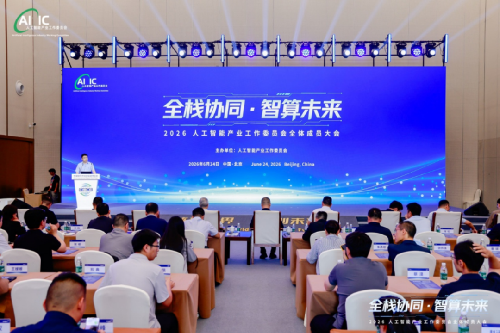
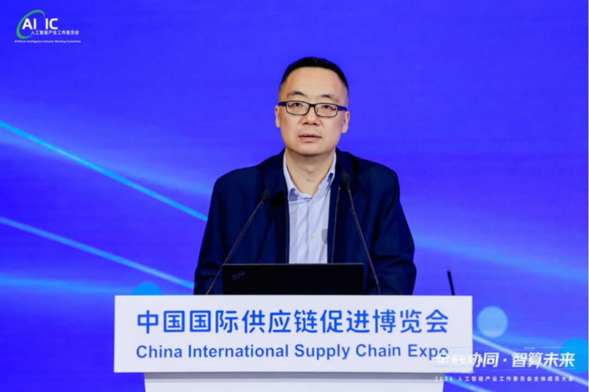
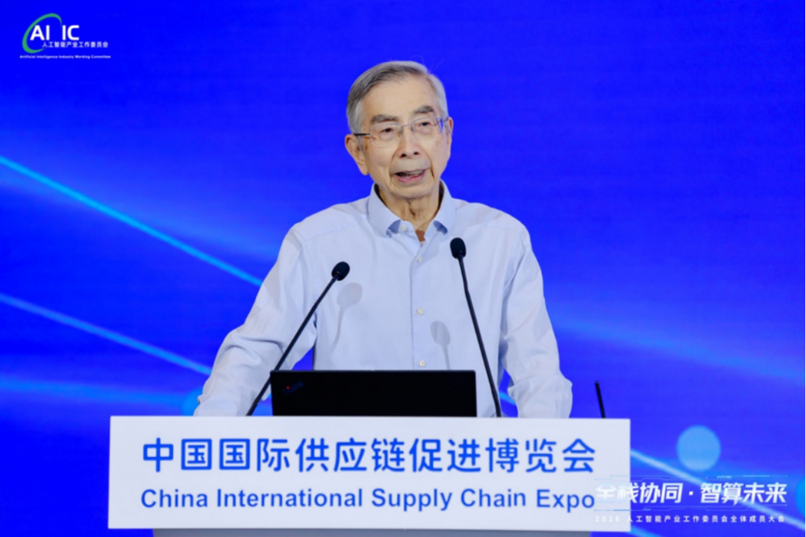
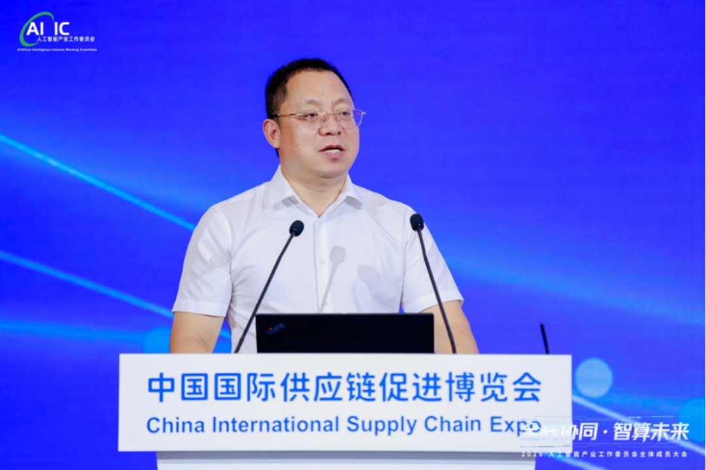
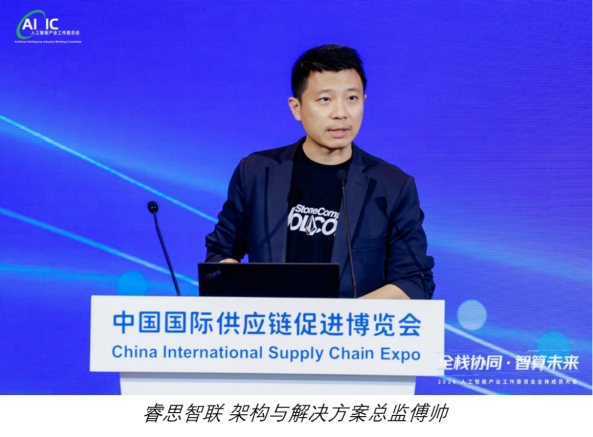

[简体中文](./README.md) · [All articles](../../README.en.md) · [Read on the website](https://www.theriseunion.com/en/blog/riseunion-aiic-full-stack-collaboration-2026.html)

# Full-Stack Collaboration Breaks Through Computing Barriers | RiseUnion Appears at the 2026 AI Industry Working Committee Plenary and Delivers a Thematic Presentation

RiseUnion · June 29, 2026 at 09:29 (UTC+08:00) · [Original WeChat article (Chinese)](https://mp.weixin.qq.com/s/Me7nw9eyQNqiEq7kQ7fQbw)

RiseUnion appears at the 2026 AI Industry Working Committee plenary and delivers a thematic presentation.

On June 24, the 2026 Artificial Intelligence Industry Working Committee Plenary, themed “Full-Stack Collaboration, Intelligent Computing for the Future,” was held at the China International Exhibition Center in Beijing. The conference brought together leaders from the Ministry of Industry and Information Technology, authoritative industry experts, and representatives from hundreds of leading companies across the entire AI industry chain for in-depth discussions on core topics including trends in China’s artificial intelligence industry, paths for full-chain collaboration, computing infrastructure development, and the construction of a domestic ecosystem.

As chair organization of the Artificial Intelligence Industry Working Committee’s Compute Pooling Working Group, Beijing RiseUnion Technology Co., Ltd. (RiseUnion) was invited to attend the entire conference. Fu Shuai, Director of Architecture and Solutions, represented the company on stage and delivered a thematic presentation. He introduced the industry to the progress of the group standard, *Information Technology—Intelligent Computing Services—Requirements for Heterogeneous Computing Virtualization and Pooling Systems*, whose drafting is led by our company. The standardization proposal addresses current core pain points in the intelligent computing industry and fully demonstrates RiseUnion’s industry leadership and ecosystem coordination capabilities in computing infrastructure.

# Top-Level Guidance: Focus on Full-Stack Collaboration and Strengthen the Foundation for Domestic Intelligent Computing

The conference was chaired by Hu Guodong, Chairman of the Artificial Intelligence Industry Working Committee and Deputy Party Secretary of the China Academy of Information and Communications Technology. Leaders and experts from the Electronic Information Department of the Ministry of Industry and Information Technology, the China Software Evaluation Center, and the Physical AI and Robotics Integrated Innovation Center (under preparation) delivered keynote addresses and reports, setting the direction for industry development. In his address, Jin Lei, Director of the Electronic Systems Division of MIIT’s Electronic Information Department, made clear that the AI industry has shifted from a single training scenario toward equal emphasis on training and inference, and that the electronic information industry is the core foundation driving AI industry development. Going forward, the authorities will focus on three major areas: strengthening the foundation of the advanced computing industry; connecting the entire chip—software—complete system—application industry chain; and supporting innovation in emerging computing fields such as compute-power coordination and space computing, while continuing to improve industry organizations and standards systems. Director Ni Guangnan offered an in-depth interpretation of *Trends in Physical AI and AI Chip Development*, proposing that physical AI is the core vehicle for bringing AI into the real economy, that edge-side RISC-V chips contain enormous opportunities for domestic substitution, and calling on the industry to jointly build a fully domestic ecosystem of “domestic large models + domestic chips + domestic software” to make the leap from digital AI to physical AI. Liu Longgeng, Director of the China Software Evaluation Center, objectively analyzed the gap between the Chinese and U.S. AI industries. He noted that China has achieved breakthroughs in vertical-industry applications, but still has shortcomings in high-end chips, underlying firmware, and the developer ecosystem. He recommended accelerating AI safety governance, public testing platforms, and unified evaluation systems, and using regular benchmarking tests to address weaknesses and strengthen deficiencies. Multiple industry experts jointly pointed out that domestic intelligent computing infrastructure currently faces three widespread computing “walls”: structural mismatch, breaks in the software ecosystem, and network interconnection bottlenecks. Although heterogeneous chips are flourishing, they are difficult to schedule uniformly; computing resources are isolated; and cluster utilization is low. These have become key bottlenecks constraining full-stack collaboration, making unified industry standards urgently necessary to connect the ecosystem.

*Director Jin Lei of the Electronic Systems Division of MIIT’s Electronics Department delivers an address*

*Director Ni Guangnan of the Physical AI and Robotics Integrated Innovation Center (under preparation) delivers a speech*

*Software Evaluation Center Director Liu Longgeng delivers a speech*

# RiseUnion Speaks: Leading the Compute Pooling Standard and Providing a Path to Break Through Industry Barriers

In response to the heterogeneous computing management challenges faced across the industry, Fu Shuai, RiseUnion’s Director of Architecture and Solutions, presented the latest results of the heterogeneous computing virtualization and pooling standard led by the Compute Pooling Working Group during the conference’s thematic presentation session, providing the entire industry with a standardized solution. Fu Shuai said that, as chair organization of the Compute Pooling Working Group, RiseUnion initiated and leads the development of the heterogeneous compute pooling group standard. Its core objective is to establish a compute pooling framework with unified interfaces, scheduling, and management; eliminate adaptation differences among heterogeneous hardware such as GPUs, NPUs, and FPGAs from different vendors; and resolve industry challenges including the difficulty of coordinating and scheduling multiple types of computing resources, resource fragmentation, and high business integration costs.

### 1. Unified Resource Abstraction Layer: Use virtualization technology to abstract all kinds of physical computing hardware into standardized logical resources, shielding differences among underlying chip architectures.

### 2. Dynamic Pooling of Computing Resources Across the Entire Domain: Bring computing resources across nodes and machine types under unified management, support fine-grained computing partitioning and elastic scheduling, and substantially improve overall cluster utilization.

### 3. Smooth Full-Chain Integration: Maintain downward compatibility with domestic computing chips and upward adaptation to diverse applications such as large-model training, industry inference, and physical robots, connecting the computing foundation with business scenarios.

Fu Shuai explained that the standard has now entered the refinement and implementation stage. The working group continues to bring chip vendors, intelligent computing centers, AI service providers, and industry end-user companies into its drafting work, promoting the standard as a common technical specification for heterogeneous computing collaboration in China and helping implement MIIT’s requirement for “full-chain collaboration” in industry development. Based on its responsibilities as chair organization, RiseUnion continues to lead collaborative problem-solving across the upstream and downstream industry chain, establish a platform for exchanging computing standards, promote the scaled implementation of compute pooling technology, help the industry escape isolated computing resources, reduce the overall cost of enterprise AI development, and strengthen the foundation of domestic, independently controllable intelligent computing infrastructure.

# Building the AI Industry Ecosystem Together: RiseUnion Continues to Lead as Chair Organization

The conference presented the achievements of full-stack collaborative innovation across China’s AI industry, identifying industry organizations and group standards as levers for bringing together the industry chain and advancing high-quality artificial intelligence development. As chair organization of the Compute Pooling Working Group, RiseUnion has always shouldered two major industry missions: first, standards leadership—continuously improving group standards related to heterogeneous computing virtualization and compute resource pooling, filling the gap in unified domestic computing scheduling specifications; second, ecosystem collaboration—bringing chip, server, large-model, and industry application companies together to build an open computing ecosystem, implement standardized compute pooling solutions, and empower intelligent transformation across government affairs, manufacturing, robotics, digital supply chains, and other fields.

In the future, RiseUnion will continue to rely on the Artificial Intelligence Industry Working Committee platform and exercise its coordinating and leading role as chair organization. It will participate deeply in industry discussions, standards development, technical problem-solving, and industrial implementation; use standardized, domestic compute pooling technology to remove collaborative barriers across the entire industry chain; help China build an independent, efficient, and inclusive intelligent computing industry system; and join industry partners on the new journey toward “Full-Stack Collaboration, Intelligent Computing for the Future.”

### About RiseUnion

Beijing RiseUnion Technology Co., Ltd. (RiseUnion) focuses on AI computing management and scheduling. It has completed compatibility certification with more than 10 domestic chips and is one of the core contributors to the CNCF Sandbox open-source project HAMi. The company is a National High-Tech Enterprise, a Beijing Specialized, Refined, Distinctive, and Innovative SME, and chair organization of the AIIC Compute Pooling Working Group, with large-scale production deployments in finance, government and military enterprises, transportation, healthcare, and other industries.

RiseUnion is committed to making computing power as readily available as water and electricity, building an intelligent, controllable, and efficient computing foundation for enterprise AI transformation.

---

[Read this article on the RiseUnion website](https://www.theriseunion.com/en/blog/riseunion-aiic-full-stack-collaboration-2026.html) · [Explore more articles](https://www.theriseunion.com/en/blog.html)
