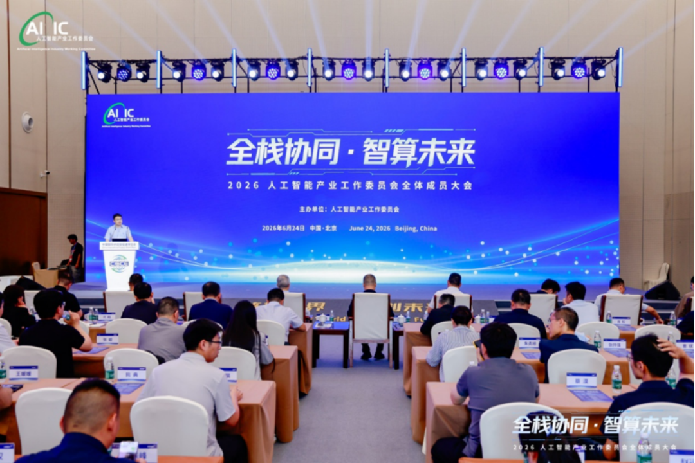
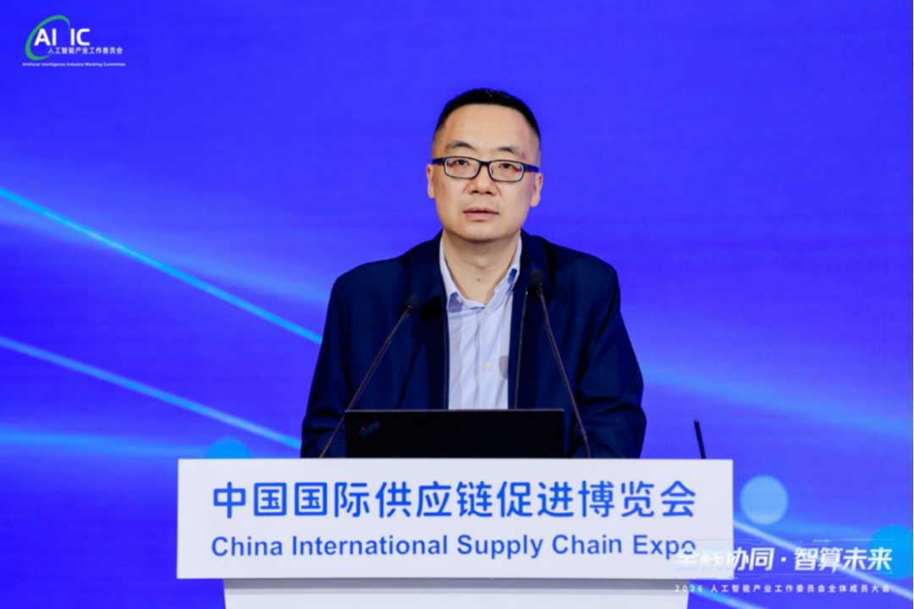
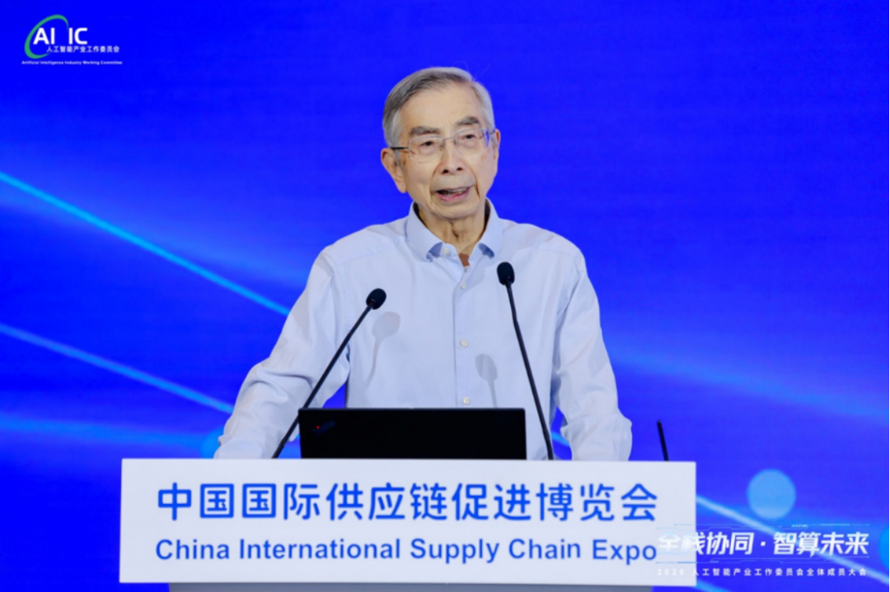
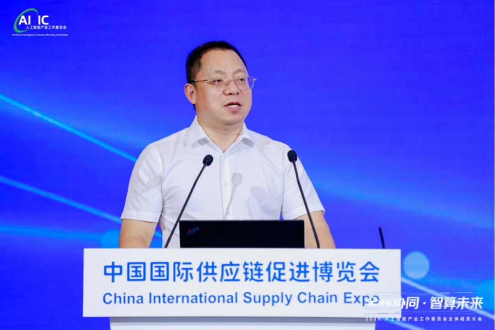
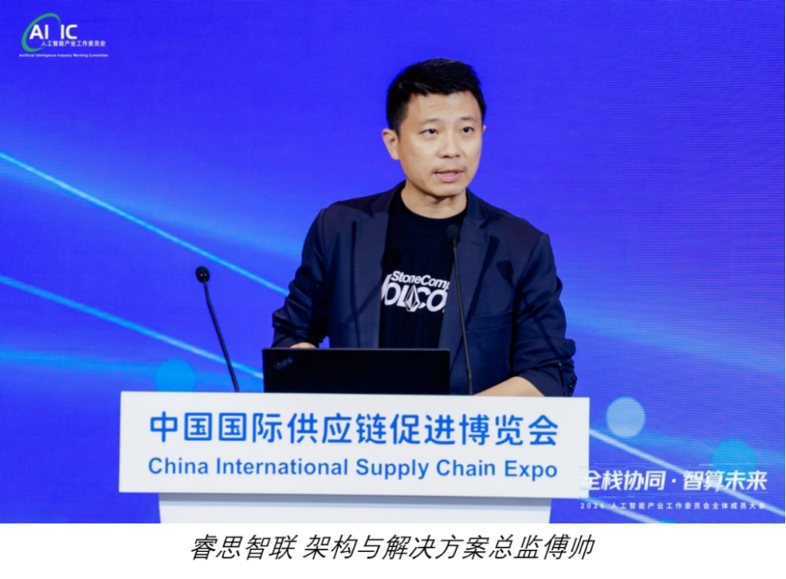

[English](./README.en.md) · [文章目录](../../README.md) · [官网阅读](https://www.theriseunion.com/zh/blog/riseunion-aiic-full-stack-collaboration-2026.html)

# 全栈协同破算力壁垒｜睿思智联亮相 2026 人工智能产业工委会全体大会并发表专题分享

睿思智联 · 2026/06/29 09:29（北京时间） · [微信公众号原文](https://mp.weixin.qq.com/s/Me7nw9eyQNqiEq7kQ7fQbw)

睿思智联亮相 2026 人工智能产业工委会全体大会并发表专题分享

6月24日，以“全栈协同 智算未来”为主题的 2026 人工智能产业工作委员会全体成员大会在北京中国国际展览中心隆重举办。本次大会汇聚工信部主管领导、行业权威专家、AI 全产业链数百家龙头企业代表，围绕我国人工智能产业发展趋势、全链条协同路径、算力基础设施建设、国产化生态构建等核心议题展开深度研讨。 

作为人工智能产业工作委员会算力池化工作组组长单位，北京睿思智联科技有限公司（睿思智联）受邀全程参会，架构与解决方案总监傅帅代表企业登台发表专题分享，面向全行业介绍由我司牵头起草的《信息技术智算服务异构算力虚拟化及池化系统要求》团体标准研制进展，以标准化方案破解当前智算产业核心痛点，充分展现睿思智联在算力基础设施领域的行业引领力与生态统筹能力。

# 顶层指引：锚定全栈协同，夯实国产智算发展底座

大会由人工智能产业工作委员会会长、赛迪研究院党委副书记胡国栋主持。工信部电子信息司、中国软件评测中心、物理 AI 与机器人融合创新中心（筹）等单位领导、专家先后发表主旨致辞与报告，为行业发展指明方向。工信部电子信息司电子系统处处长金磊在致辞中明确，AI 产业已从单一训练场景转向训练、推理双向并重发展，电子信息产业是 AI 产业发展的核心驱动底座。下一步主管部门将重点推进三大工作：夯实先进计算产业底座、打通芯片 — 软件 — 整机 — 应用全产业链条、扶持算电协同、太空计算等新兴算力领域创新，持续完善行业组织与标准体系建设。 倪光南主任围绕《物理 AI 与 AI 芯片发展趋势》展开深度解读，提出物理 AI 是 AI 落地实体经济的核心载体，端侧 RISC-V 芯片蕴藏巨大国产替代机遇，呼吁产业共建 “国产大模型 + 国产芯片 + 国产软件” 全栈国产化生态，实现从数字 AI 向物理 AI 跨越。 中国软件评测中心主任刘龙庚则客观剖析中美 AI 产业发展差距，指出我国在垂直行业应用已实现突破，但高端芯片、底层固件、开发者生态仍存短板，建议行业加快 AI 安全治理、公共检测平台与统一评测体系建设，以常态化对标测试推动产业补短板、强弱项。 多位行业专家共同指出，当前国内智算基础设施普遍遭遇结构错配、软件生态断层、网络互连梗阻三大算力 “堵墙”，异构芯片百花齐放却难以统一调度、算力资源孤岛化、集群利用率偏低，已成为制约全栈协同发展的关键瓶颈，亟需统一行业标准实现生态打通。

*工信部电子司电子系统处金磊处长致辞*

*物理AI与机器人融合创新中心（筹）倪光南主任演讲*

*国软件评测中心刘龙庚主任演讲*

# 睿思智联发声：牵头算力池化标准，提供产业破局方案

针对行业普遍面临的异构算力管理难题，睿思智联架构与解决方案总监傅帅在大会专题分享环节，带来由算力池化工作组牵头推进的异构算力虚拟化与池化标准最新成果，为全行业提供标准化解决方案。 傅帅表示，作为算力池化工作组组长单位，睿思智联牵头立项并主导编制异构算力池化团体标准，核心目标是搭建一套统一接口、统一调度、统一管理的算力池化框架，抹平不同厂商 GPU、NPU、FPGA 等异构硬件的适配差异，解决多类型算力难以统筹调度、资源碎片化、业务对接成本高的行业难题。

### 1.统一资源抽象层：通过虚拟化技术将各类物理算力硬件抽象为标准化逻辑资源，屏蔽底层芯片架构差异。

### 2.全域算力动态池化：实现跨节点、跨机型算力统一纳管，支持细粒度算力切分、弹性调度，大幅提升集群整体利用率。

### 3.全链路平滑对接：向下兼容国产算力芯片，向上适配大模型训练、行业推理、物理机器人等多元化上层应用，打通算力底座与业务场景的链路。

傅帅介绍，目前该标准已进入完善落地阶段，工作组持续吸纳芯片厂商、智算中心、AI 服务商、行业终端企业共同参与编制，推动标准成为国内异构算力协同的通用技术规范，助力落实工信部 “全链协同” 产业发展要求。 立足组长单位职责，睿思智联持续牵头产业链上下游协同攻关，搭建算力标准化交流平台，推动算力池化技术规模化落地，助力行业摆脱算力孤岛困境，降低企业 AI 建设综合成本，夯实国产自主可控智算基础设施根基。

# 共筑 AI 产业生态，睿思智联持续发挥组长单位引领作用

本次大会集中展示国内 AI 产业全栈协同创新成果，明确以行业组织、团体标准为抓手，凝聚产业链合力，推动人工智能高质量发展。 作为算力池化工作组组长单位，睿思智联始终肩负两大行业使命：一是标准引领：持续完善异构算力虚拟化、算力资源池化相关团体标准，填补国内统一算力调度规范空白；二是生态协同：联动芯片、服务器、大模型、行业应用企业共建开放算力生态，落地标准化算力池化解决方案，赋能政务、制造、机器人、数字供应链等多领域智能化转型。 

未来，睿思智联将持续依托人工智能产业工作委员会平台，发挥组长单位统筹引领作用，深度参与行业研讨、标准制定、技术攻关与产业落地，以标准化、国产化算力池化技术打通全产业链协同壁垒，助力我国构建自主、高效、普惠的智算产业体系，携手行业伙伴奔赴 “全栈协同 智算未来”发展新征程。

### 关于睿思智联

北京睿思智联科技有限公司（RiseUnion）专注于AI 算力管理与调度，已完成 10+ 国产芯片兼容认证，是 CNCF Sandbox 开源项目 HAMi 的核心贡献者之一。公司是国家高新技术企业、北京市专精特新中小企业、AIIC 算力池化工作组组长单位，在金融、政企军工、交通、医疗等行业实现大规模生产级落地。

睿思智联致力于让算力像水电一样随取随用，为企业 AI 转型构建智能、可控、高效的算力底座。

---

[在睿思智联官网阅读本文](https://www.theriseunion.com/zh/blog/riseunion-aiic-full-stack-collaboration-2026.html) · [浏览更多文章](https://www.theriseunion.com/zh/blog.html)
