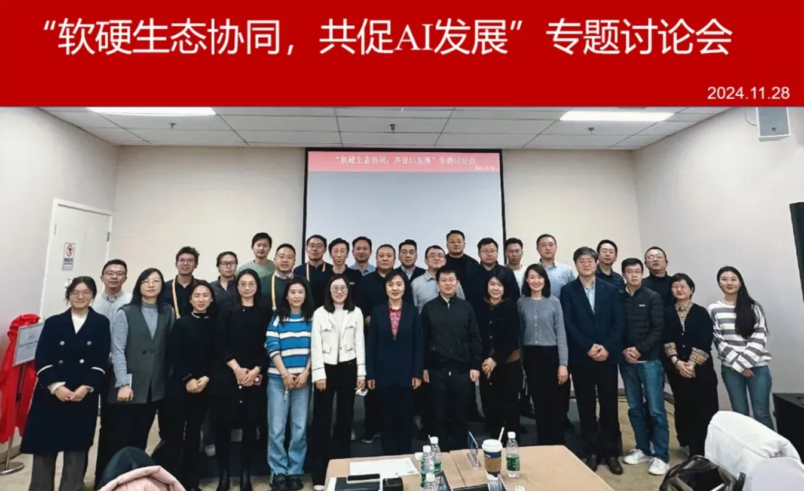
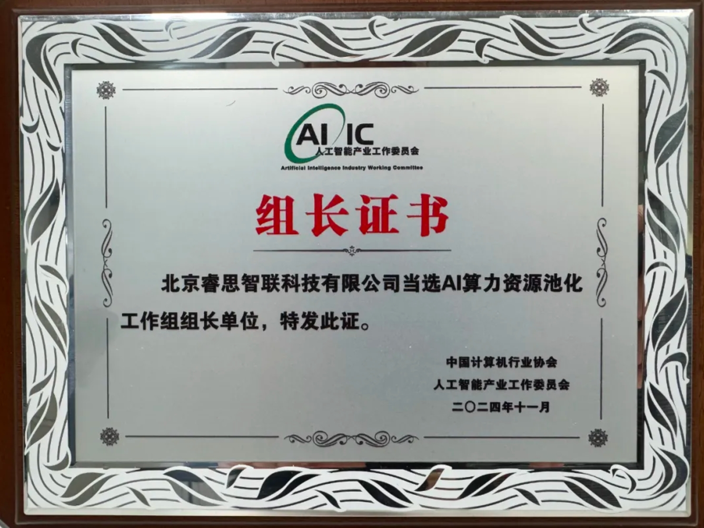

[简体中文](./README.md) · [All articles](../../README.en.md) · [Read on the website](https://www.theriseunion.com/en/blog/riseunion-aiic-leadership.html)

# RiseUnion Leads AI Computing Power Pooling Group

RiseUnion · January 01, 2025 at 08:00 (UTC+08:00)

At the AI Industry Committee's ecosystem collaboration seminar, RiseUnion was elected as the leader of the AI Computing Power Pooling Working Group, leveraging its expertise in heterogeneous computing pooling and GPU virtualization.

Summary: RiseUnion, as the leader of the "AI Computing Power Pooling Working Group", participated in the AI Industry Committee's special seminar, shared experiences in heterogeneous AI computing power pooling management, and received the working group leadership certificate. The company will dedicate itself to promoting AI computing resource pooling standards and industry development.

On November 28, 2024, the Artificial Intelligence Industry Working Committee held a special discussion on "Ecosystem Collaboration between Software and Hardware to Promote AI Development" at the 2nd China International Supply Chain Expo. Beijing RiseUnion Technology Co., Ltd., as the leader of the "AI Computing Power Pooling Working Group", was invited to attend and deliver a keynote speech.

The seminar focused on promoting AI technology development and application through software and hardware collaboration, attracting nearly fifty representatives from enterprises and research institutions. The meeting was chaired by Gao Hongling, Secretary-General of the Working Committee, with Yang Shiqi, Vice President of RiseUnion, attending as an invited guest.

During the meeting, Yang Shiqi, Vice President of RiseUnion, delivered a keynote speech from the perspective of heterogeneous AI computing power pooling management. He pointed out that as large model applications accelerate across various industries, enterprise demands for AI computing power are becoming increasingly complex and diverse. On one hand, there is a need to improve the utilization efficiency of computing infrastructure resources through technical means, breaking down physical GPUs for flexible expansion and scheduling, thereby reducing business application deployment costs. On the other hand, it is necessary to achieve stable and efficient operation of heterogeneous large models and applications on multiple chip systems, solving compatibility issues and accelerating the scale application of domestic computing power and large model achievements.

During the achievement release session, Secretary-General Gao Hongling presented certificates to the first batch of seven working group leaders. Beijing RiseUnion Technology Co., Ltd., as a leading enterprise in promoting heterogeneous AI computing power pooling and GPU virtualization solutions in China, was selected as the group leader and received the "AI Computing Resource Pooling Working Group" leadership certificate.

> 原文: [“软硬生态协同，共促AI发展”专题讨论会成功召开](https://mp.weixin.qq.com/s/LJsdtldhJkPt1jnIvy9LLA)

---

[Read this article on the RiseUnion website](https://www.theriseunion.com/en/blog/riseunion-aiic-leadership.html) · [Explore more articles](https://www.theriseunion.com/en/blog.html)
