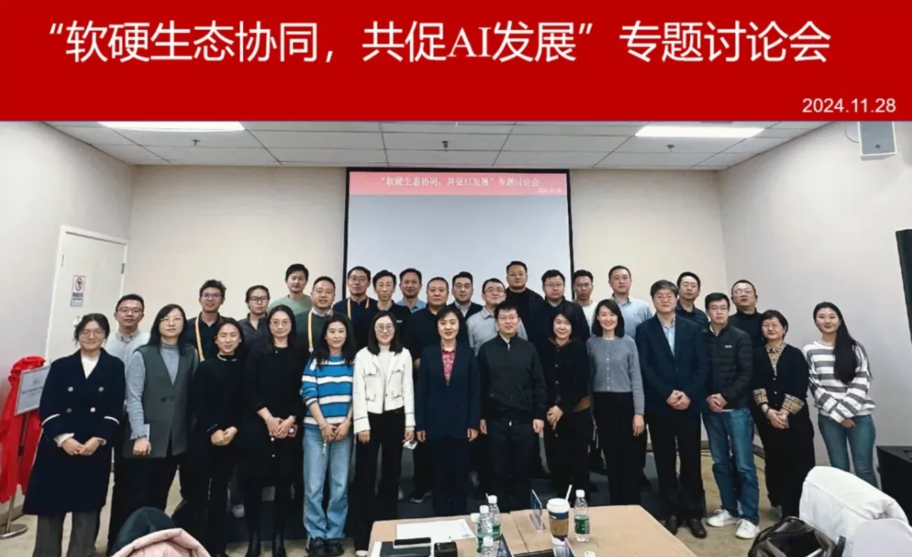
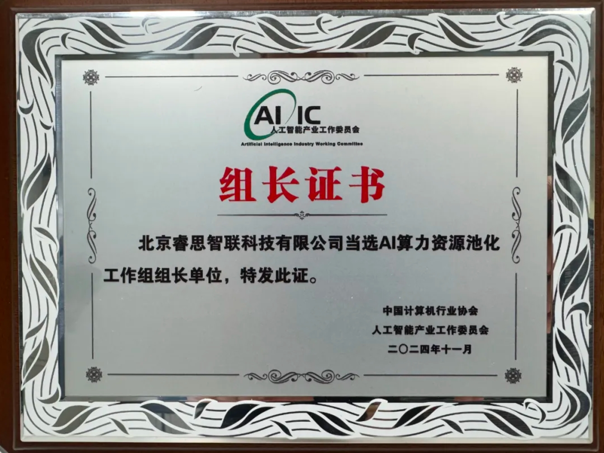

[English](./README.en.md) · [文章目录](../../README.md) · [官网阅读](https://www.theriseunion.com/zh/blog/riseunion-aiic-leadership.html)

# 睿思智联当选 AI 产业工委会算力池化工作组组长

睿思智联 · 2025/01/01 08:00（北京时间）

在人工智能产业工委会'软硬生态协同'专题讨论会上，睿思智联凭借在异构算力池化与GPU虚拟化领域的领先优势，当选首批AI算力资源池化工作组组长单位。

2024年11月28日，人工智能产业工作委员会在第二届中国国际供应链促进博览会举办**“软硬生态协同，共促 AI 发展”专题讨论会**。北京睿思智联科技有限公司作为 **“AI 算力池化工作组”组长单位** 应邀参会，并发表了主题演讲。

本次研讨会聚焦如何通过软硬件的协同合作促进人工智能技术的发展和应用落地，吸引了来自企业、研究机构等多方代表、近五十人参会。会议由工委会秘书长高宏玲主持，睿思智联副总裁杨世琪应邀出席。

人工智能产业工作委员会（以下简称为“工委会”）是在工信部电子司指导下，由几十家人工智能产业链上下游单位共同发起成立，聚焦人工智能产业各环节，推动开展人工智能产业技术趋势研究、标准制定、测试验证、生态培育、应用推广等工作，成为畅通政府与行业间、产业链上下游间、国内与国际间的沟通渠道，推动产业合作的公共平台。工委会成员单位包含部直属事业单位、AI 应用企业、AI 芯片企业、研究机构与高校等产业及行业机构。

本次讨论会聚焦于 **“软硬协同生态构建关键核心问题及路径探索”** 主题，邀请了多家 AI 产业生态链的研究机构与企事业单位参与探讨，就我国 AI 产业生态现状及存在问题等分享了各自经验及见解。与会嘉宾围绕 AI 产业发展与落地过程中遇到的挑战与解决方案展开深入讨论，并提出强化政策支持、加大投资力度、推动标准制定、加强产业链协同等建议。

会议中，睿思智联副总裁杨世琪应邀从 **AI 异构算力池化管理** 角度做主题发言。随着大模型应用在各行业的加速落地，企业对 AI 算力的需求变得更加复杂多样化。一方面需要通过技术手段提高算力基础设施资源利用效率，将**物理 GPU** 化整为零、弹性扩展、灵活调度，降低业务应用落地成本。另一方面需要在多芯片体系上实现异构大模型与应用稳定高效运行，解决 **上下层兼容性问题**，助力国产算力规模应用和大模型成果加速转化。他建议，在整个生态层面产业链上下游要协同协作，在模型算子、芯片池化等方面推动形成标准体系，并通过工委会“AI 算力池化工作组”的成立与工作，在构建开放生态体系，解决兼容性问题，形成标准化方案，推广场景化应用，构建人才发展体系等方面发挥主导作用。睿思智联作为工作组组长单位，重点关注 AI 异构算力池化问题，并致力促进 HAMi 社区在国内的建设发展。

成果发布环节是本次会议的亮点之一。高宏玲秘书长为首批成立的7个工作组组长单位颁发证书。在此前进行的工作组组长竞选中，北京睿思智联科技有限公司作为 **国内推动 AI 异构算力池化与 GPU 虚拟化方案的头部企业** 获选组长，并在本次会议中领取了“AI 算力资源池化工作组”  组长证书。

最后，高宏玲秘书长总结，本次研讨会不仅促进了业内各方的交流合作，也为未来中国人工智能产业的高质量发展奠定了坚实基础。希望各成员单位通过工委会的平台，加强彼此间的合作交流，共同为中国人工智能产业发展做出积极贡献。

> 原文: [“软硬生态协同，共促AI发展”专题讨论会成功召开](https://mp.weixin.qq.com/s/LJsdtldhJkPt1jnIvy9LLA)

---

[在睿思智联官网阅读本文](https://www.theriseunion.com/zh/blog/riseunion-aiic-leadership.html) · [浏览更多文章](https://www.theriseunion.com/zh/blog.html)
