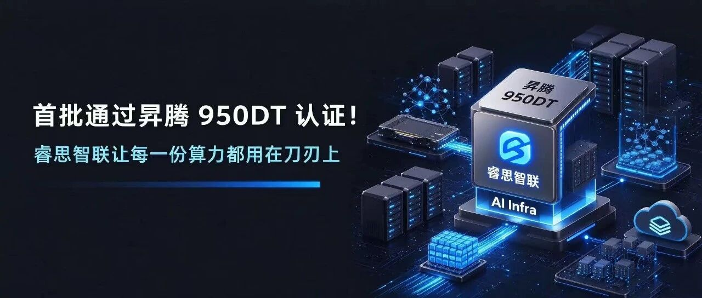
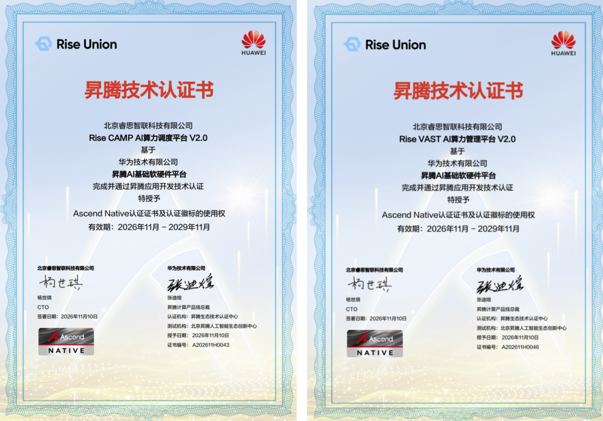
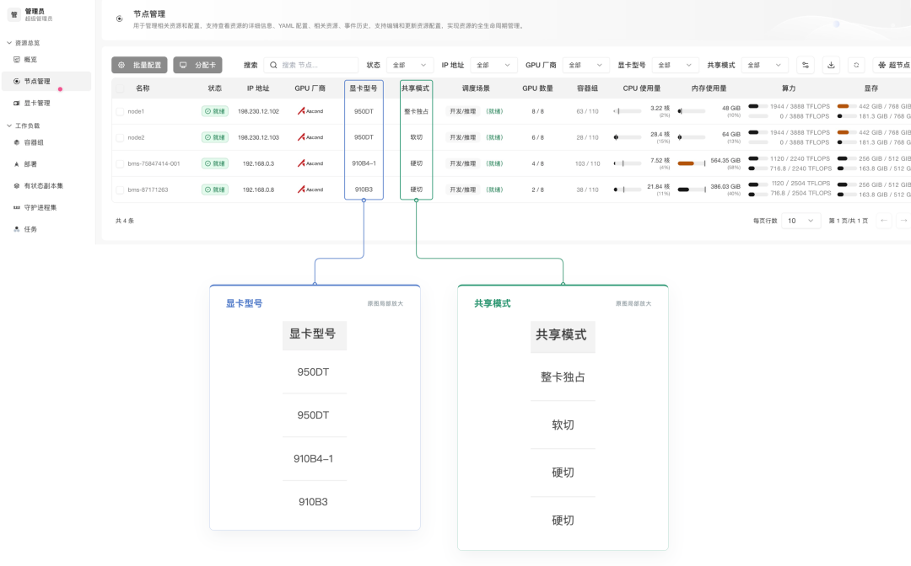
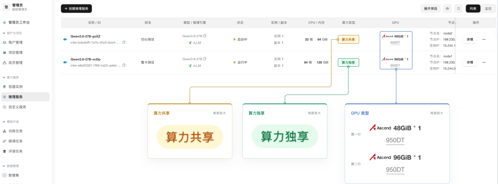
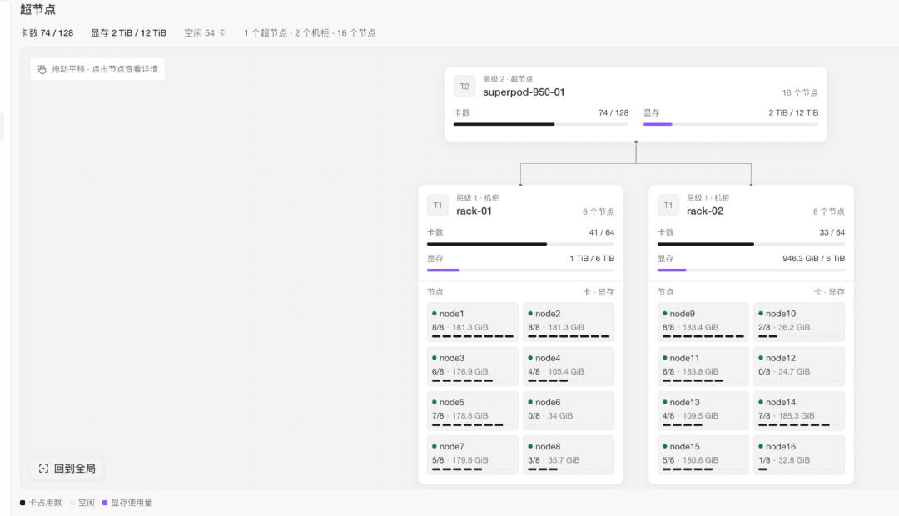

[简体中文](./README.md) · [All articles](../../README.en.md) · [Read on the website](https://www.theriseunion.com/en/blog/riseunion-ascend-950dt-certification.html)

# Among the First: RiseUnion Earns Ascend 950DT Certification, Putting Every Unit of Compute to Work

RiseUnion · November 12, 2026, 09:59 (UTC+08:00) · [Original WeChat article (Chinese)](https://mp.weixin.qq.com/s/J8feqkhnWzGJ_mExJO6Pfg)

RiseUnion has obtained certification for the Ascend 910B, 910C and 950DT.

Beijing RiseUnion Technology Co., Ltd. (RiseUnion) recently completed adaptation of its Rise VAST AI Compute Management Platform and Rise CAMP AI Compute Scheduling Platform (collectively, the "Rise platform") for Huawei's new-generation Ascend 950DT. It is among the first to pass both Ascend 950DT Ascend Native certification and Ascend application development technology certification. This further expands compatibility across multiple generations of Ascend accelerators, providing complete support from infrastructure-level compute management to higher-level model services. It covers resource management, partitioning and oversubscription, topology-aware scheduling, and fault monitoring.

The Ascend 950DT uses Huawei's proprietary HiZQ 2.0 HBM technology, with 144 GB of memory, 4 TB/s memory bandwidth and interconnect bandwidth increased to 2 TB/s. It supports FP8, MXFP8, MXFP4, HiF8 and other data formats, with FP4 performance reaching 16E FLOPS, focusing on inference decoding and training. In an Atlas 950 supernode, up to 8,192 Ascend 950DT cards can be interconnected through the all-optical "Lingqu" (UnifiedBus) interconnect protocol. Compared with the previous-generation Ascend 384 supernode, training performance increases by 17 times and inference performance by 26.5 times.

Specifications, however, are only the starting point. Once the 950DT moves from a launch presentation into a data center, returns on compute investment depend on four further engineering questions. How can the 144 GB of HBM be kept consistently supplied with work? How can multi-card workloads fully use the Lingqu UB interconnect bandwidth? How can a single-card fault be prevented from becoming a service outage? How can different generations of Ascend cards be scheduled within the same system?

Certification shows that the platform "works." What the Rise platform aims to deliver is that it "works well."

## 01 Unified Management: Manage Different Ascend Models in One Place

The first step in putting the 950DT into production is integrating it into a unified heterogeneous compute management system. The Rise platform already supports resource pooling across the Ascend family, including the 310P, 910A, 910B and 910C. The 950DT joins the same management and scheduling framework: it can be managed alongside 910-series cards in the same cluster, or even the same heterogeneous resource pool. Pools can be flexibly divided by node or by card. The platform also supports a Host-Member multi-cluster architecture that separates management and control, with unified resource requests, allocation and monitoring.

The runtime libraries required for software partitioning are pre-integrated and centrally managed in the Enterprise Edition. Multiple CANN versions, including 8.5.0, 9.0.0, 9.1.0 and 9.2.0, are maintained and continuously updated in one place, keeping application runtimes consistent and controlled.

## 02 Software Partitioning: Whole Cards for Main Workloads, On-Demand Resources for Supporting Models

The 950DT's main workloads are large-model training and large-model decode inference. These tasks require a whole card or even multiple cards working together, so we do not recommend partitioning cards for them.

Real AI applications, however, involve more than the main workload. An agent application often relies on cooperation between large and small models: large models handle complex reasoning, while small models perform frequent, lightweight tasks such as intent recognition, request routing, embedding, reranking, content moderation and tool calls, providing both speed and cost savings. There can be many such small models, each with a small resource footprint. If each occupies a whole card, the main workload may have no resources left.

Building on its existing compute partitioning capabilities, the Rise platform provides more flexible software partitioning for the 950DT. Instead of fixed templates, applications can define compute specifications according to their needs, such as 40% or 70%, without partitioning in advance. Compute shares and memory sizes can be configured flexibly and dynamically so that multiple small models can share resources. vNPUs support both distributed inference and distributed training tasks. Main workloads use whole cards or multiple cards, while supporting models share individual cards on demand, working together efficiently within the same 950DT cluster.

Customer benefit: supporting small models no longer each occupy a whole card, leaving whole cards available for training and decode workloads. A cluster of the same size can support a more complete agent application.

## 03 Oversubscription: Stop Infrequently Used "Cold Models" from Holding On to Device Memory

Device memory is like a desk: quick to access, but with limited space. Server memory is like a bookshelf, with much greater capacity. Oversubscription means keeping the models currently in use on the desk and returning idle models to the bookshelf until they are needed again. Rise's memory oversubscription capabilities already support multiple vendors, including NVIDIA, Ascend and Kunlunxin. Oversubscription ratios can be set by hardware type, allowing more tasks to share compute while preventing resource exhaustion if every task reaches peak demand at once.

- Virtual device memory pool: physical device memory and system memory are combined into a unified virtual device memory pool with substantially greater capacity than physical device memory alone. This is completely transparent to applications and requires no application changes.

- Hot and cold data scheduling: the system tracks model status in real time. Active models remain in device memory, while infrequently used models are automatically moved to system memory.

- Switching in seconds: when switching between models, data is swapped between system memory and device memory. Measured model switching takes approximately 1.5 seconds.

Customer benefit: models that stay online but are rarely called no longer each occupy a dedicated block of device memory. More models can be hosted on the same card, making full use of existing cards before adding new ones.

## 04 Topology-Aware Scheduling: Keep Multi-Card Tasks Close Together

Training and large-model inference often require multiple cards to cooperate, with constant communication between them. The 950DT uses the Lingqu UB interconnect, and the quality of communication links between cards directly determines the efficiency of multi-card tasks. The Rise platform provides topology-aware scheduling for the interconnect structures of Ascend and other chips, identifying physical hardware connections and matching tasks with the most suitable communication paths.

The Rise platform detects device interconnect topology and prioritizes tightly connected cards when scheduling multi-card tasks. It is like seating colleagues who need to work closely together on the same floor rather than in two separate buildings.

Customer benefit: multi-card tasks avoid the overhead of "long-distance" communication, directly supporting the 950DT's main workloads: training and large-model decode inference.

## 05 Fault Awareness: Automatically Keep New Tasks Away from Faulty Cards

The platform continuously collects key metrics for each Ascend card, including utilization, device memory, temperature and power consumption, and reads and parses fault codes reported by the cards. It supports four severity levels for detailed Ascend fault codes: critical, high, medium and low. Each code, error message and error detail is listed and translated into a clear answer to "which card, what fault, and can it still be used?" Faults reaching the configured threshold trigger P0 alerts and automatically isolate the faulty card, so new tasks are scheduled elsewhere. Alerts are routed by severity to the on-call queue through email and SMS, completing a "detect, respond, review" loop.

Customer benefit: new tasks are not assigned to faulty cards, avoiding the need to wait for manual troubleshooting and then start again. Fault causes are clear at a glance, rather than hidden behind a string of error codes. The larger the cluster, the more useful this becomes.

## Closing Thoughts

As a core contributor to the open-source HAMi project, RiseUnion will also progressively contribute adaptation code so that community users can benefit from the Ascend 950DT's new features.

RiseUnion has obtained certification for the Ascend 910B, 910C and 950DT. Whichever generation of Ascend cards a customer uses, the Rise platform provides unified management and on-demand partitioning, while handling task scheduling and operational stability. For model services, the platform supports one-click deployment and Token metering for mainstream inference engines such as vLLM, SGLang and MindIE, covering the full path from infrastructure-level compute to higher-level model services.

If you are planning an Ascend 950DT cluster or want to make fuller use of your existing Ascend compute resources, contact us to try the Rise platform Enterprise Edition.

### About RiseUnion

Beijing RiseUnion Technology Co., Ltd. (RiseUnion) focuses on AI compute management and scheduling. It has completed compatibility certification with more than 10 domestic chip vendors and is a core contributor to the CNCF open-source project HAMi. The company is recognized as a national high-tech enterprise and a Beijing specialized and innovative SME, and leads the AIIC Compute Resource Pooling Working Group. It has achieved large-scale production deployments in finance, government and enterprise, defense, transportation, healthcare and other industries.

RiseUnion is committed to making compute as readily available as water and electricity, building an intelligent, controllable and efficient computing foundation for enterprise AI transformation.

For more information, visit **riseunion.ai** or call **400-605-2336.**

---

[Read this article on the RiseUnion website](https://www.theriseunion.com/en/blog/riseunion-ascend-950dt-certification.html) · [Explore more articles](https://www.theriseunion.com/en/blog.html)
