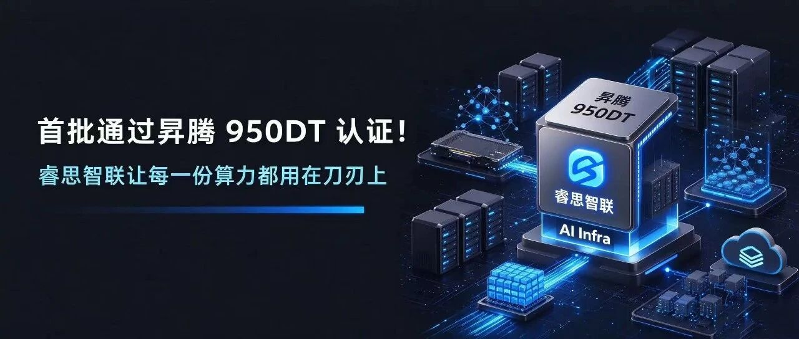
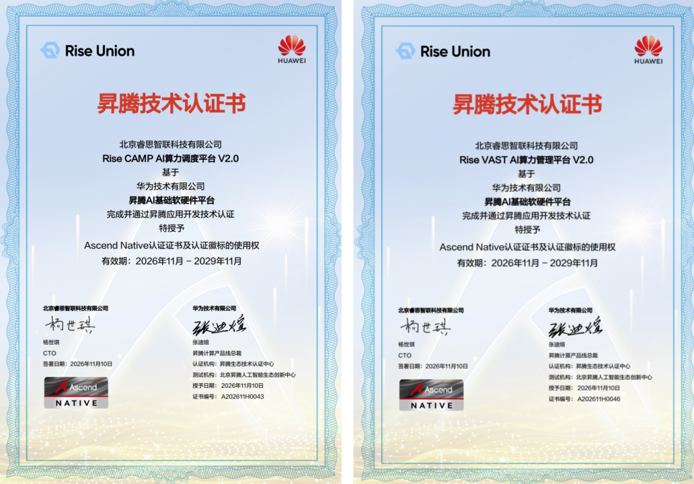
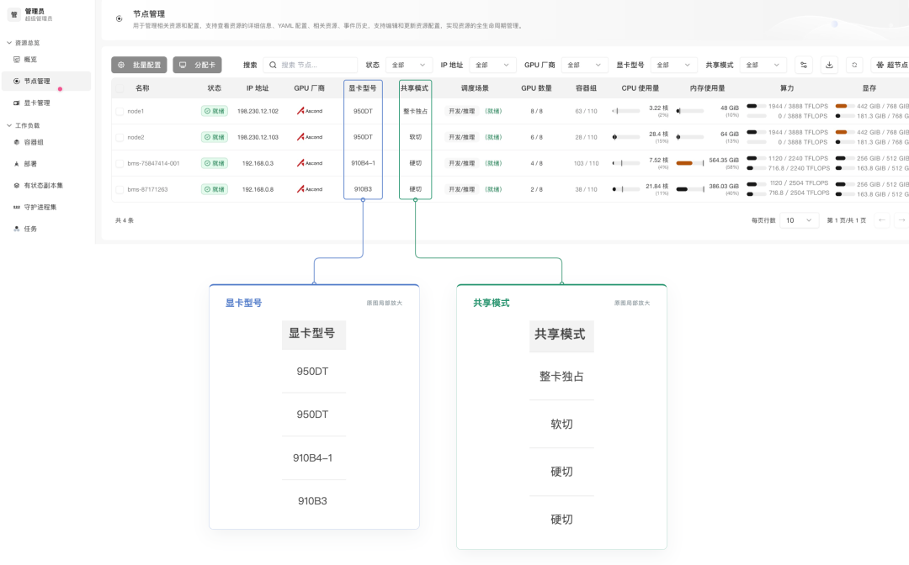
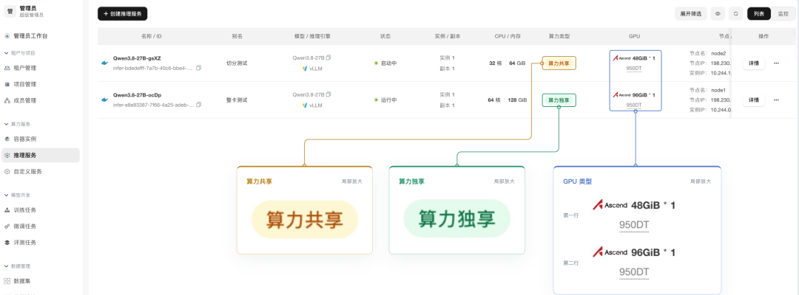
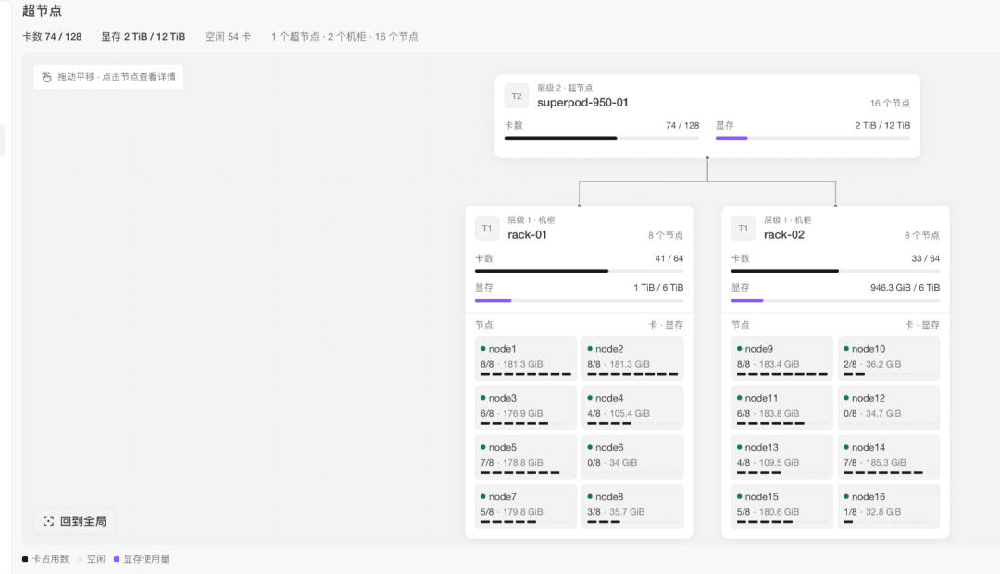

[English](./README.en.md) · [文章目录](../../README.md) · [官网阅读](https://www.theriseunion.com/zh/blog/riseunion-ascend-950dt-certification.html)

# 首批！睿思智联通过昇腾 950DT 认证，让每一份算力都用在刀刃上

睿思智联 · 2026 年 11 月 12 日 09:59（北京时间） · [微信公众号原文](https://mp.weixin.qq.com/s/J8feqkhnWzGJ_mExJO6Pfg)

睿思智联已获得昇腾 910B、910C、950DT 认证。

北京睿思智联科技有限公司(简称“睿思智联”)，Rise VAST AI 算力管理平台与 Rise CAMP AI 算力调度平台（统称"Rise 平台"）已于近日完成对华为新一代昇腾 950DT 的适配，并率先通过昇腾 950DT Ascend Native 认证及昇腾应用开发技术认证。进一步完善了对昇腾多个版本算力卡的兼容适配矩阵，实现从底层算力管理到上层模型服务的完整支持。覆盖算力纳管、切分超分、拓扑调度和故障监控等场景。

昇腾950DT采用自研HiZQ 2.0 HBM技术，内存容量达144GB，内存访问带宽4TB/s，互联带宽提升至2TB/s，支持FP8/MXFP8/MXFP4/HiF8等多数据格式，其FP4算力达16E FLOPS，更侧重推理解码和训练场景。在Atlas 950超节点中，最多可支持8192张昇腾950DT卡通过“灵衢”（UnifiedBus）全光互联协议进行互联。相比上一代昇腾384超节点，训练性能提升17倍，推理性能提升26.5倍。

但参数只是起点。950DT 从发布会走进数据中心之后，决定算力投资回报的是另外四个工程问题。144GB HBM 如何被持续喂满？多卡协同如何跑满灵衢 UB 的互联带宽？单卡故障如何不演变为业务中断？新旧几代昇腾卡如何在同一套体系下统一调度？

拿到认证只说明"能用"。Rise 平台要交付的是"好用"。

## 01 统一纳管：不同型号昇腾卡，一管到底

要让 950DT 进入生产，第一步是把它接入统一的异构算力管理体系。Rise 平台对昇腾全系（310P、910A、910B、910C等）已实现池化支持，950DT 纳入同一套纳管与调度方式：既可以与 910 系列放在同一个集群、甚至同一个异构资源池中混合管理，资源池可按节点和卡两个维度灵活划分；也支持 Host-Member 管控分离的多集群架构，统一申请、分配和监控。

软切分所需的运行库由企业版预先集成并统一管理，CANN 8.5.0 / 9.0.0 / 9.1.0 / 9.2.0 等多个版本集中维护、持续更新，各业务运行环境一致、可控。

## 02 软切分：主角用整卡，配角按需分配

950DT 的主角戏是大模型训练和大模型 Decode 推理，这类任务需要整卡甚至多卡协作，我们不建议对其切分。

但真实的 AI 业务不只有主角。一个智能体应用背后往往是"大小模型协同"：大模型负责复杂推理，意图识别、请求路由、Embedding、Rerank、内容审核、工具调用这类高频、轻量任务交给小模型，既快又省。这些小模型数量多、单个占用小，如果各占一张整卡，主角反而没有资源可用。

Rise 平台在已有多种算力切分能力的基础上，此次针对 950DT 提供更灵活的软切分：相比固定模板，业务可按算力需要自定义算力规格（如 40%、70%等），并且无须提前切分。支持灵活、动态设置算力比例与显存大小，供多个小模型共享。vNPU 可同时用于分布式推理和分布式训练任务。主角用整卡或多卡，配角按需共享单卡，在同一个 950DT 集群中协同、高效地运行。

客户收益：周边小模型不再各占整卡，整卡留给训练和 Decode。同样规模的集群，能承载更完整的智能体业务。

## 03 超分：让低频"冷模型"不再霸占显存

显存像书桌，取用快但桌面小；服务器内存像书架，容量大得多。超分的做法是：正在用的模型摊在书桌上，暂时不用的收回书架，要用时再拿回来。Rise 的显存超分能力已支持 NVIDIA、昇腾、昆仑芯等多厂商，并可按硬件类型设置超配比例，在允许更多任务共享算力的同时，避免所有任务同时到达峰值导致资源耗尽。

- 虚拟显存池：物理显存与系统内存融合成统一的虚拟显存池，容量远大于物理显存，对上层应用完全透明，业务零改动。

- 冷热数据调度：系统实时掌握模型状态，活跃模型留在显存，低频模型自动换至系统内存。

- 秒级切换：模型间切换时数据在内存与显存间换入换出。实测模型切换约需 1.5 秒。

客户收益：长期在线、很少被调用的模型，不再一个模型独占一块显存。同一张卡挂更多模型，先把现有的卡用足，再考虑加卡。

## 04 拓扑调度：多卡任务，就近安排

训练和大模型推理常常要多卡协同，卡与卡之间要不停"对话"。950DT 采用灵衢 UB 互联，卡间通信链路的质量直接决定多卡任务的效率。Rise 平台针对昇腾等芯片的互联结构提供拓扑感知调度：智能识别硬件之间的物理连接结构，为任务匹配最合理的通信路径。

Rise 平台感知设备的互联拓扑，调度多卡任务时优先落在互联更紧密的卡上。就像安排需要密切配合的同事坐在同一层，而不是分两栋楼。

客户收益：多卡任务不被"远距离"通信拖累，直接服务于 950DT 的主角场景，也就是训练与大模型 Decode。

## 05 故障感知：新任务，自动绕开坏卡

平台持续采集每张昇腾卡的利用率、显存、温度、功耗等关键指标，并读取解析卡上报的故障码：支持 Ascend 详细故障码的分级告警（严重、高、中、低四级），逐条列出故障代码、错误信息与错误详情，翻译成"哪张卡、什么故障、还能不能用"。达到阈值的故障触发 P0 级告警并自动隔离故障卡，新任务调度时自动绕开。告警按级别路由后通过邮件、短信推送至值班队列，形成"发现—处置—复盘"的完整闭环。

客户收益：新任务不会被分到坏卡上，不用等人工排查再重来。故障原因一目了然，不再面对一串故障码。集群规模越大，这点越省心。

## 写在最后

作为开源项目 HAMi 的核心贡献者之一，睿思智联也将陆续提交相关的适配代码，以支持社区用户共享昇腾 950DT 的新特性。

睿思智联已获得昇腾 910B、910C、950DT 认证。无论客户用哪一代昇腾卡，都可以在 Rise 平台上统一管理、按需切分，任务调度和运行稳定性也由平台保障；模型服务侧，平台支持vLLM、SGLang、MindIE 等主流推理引擎的一键部署与 Token 计量，从底层算力到上层模型服务一站完成。

如果你正在规划昇腾 950DT 集群，或想把现有昇腾算力用得更充分，欢迎联系试用 Rise 平台企业版。

### 关于睿思智联

北京睿思智联科技有限公司（RiseUnion）专注于AI 算力管理与调度，已完成 10+ 国产芯片兼容认证，是 CNCF  开源项目 HAMi 的核心贡献者之一。公司是国家高新技术企业、北京市专精特新中小企业、AIIC 算力池化工作组组长单位，在金融、政企军工、交通、医疗等行业实现大规模生产级落地。

睿思智联致力于让算力像水电一样随取随用，为企业 AI 转型构建智能、可控、高效的算力底座。

了解更多详细信息，欢迎访问官网：**riseunion.ai** 或联系：**400-605-2336。**

---

[在睿思智联官网阅读本文](https://www.theriseunion.com/zh/blog/riseunion-ascend-950dt-certification.html) · [浏览更多文章](https://www.theriseunion.com/zh/blog.html)
