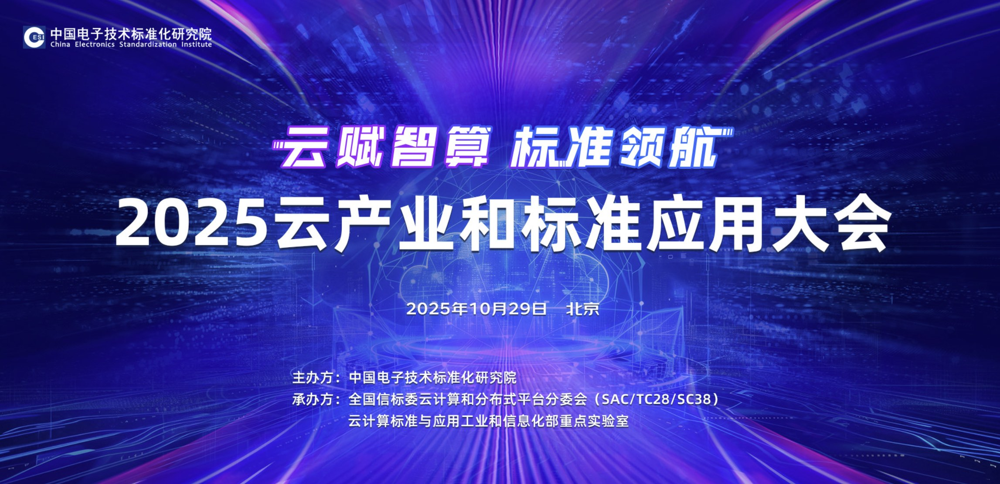

[简体中文](./README.md) · [All articles](../../README.en.md) · [Read on the website](https://www.theriseunion.com/en/blog/riseunion-at-2025-cloud-industry-conference.html)

# RiseUnion Attends 2025 Cloud Industry and Standards Application Conference, Sharing Heterogeneous Resource Pooling Practices

RiseUnion · October 29, 2025 at 08:00 (UTC+08:00)

RiseUnion attends the 2025 Cloud Industry and Standards Application Conference, sharing its heterogeneous resource pooling practices, showcasing advanced AI compute pooling, intelligent scheduling, and GPU resource optimization technologies for industrial AI transformation.

On October 29, the **2025 Cloud Industry and Standards Application Conference**, a premier annual event in cloud computing, was held in Beijing. As a leading enterprise in heterogeneous compute orchestration, **Beijing RiseUnion Technology Co., Ltd.** was invited to participate and delivered a keynote presentation at the sub-forum **"Intelligent Computing Cloud: Infrastructure for the AI Era"**, sharing the company's latest practices and achievements in heterogeneous resource pooling, which attracted significant industry attention.

The conference was hosted by the **China Electronics Standardization Institute** and co-organized by the Cloud Computing and Distributed Platforms Subcommittee of the National Information Technology Standardization Technical Committee. It brought together leaders from regulatory bodies including the Ministry of Industry and Information Technology and the State Administration for Market Regulation, as well as distinguished experts such as **Mei Hong**, Academician of the Chinese Academy of Engineering. Over 400 representatives from industry, academia, and research institutions gathered to explore cloud industry trends, standards development, and compute infrastructure innovation in the AI era.

## Reshaping the Future of Compute: Practical Implementation of Heterogeneous Resource Pooling

During the sub-forum's core session, Fu Shuai, RiseUnion's Director of Products and Solutions Architecture, delivered a presentation titled **"Reshaping the Future of Compute: Heterogeneous Resource Pooling Driving New Paradigms for the Digital Economy"**.

He noted that as compute-intensive applications—including large language models, autonomous driving, and intelligent manufacturing—continue to grow, **efficient coordination of multi-architecture compute resources (CPU, GPU, NPU)** has become a critical challenge for enterprises. Traditional compute scheduling models face persistent issues including low resource utilization, slow scheduling response times, and high energy consumption, making them inadequate to meet the digital economy's demand for **"efficient, elastic, and green"** compute resources.

To address these challenges, RiseUnion's **Heterogeneous Resource Pooling Platform** delivers three core innovations:

1. **Unified Compute Orchestration Interface**: Integrates compute resources across different architectures, enabling "one-stop management";
2. **Intelligent Scheduling Algorithms**: Dynamically allocates compute resources based on application workloads, significantly improving resource utilization;
3. **Energy-Efficient Optimization**: Reduces overall power consumption through workload-aware scheduling and energy monitoring.

The platform has been deployed in production environments including **financial risk modeling and industrial quality inspection AI inference**. Customer data shows compute utilization improvements exceeding 30%, with overall energy consumption reduced by approximately 20%, providing verifiable compute infrastructure that enables **"cost reduction and efficiency gains"** for enterprises.

## Industry Consensus: Heterogeneous Resource Pooling as a Key Breakthrough

RiseUnion's technical achievements sparked active discussion among experts and enterprise representatives at the event. Multiple speakers noted that heterogeneous resource pooling represents a critical path to addressing current compute supply-demand imbalances, with **RiseUnion's solution providing a replicable technical model for the industry**.

During the conference, RiseUnion's technical team also reached preliminary collaboration agreements with multiple ecosystem partners and leading customers around **technical integration and scenario co-development**, further advancing the industrialization of heterogeneous compute management technologies.

## Continuous Innovation: Making Compute More Efficient

As an innovation company long focused on compute orchestration and management, RiseUnion remains committed to its mission: **"Making compute more efficient, making innovation simpler"**.

RiseUnion's participation in the 2025 Cloud Industry Conference not only demonstrated the company's technical capabilities but also reflected its ongoing investment in industry standards, ecosystem collaboration, and green computing. Moving forward, RiseUnion will continue to increase R&D investment, actively participate in **cloud computing standards development**, and promote the deployment of heterogeneous compute technologies across more industry scenarios, providing sustained momentum for high-quality digital economy development.

---

[Read this article on the RiseUnion website](https://www.theriseunion.com/en/blog/riseunion-at-2025-cloud-industry-conference.html) · [Explore more articles](https://www.theriseunion.com/en/blog.html)
