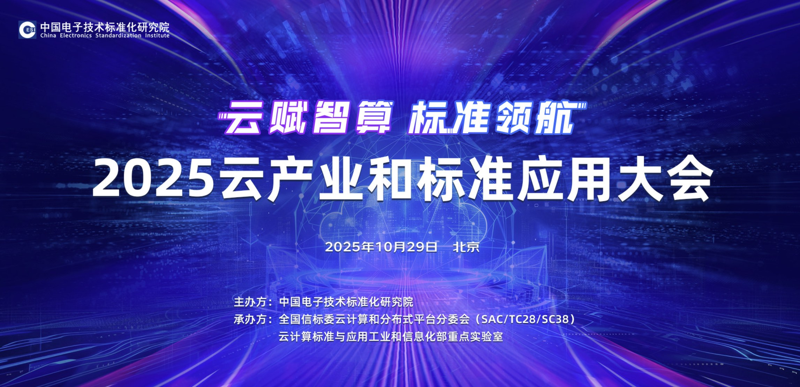
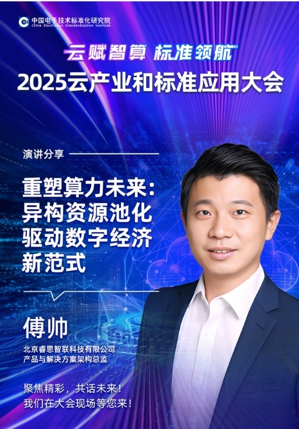

[English](./README.en.md) · [文章目录](../../README.md) · [官网阅读](https://www.theriseunion.com/zh/blog/riseunion-at-2025-cloud-industry-conference.html)

# 睿思智联出席2025云产业和标准应用大会，分享异构资源池化实践

睿思智联 · 2025/10/29 08:00（北京时间）

睿思智联出席2025云产业和标准应用大会，分享异构资源池化实践，展示AI算力池化、智能调度、GPU资源优化等核心技术实力，助力产业智能化升级。

10月29日，云计算领域年度盛会 - **2025云产业和标准应用大会**在北京隆重召开。作为异构算力调度领域的代表企业，**北京睿思智联科技有限公司**受邀参会，并在分论坛《智算云 - AI时代基础设施》中发表主题演讲，分享公司在异构资源池化方向的最新实践与成果，吸引了业界的广泛关注。

本次大会由**中国电子技术标准化研究院**主办，全国信标委云计算和分布式平台分委会等承办，汇聚了工业和信息化部、国家市场监督管理总局等主管部门领导，以及**中国工程院院士梅宏**等权威专家。来自产业界、学术界、研究机构的400余名代表共同探讨了AI时代云产业的发展趋势、标准体系建设与算力基础设施创新方向。

## **重塑算力未来：异构资源池化的落地实践**

在分论坛的核心环节，睿思智联产品与解决方案架构总监傅帅以《**重塑算力未来 - 异构资源池化驱动数字经济新范式**》为主题发表演讲。

他指出，随着AI大模型、自动驾驶、智能制造等算力密集型应用的持续增长，CPU、GPU、NPU等多类型计算资源的**高效协同**已成为企业的关键挑战。传统算力调度模式普遍存在“**资源利用率低、调度响应慢、能耗高**”等问题，已难以满足数字经济对“高效、弹性、绿色”算力的需求。

针对这些痛点，睿思智联推出的**异构资源池化平台**实现了三项核心创新：

1. **统一算力调度接口**：融合不同架构的计算资源，实现“一站式管理”；
2. **智能编排算法**：根据应用负载动态分配算力，大幅提升资源利用率；
3. **绿色节能逻辑**：通过算力错峰调度与能效监控，降低整体能耗。

该平台目前已在**金融风控建模、工业质检AI推理**等场景中落地应用。实践数据显示，客户算力利用率提升超过30%，整体能耗下降约20%，为企业实现“**降本增效**”提供了可验证的算力基础。

## **行业共识：异构资源池化成为关键突破口**

睿思智联的技术成果在现场引发了专家与企业代表的热烈讨论。多位嘉宾认为，异构资源池化是破解当前算力供需矛盾的关键路径，**睿思智联的方案为行业提供了可复制的技术样本**。

大会期间，睿思智联技术团队还与多家生态伙伴及头部客户围绕**技术协同与场景共建**达成初步合作意向，进一步推动异构算力管理技术的产业化落地。

## **持续深耕，让算力更高效**

作为长期专注算力调度与管理的创新企业，睿思智联始终以“**让算力更高效，让创新更简单**”为使命。

此次亮相2025云产业大会，不仅展示了公司的技术实力，也体现了其在行业标准、生态共建、绿色算力等方向的持续投入。未来，睿思智联将继续加大研发投入，积极参与**云计算标准体系建设**，推动异构算力技术在更多行业场景中落地，为数字经济的高质量发展提供持续动力。

---

[在睿思智联官网阅读本文](https://www.theriseunion.com/zh/blog/riseunion-at-2025-cloud-industry-conference.html) · [浏览更多文章](https://www.theriseunion.com/zh/blog.html)
