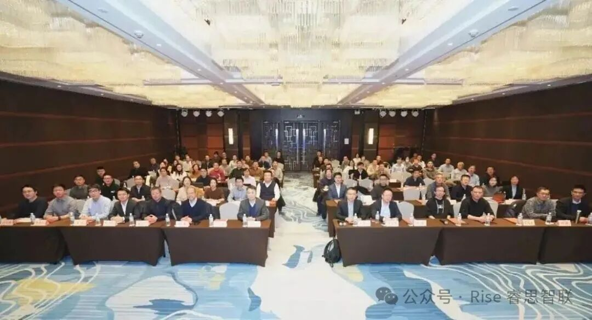
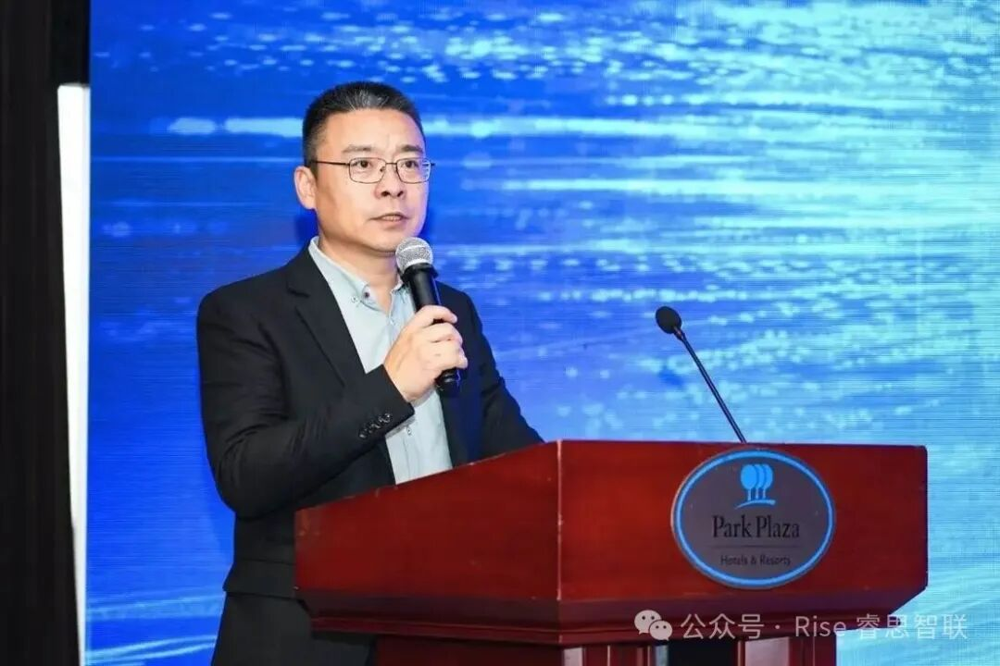
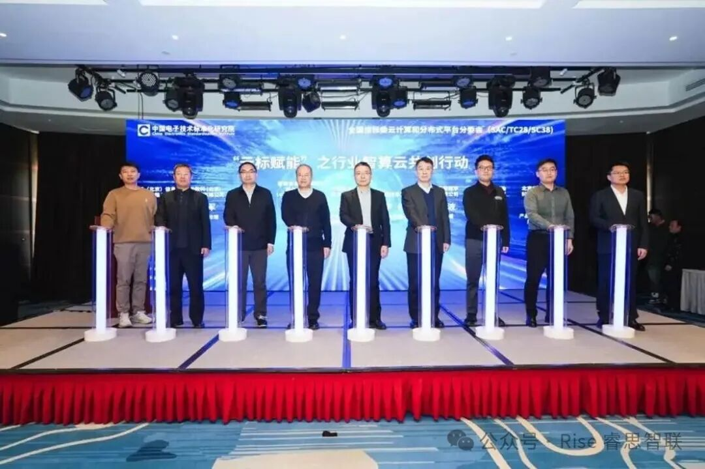
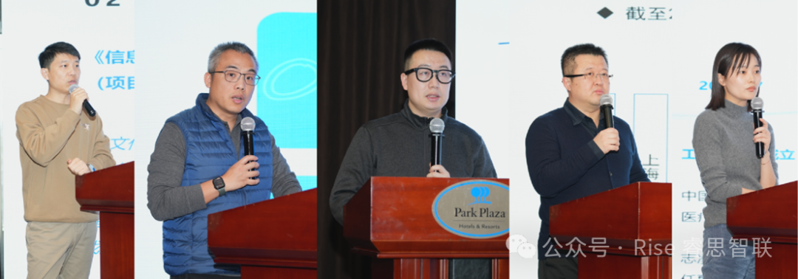

[简体中文](./README.md) · [All articles](../../README.en.md) · [Read on the website](https://www.theriseunion.com/en/blog/riseunion-attends-national-cloud-computing-standard-conference.html)

# RiseUnion Attends National Cloud Standard Conference, Leading New Journey of Standard Implementation

RiseUnion · January 13, 2026 at 08:00 (UTC+08:00)

RiseUnion attended the National Cloud Computing Standard Conference. Fu Shuai participated in the launch of 'Cloud Standard Empowerment' and shared insights on heterogeneous intelligent computing standards, demonstrating RiseUnion's technical strength and industry influence.

On January 13, 2026, the first Cloud Computing Standard Conference Week of 2026 of the Cloud Computing and Distributed Platform Sub-technical Committee of the National Information Technology Standardization Technical Committee and the quarterly meeting of the Cloud Construction and Application Standard Working Group were grandly held in Beijing. As a key enterprise in the field of cloud computing and intelligent computing, Beijing RiseUnion Technology Co., Ltd. (hereinafter referred to as "RiseUnion") was invited to attend. With its deep accumulation in industry standard formulation and technical practice, it participated deeply in the whole process, demonstrating its influence in the industry.

This meeting brought together leading forces from government, industry, academia, research, and application, including the China Electronics Standardization Institute (CESI), China Construction Bank, China Information Industry Association, PetroChina, and H3C. It focused on the new trend of cloud-intelligence integration development and conducted in-depth discussions on key topics such as cloud computing standard development and industry application promotion.

Wang Zhipeng, Director of the Software Center of CESI, welcomed the leaders and guests on behalf of the conference organizer. Currently, cloud computing development is facing new opportunities and challenges, and cloud-intelligence integration has become a new development trend. CESI will closely follow the national strategic deployment and the planning requirements of the "Cloud Computing Comprehensive Standardization System Construction Guide (2025 Edition)", join hands with all parties in the industry, tap deep into standard needs, jointly promote standard development and application, and support the high-quality development of various industries.

Fu Shuai, Director of Product and Solution Architecture at RiseUnion, took the stage on behalf of the company. He not only participated as a core guest in the launch ceremony of the "Cloud Standard Empowerment" Industry Intelligent Computing Cloud Co-creation Action but also shared the interpretation and practical experience of heterogeneous intelligent computing resource standards at the meeting, providing valuable reference for the implementation of industry standards.

## Deepening Standard Development, Demonstrating Technical Strength

Over the years, RiseUnion has always regarded standard construction as a core strategy and actively participated in national and industry-level standard development. With its profound understanding of fields such as heterogeneous intelligent computing, it has injected key strength into the improvement of the industry standard system. At this meeting, Fu Shuai's interpretation of heterogeneous intelligent computing resource standards, based on RiseUnion's rich practice in the intelligent computing cloud field, systematically disassembled the core points and implementation paths of the standards, gaining high recognition from attending experts.

As an active promoter and firm practitioner of industry standards, RiseUnion is deeply involved in the formulation and revision of standards in the fields of cloud computing and intelligent computing. It transforms technological innovation achievements into norms followed jointly by the industry, providing important support for solving pain points in intelligent computing cloud construction, improving the utilization rate of heterogeneous computing resources, and strengthening independent and controllable core capabilities, fully demonstrating the company's dual hard strength in technology R&D and standard formulation.

## Leading Industry Practice, Empowering High-Quality Development of Intelligent Computing Cloud

At the launch ceremony of the "Cloud Standard Empowerment" Industry Intelligent Computing Cloud Co-creation Action, Fu Shuai took the stage together with leaders from CESI, the China Information Industry Association, and other units, marking that RiseUnion has officially become a core participant in the construction of the industry intelligent computing cloud ecosystem. This action aims to rely on a series of standards to link all parties in the industrial chain to solve industry pain points and empower the high-quality development of the intelligent computing cloud industry. RiseUnion, with its mature experience in intelligent computing cloud products and solutions, will play a key role in it.

(Guests on stage: Wang Zhipeng, Director of Software Application and Service Research Center of CESI; Li Hong, Vice President and Secretary General of China Information Industry Association; Yang Jun, Senior Supervisor of Zero Carbon Information Communication Network Joint Laboratory (China Comservice Technology Innovation Department); Ding Wenbo, Deputy General Manager of SDIC Cloud Network Digital Technology Co., Ltd.; Li Xinzhe, Technical Director of Basic Center of PetroChina Digital Intelligence Research Institute; Zhao Hongjun, Executive Deputy General Manager of Sinomach Digital (Beijing) Information Technology Co., Ltd.; An Peng, Senior Engineer of CNOOC; Liu Bing, Senior AI Software R&D Engineer of Lenovo (Beijing); Fu Shuai, Director of Product and Solution Architecture of Beijing RiseUnion Technology Co., Ltd.)

By participating in this conference, RiseUnion not only shared the practical application results of heterogeneous intelligent computing resource standards but also communicated deeply with leading enterprises in finance, government, medical and other fields, building an important bridge for the promotion and implementation of standards in various industries. With its technical accumulation and industry resource integration capabilities in the intelligent computing cloud field, RiseUnion has become a core force in promoting the implementation of industry standards and leading industrial upgrading. Its solutions and practical experience are providing references for more industry customers, helping the high-quality development of the digital economy.

(First from left: Fu Shuai, Director of Product and Solution Architecture of Beijing RiseUnion Technology Co., Ltd.)

In the future, RiseUnion will continue to deepen standard construction and technological innovation in the fields of cloud computing and intelligent computing. With a more open attitude, it will link all parties in the industrial chain, transform standard advantages into industrial development momentum, provide better products and solutions for the industry, and continue to move forward on the road of promoting the improvement of China's cloud computing standard system and empowering digital economy construction!

---

[Read this article on the RiseUnion website](https://www.theriseunion.com/en/blog/riseunion-attends-national-cloud-computing-standard-conference.html) · [Explore more articles](https://www.theriseunion.com/en/blog.html)
