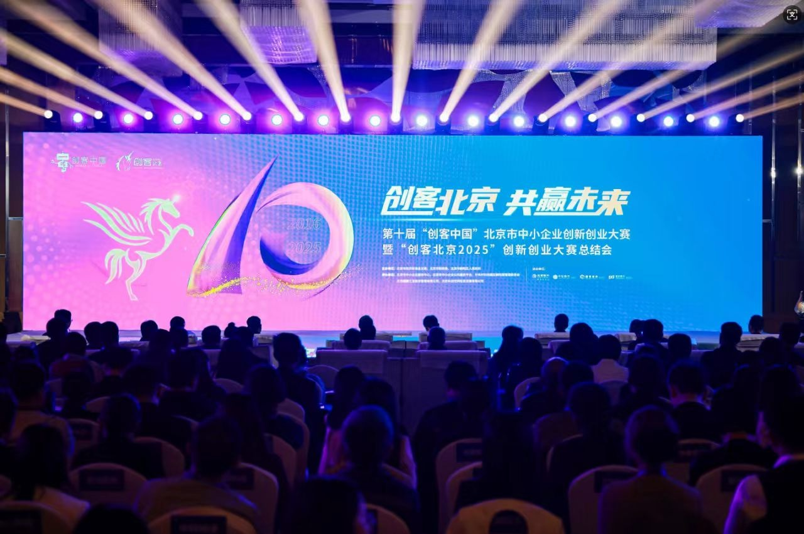

[简体中文](./README.md) · [All articles](../../README.en.md) · [Read on the website](https://www.theriseunion.com/en/blog/riseunion-beijing-cnmaker-2025-award.html)

# RiseUnion Wins Beijing CNMaker 2025 TOP150

RiseUnion · October 17, 2025 at 08:00 (UTC+08:00)

RiseUnion Rise CAMP heterogeneous AI compute management platform secures TOP150 in Beijing CNMaker 2025 innovation competition, showcasing advanced AI compute pooling, intelligent scheduling, and GPU resource optimization technologies for industrial AI transformation.

## RiseUnion Secures Top 150 Position in Beijing CNMaker 2025 Innovation Competition

In the golden autumn of October, innovation surged forward. On October 16th, the 10th "Maker China" Beijing SME Innovation and Entrepreneurship Competition and the **"Maker Beijing 2025"** Innovation and Entrepreneurship Competition Summary Conference was held in Chaoyang District.

As a leading enterprise in AI compute resource management, **RiseUnion** was honored with the "Maker Beijing 2025" Innovation and Entrepreneurship Competition TOP 150 award and was invited to participate in the summary conference. The event brought together distinguished guests including Wang Junfeng, Chief Engineer of the Ministry of Industry and Information Technology's Cybersecurity Industry Development Center, Su Guobin, Deputy Director of the Beijing Municipal Bureau of Economy and Information Technology, along with over 400 representatives from government, enterprises, and industry leaders to discuss innovation opportunities and share practical achievements in AI compute infrastructure development.

### Deep Dialogue on Technology Innovation

At the conference, government officials, industry experts, and award-winning enterprise representatives engaged in in-depth discussions around **"Technology Innovation Empowering Industrial Upgrades"**, emphasizing the acceleration of key core technology breakthroughs and the transformation of innovative achievements into practical applications. RiseUnion, as an innovative enterprise in AI compute resource management, was recognized for its self-developed [**Rise CAMP**](https://www.theriseunion.com/en/product/camp.html) heterogeneous intelligent computing management and pooling platform, securing the TOP 150 position in the "Maker Beijing 2025" Innovation and Entrepreneurship Competition.

### Robust Technical Capabilities Solving Compute Resource Management Challenges

Since its establishment, RiseUnion has remained focused on AI compute pooling, heterogeneous integration, and intelligent scheduling technology R&D, committed to building efficient and flexible **compute resource management platforms** that provide core support for industrial intelligent transformation. The company's self-developed [Rise CAMP](https://www.theriseunion.com/en/product/camp.html) heterogeneous intelligent computing management and pooling platform features three core advantages:

- **Heterogeneous Resource Pooling Capability:** Unified management of multiple domestic and international AI accelerators, enabling centralized control and flexible scheduling of compute resources. One research institute achieved resource utilization improvement from 30% to 80% after implementing this solution.
- **Intelligent Scheduling Engine:** Topology-aware scheduling algorithms provide optimal resource allocation strategies for the entire AI training and inference lifecycle. A leading company achieved 40% training efficiency improvement through this technology.
- **Enterprise-Grade Reliability:** Multi-tenant management and resource isolation support, providing visual monitoring and automated operations capabilities. A financial institution reduced operational costs by over 50% after deploying 100+ model services.

Reference: ["Maker Beijing 2025" Innovation and Entrepreneurship Competition TOP 150 Award Winners](https://mp.weixin.qq.com/s/HVbAyKOGrB7KEYamgMONew)

### About RiseUnion

Beijing RiseUnion Technology Co., Ltd.

Dedicated to building next-generation AI infrastructure intelligent management platforms, serving high-compute application scenarios including artificial intelligence, large language models, and research training. The company's core products leverage key technologies such as heterogeneous GPU resource pooling, compute slicing and scheduling optimization, multi-model collaborative scheduling, and edge inference support, widely applied across large government enterprises, leading financial institutions, AI innovation companies, universities, and research institutes. RiseUnion adheres to the philosophy of **"AI Compute Collaborative Platform"**, helping to build intelligent, controllable, and efficient future compute infrastructure.

---

[Read this article on the RiseUnion website](https://www.theriseunion.com/en/blog/riseunion-beijing-cnmaker-2025-award.html) · [Explore more articles](https://www.theriseunion.com/en/blog.html)
