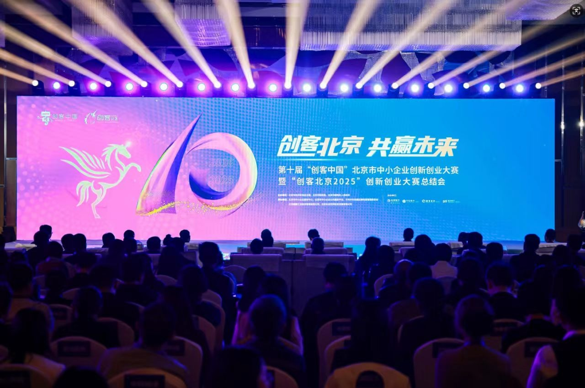

[English](./README.en.md) · [文章目录](../../README.md) · [官网阅读](https://www.theriseunion.com/zh/blog/riseunion-beijing-cnmaker-2025-award.html)

# 睿思智联获创客北京2025 TOP150奖

睿思智联 · 2025/10/17 08:00（北京时间）

睿思智联Rise CAMP异构智算管理平台荣获创客北京2025创新创业大赛TOP150，展示AI算力池化、智能调度、GPU资源优化等核心技术实力，助力产业智能化升级。

金秋十月，创新潮涌。10月16日，第十届“创客中国”北京市中小企业创新创业大赛暨**“创客北京2025”**创新创业大赛总结会在朝阳区隆重举行。

作为AI算力管理领域的领军企业，**睿思智联**获得“创客北京2025”创新创业大赛 TOP150，受邀参加总结会，与工业和信息化部网络安全产业发展中心总工程师王俊峰、北京市经济和信息化局党组成员、副局长苏国斌等领导，以及400余名政企代表、行业精英共话创新机遇，分享AI算力基础设施建设的实践成果。

在总结会现场，政府领导、行业专家与获奖企业代表围绕 **“科技创新赋能产业升级”** 展开深度对话，强调要加快关键核心技术攻关，推动创新成果转化落地。睿思智联作为AI算力管理领域的创新企业，其自主研发的 [**Rise CAMP**](https://www.theriseunion.com/zh/product/camp.html) 异构智算管理和池化平台项目，获得“创客北京2025”创新创业大赛TOP150。

## 硬核技术实力，破解算力管理难题

睿思智联自成立以来，始终专注于AI算力池化、异构融合与智能调度技术研发，致力于打造高效、灵活的 **算力管理平台**，为产业智能化升级提供核心支撑。公司自主研发的 [Rise CAMP](https://www.theriseunion.com/zh/product/camp.html) 异构智算管理和池化平台，具备三大核心优势：

- **异构资源池化能力：** 统一管理多种国产/非国产AI加速卡，实现算力资源的集中管控与灵活调度，某研究院采用该方案后，资源利用率从30%提升至80%。
- **智能调度引擎：** 基于拓扑感知的调度算法，为AI训练、推理全生命周期提供最优资源分配策略，某头部公司借此将训练效率提升40%。
- **企业级可靠性：** 支持多租户管理与资源隔离，提供可视化监控和自动化运维能力，某金融机构部署100+模型服务后，运维成本降低50%以上。

访问：[“创客北京2025”创新创业大赛TOP150获奖项目名单](https://mp.weixin.qq.com/s/HVbAyKOGrB7KEYamgMONew)

## 关于睿思智联

北京睿思智联科技有限公司

致力于构建新一代AI基础设施智能管理平台，服务于人工智能、大模型、科研训练等高算力应用场景。公司核心产品通过异构 GPU 资源池化、算力分片与调度优化、多模型协同调度、边缘推理支持等核心技术，广泛应用于大型政企、头部金融、AI创新企业、高校科研院所等。睿思智联以 **“AI智算协同平台”** 为理念，助力构建智能、可控、高效的未来算力底座。

---

[在睿思智联官网阅读本文](https://www.theriseunion.com/zh/blog/riseunion-beijing-cnmaker-2025-award.html) · [浏览更多文章](https://www.theriseunion.com/zh/blog.html)
