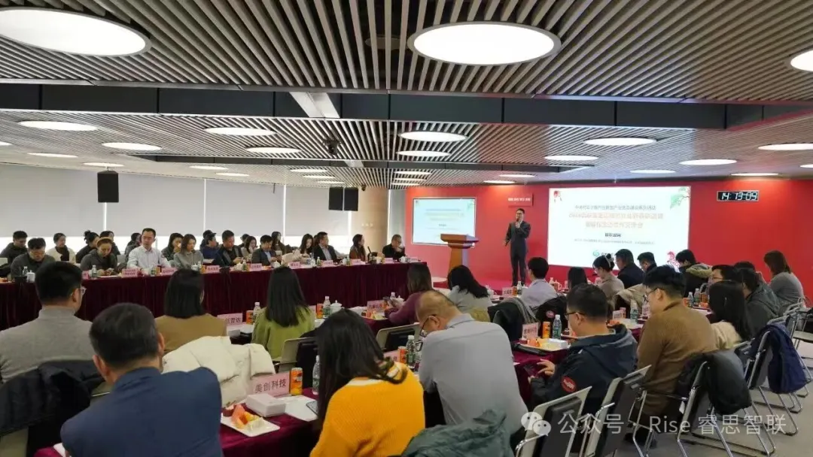
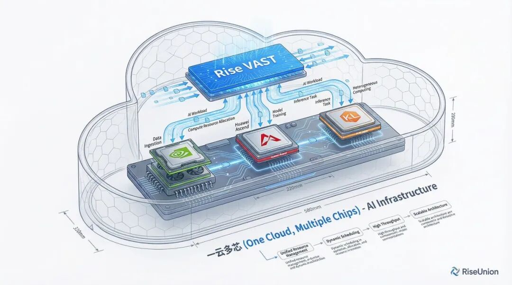

[简体中文](./README.md) · [All articles](../../README.en.md) · [Read on the website](https://www.theriseunion.com/en/blog/riseunion-cloud-alliance-2026.html)

# RiseUnion at 2026 Cloud Alliance Conference, Building the Domestic AI Compute Ecosystem

RiseUnion · February 06, 2026 at 08:00 (UTC+08:00)

RiseUnion was invited to the 2026 Cloud Alliance Spring Conference, engaging with Sugon and 40+ industry partners to share latest practices in AI compute management and pooled scheduling.

In 2026, AI large models have entered a critical phase of scaled deployment. As compute demand shifts from brute-force provisioning to maximum efficiency, infrastructure transformation is inevitable. RiseUnion was recently invited to the 2026 Cloud Alliance Spring Conference, engaging in deep dialogue with Sugon and over 40 industry leaders to explore the ecosystem evolution of the AI compute era.

## On the Ground

On January 28, the AI Ecosystem Cooperation Conference, co-hosted by the Zhongguancun Cloud Computing Industry Alliance (Cloud Alliance) and Sugon, was held at Sugon Tower in Beijing. Distinguished guests including Mei Jianping, former Deputy Director of the Ministry of Science and Technology's High-Tech Department, and Gong Mei, Executive President of the Cloud Alliance, were in attendance.

As an innovative force in AI infrastructure, RiseUnion joined partners from chip manufacturing, cloud services, and AI applications to discuss cloud ecosystem development for AI-driven scenarios.

## Key Insights

During the exchange session, RiseUnion shared its latest practices in AI compute management and pooled scheduling.

Addressing the industry-wide challenge of "**high allocation rates but low actual utilization**" at AI compute centers, RiseUnion presented its approach:

- **Full ecosystem adaptation** — Deep integration with domestic chip vendors, breaking hardware barriers to deliver standardized heterogeneous compute output
- **End-to-end coordination** — Open APIs connecting upstream AI application developers to downstream compute infrastructure, creating a closed-loop compute-algorithm-application system
- **Maximum efficiency** — Continuous scheduling algorithm optimization for large model inference and training, ensuring every unit of compute precisely serves business needs

> Learn more: [Rise VAST Heterogeneous Compute Platform](https://www.theriseunion.com/en/product/vast.html) · [Rise CAMP Scheduling Platform](https://www.theriseunion.com/en/product/camp.html)

## Building Connections

During the conference, RiseUnion actively participated in targeted matchmaking and technical exchanges. Domestic technology substitution isn't just about swapping a card — it's a complete ecosystem reconstruction of the technology stack.

Through the Cloud Alliance platform, RiseUnion is accelerating solution integration. Whether it's the stringent real-time requirements of financial securities or the self-reliance demands of state-owned enterprises, we are working with ecosystem partners to strengthen the AI compute service chain.

## Looking Ahead

As Cloud Alliance Executive President Gong Mei noted: "Artificial intelligence will surge forward."

RiseUnion will continue to focus on large model training and intelligent inference scenarios, partnering with like-minded organizations to contribute to the high-quality development of China's AI industry.

---

[Read this article on the RiseUnion website](https://www.theriseunion.com/en/blog/riseunion-cloud-alliance-2026.html) · [Explore more articles](https://www.theriseunion.com/en/blog.html)
