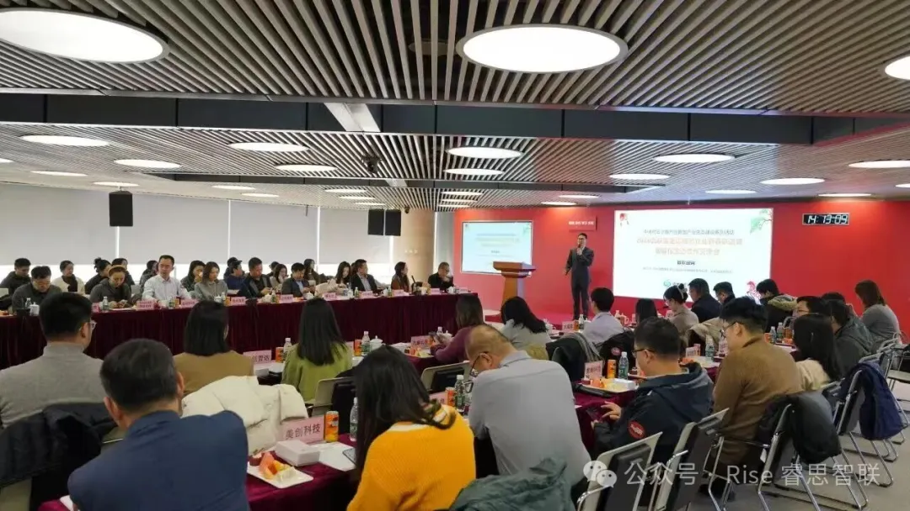
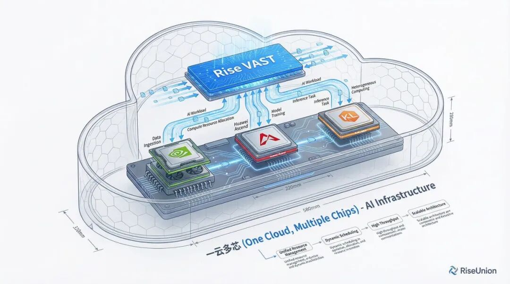

[English](./README.en.md) · [文章目录](../../README.md) · [官网阅读](https://www.theriseunion.com/zh/blog/riseunion-cloud-alliance-2026.html)

# 睿思智联亮相 2026 云联盟交流会，共筑国产算力生态

睿思智联 · 2026/02/06 08:00（北京时间）

睿思智联受邀参加 2026 云联盟新春交流会，与中科曙光等 40 余家行业伙伴深度对话，分享 AI 算力管理与池化调度的最新实践。

2026 年，AI 大模型进入规模化落地的深水区。当算力需求从暴力堆料转向极致能效，基础设施的重构已成必然。近日，睿思智联受邀参加 2026 云联盟新春交流会，与中科曙光等 40 余家行业先锋深度对话，共探智算时代的生态进化。

## 现场直击

1 月 28 日，由中关村云计算产业联盟（云联盟）与中科曙光联合主办的智能化生态合作交流会在曙光大厦举行。科技部高新司原副司长梅建平、云联盟执行会长龚梅等行业嘉宾齐聚现场。

作为 AI 基础设施赛道的创新力量，睿思智联与来自芯片、云服务、AI 应用等领域的合作伙伴，就智能化场景下的云生态建设展开了深度交流。

## 核心分享

在交流环节中，睿思智联分享了在 AI 算力管理与池化调度领域的最新实践。

面对当前智算中心"**资源分配率高、实际使用率低**"的行业痛点，睿思智联给出了自己的解法：

- **全生态适配** — 与国产芯片厂商深度绑定，打破硬件壁垒，实现异构算力的标准化输出
- **全链路协同** — 通过开放 API，向上衔接 AI 应用开发商，向下驱动算力底座，构建算力-算法-应用的闭环体系
- **极致能效比** — 针对大模型推理与训练场景，持续优化调度算法，让每一份算力都能精准触达业务核心

> 了解更多：[Rise VAST 异构算力管理平台](https://www.theriseunion.com/zh/product/vast.html) · [Rise CAMP 算力调度平台](https://www.theriseunion.com/zh/product/camp.html)

## 深度链接

会议期间，睿思智联积极参与了定向对接与技术交流。国产化替代不只是换一张卡，更是整个技术栈的生态重构。

通过云联盟平台，睿思智联正加速拓展方案整合空间。无论是金融证券的严苛实时性要求，还是央国企的自主可控需求，我们都在与生态伙伴共同完善 AI 算力服务链条。

## 展望

正如云联盟执行会长龚梅所言：人工智能必会奔涌向前。

未来，睿思智联将继续深耕大模型训练与智能推理场景，在科技企业出海与 AI 生态重构的浪潮中，携手更多伙伴，为中国 AI 产业的高质量发展贡献力量。

---

[在睿思智联官网阅读本文](https://www.theriseunion.com/zh/blog/riseunion-cloud-alliance-2026.html) · [浏览更多文章](https://www.theriseunion.com/zh/blog.html)
