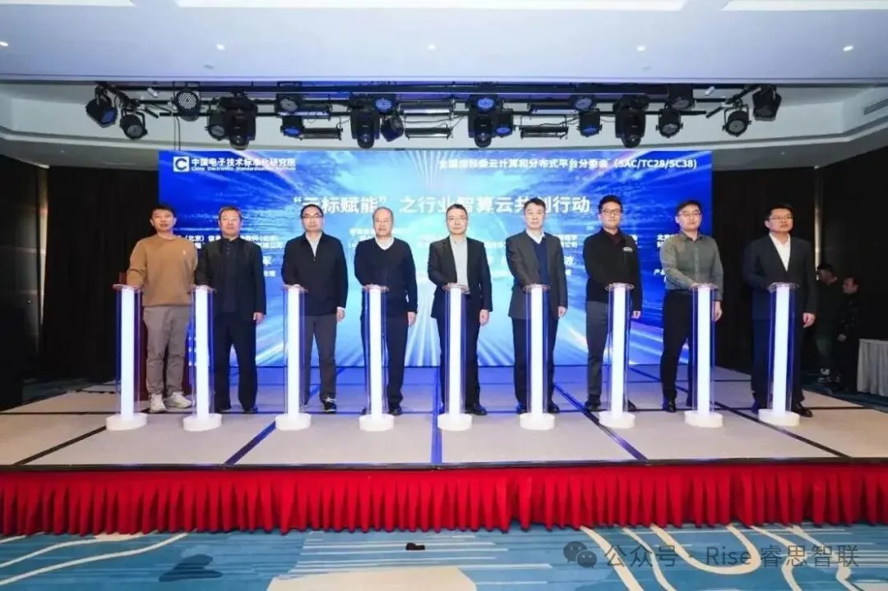
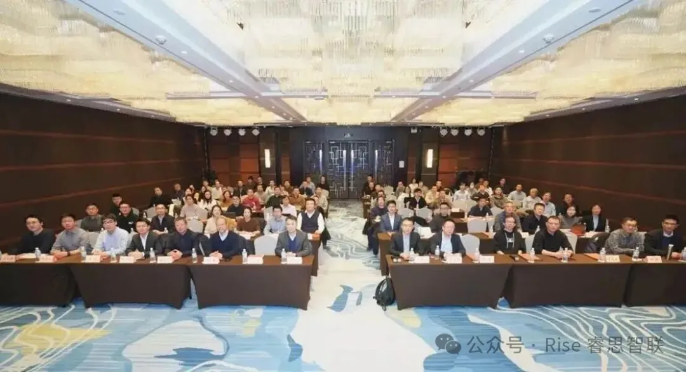
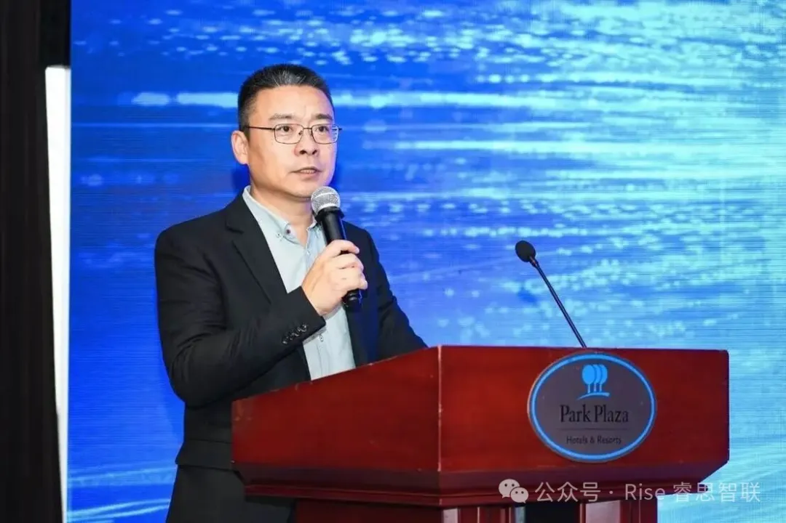
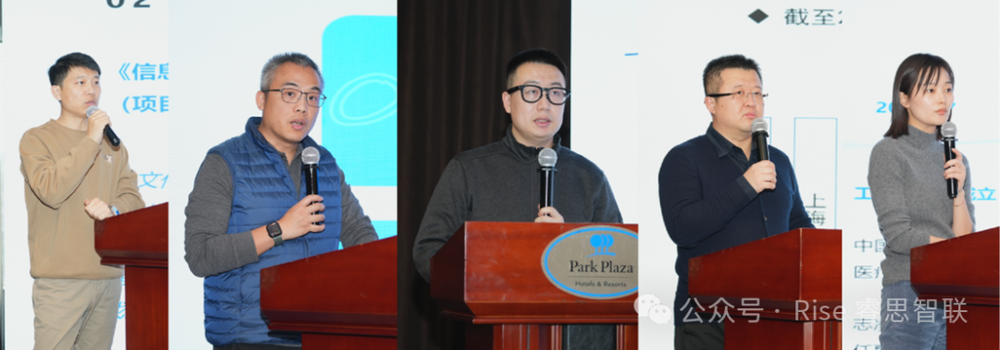

[简体中文](./README.md) · [All articles](../../README.en.md) · [Read on the website](https://www.theriseunion.com/en/blog/riseunion-cloud-computing-standards-2026.html)

# RiseUnion Attends National Cloud Computing Standards Conference, Co-creating Industry AI Cloud Standards

RiseUnion · January 13, 2026 at 08:00 (UTC+08:00)

RiseUnion was invited to the first 2026 Standards Conference of the National IT Standards Cloud Computing Sub-committee, participating as a core guest in the 'Cloud Standards Empowerment' AI cloud co-creation initiative and sharing insights on heterogeneous AI compute resource standards.

On January 13, 2026, the first Cloud Computing Standards Conference Week of 2026, hosted by the Cloud Computing and Distributed Platform Sub-committee of the National Information Technology Standardization Technical Committee, convened in Beijing. As a key player in cloud computing and AI compute, **Beijing RiseUnion Technology Co., Ltd.** was invited to participate throughout the event.

The conference brought together leading organizations from government, industry, academia, and enterprise, including the China Electronics Standardization Institute (CESI), China Construction Bank, China Information Industry Association, PetroChina, and H3C. Discussions focused on the convergence of cloud and AI computing, cloud computing standards development, and industry adoption.

Wang Zhipeng, Director of the Software Center at CESI, welcomed attendees on behalf of the organizers. He noted that cloud computing faces new opportunities and challenges, with cloud-AI convergence emerging as a key trend. CESI will follow national strategic deployments and the "Cloud Computing Standardization System Construction Guide (2025 Edition)" to work with industry partners on standards development and application.

**Fu Shuai**, RiseUnion's Director of Product & Solution Architecture, represented the company on stage. He participated as a core guest in the "**Cloud Standards Empowerment**" AI Cloud Co-creation Initiative launch ceremony and shared insights on heterogeneous AI compute resource standards and practical implementation experience.

## Deep Standards Engagement, Demonstrating Technical Strength

RiseUnion has consistently prioritized standards development as a core strategy, actively contributing to national and industry-level standardization efforts. At this conference, Fu Shuai's presentation on heterogeneous AI compute resource standards, grounded in RiseUnion's extensive practice in AI cloud infrastructure, systematically outlined the standard's key requirements and implementation pathways, earning strong recognition from attending experts.

As an active promoter and practitioner of industry standards, RiseUnion has been deeply involved in the development and revision of cloud computing and AI compute standards, translating technical innovations into industry-wide norms that address AI cloud deployment challenges, improve heterogeneous compute utilization, and strengthen self-reliant core capabilities.

## Leading Industry Practice, Empowering High-Quality AI Cloud Development

At the "Cloud Standards Empowerment" AI Cloud Co-creation Initiative launch ceremony, Fu Shuai took the stage alongside leaders from CESI, the China Information Industry Association, and other organizations, marking RiseUnion's formal role as a core participant in the industry AI cloud ecosystem. The initiative aims to leverage standards to unite the supply chain in solving industry pain points and empowering high-quality AI cloud development.

Stage guests included leaders from CESI, the China Information Industry Association, China Communications Services, SDIC Cloud Network, PetroChina Digital Intelligence Research Institute, CMIC Digital Technology, CNOOC, Lenovo, and RiseUnion.

RiseUnion shared practical results from heterogeneous AI compute resource standardization and engaged in deep discussions with leading enterprises across finance, government, and healthcare sectors, building bridges for standards adoption across industries.

Far left: Fu Shuai, Director of Product & Solution Architecture, Beijing RiseUnion Technology Co., Ltd.

Looking ahead, RiseUnion will continue to deepen its commitment to cloud computing and AI compute standards development and technical innovation, working with industry partners to translate standards into drivers of industrial growth and delivering better products and solutions for the market.

---

[Read this article on the RiseUnion website](https://www.theriseunion.com/en/blog/riseunion-cloud-computing-standards-2026.html) · [Explore more articles](https://www.theriseunion.com/en/blog.html)
