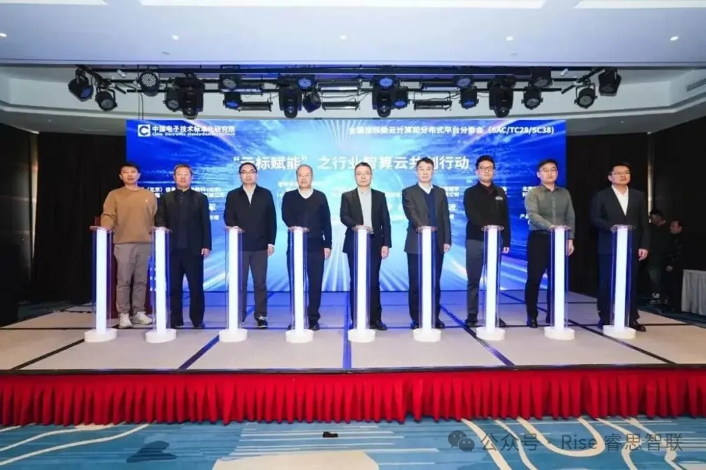
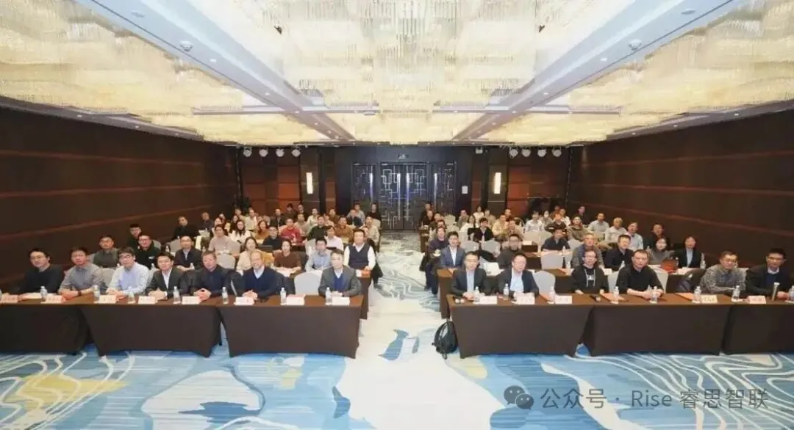
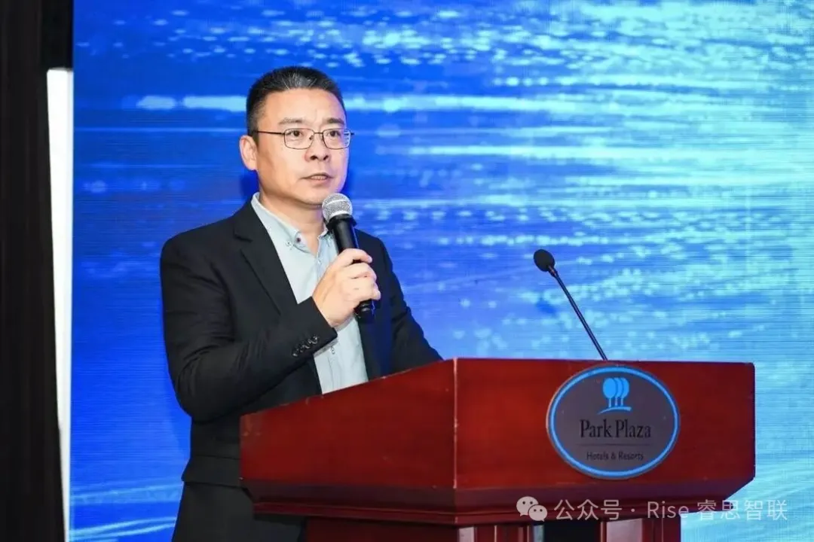
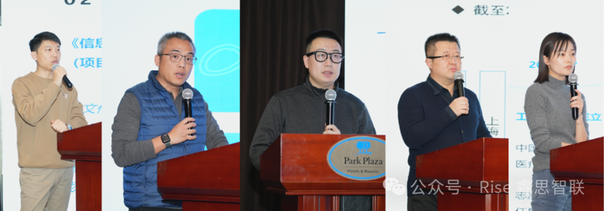

[English](./README.en.md) · [文章目录](../../README.md) · [官网阅读](https://www.theriseunion.com/zh/blog/riseunion-cloud-computing-standards-2026.html)

# 睿思智联出席国家级云计算标准会议，深度参与行业智算云共创

睿思智联 · 2026/01/13 08:00（北京时间）

睿思智联受邀出席全国信标委云计算分技术委员会 2026 年首次标准会议周，作为核心嘉宾参与「云标赋能」行业智算云共创行动启动仪式，并分享异构智算资源标准解读与实践经验。

2026 年 1 月 13 日，全国信息技术标准化技术委员会云计算和分布式平台分技术委员会 2026 年第一次云计算标准会议周暨云建设与应用标准工作组季度会议在北京隆重召开。作为云计算与智算领域的重点企业，**北京睿思智联科技有限公司**受邀参会，全程深度参与。

本次会议汇聚了中国电子技术标准化研究院、中国建设银行、中国信息协会、中石油、新华三等政产学研用各界领军力量，聚焦云智融合发展新趋势，围绕云计算标准研制、行业应用推广等关键议题展开深入探讨。

电子标准院软件中心主任王志鹏代表会议主办方，对与会领导嘉宾表示欢迎。当前云计算发展正面临新的机遇和挑战，云智融合已成为新的发展趋势，电子标准院将紧跟国家战略部署和《云计算综合标准化体系建设指南（2025 版）》规划要求，携手产业各方，深挖标准需求，共同推动标准研制与应用，支撑各行业高质量发展。

睿思智联产品与解决方案架构总监**傅帅**代表公司登台，不仅作为核心嘉宾参与"**云标赋能**"行业智算云共创行动启动仪式，更在会上分享了异构智算资源标准解读与实践经验，为行业标准落地提供了极具价值的参考。

## 深耕标准研制，彰显技术实力

多年来，睿思智联始终将标准建设作为核心战略，积极投身国家级、行业级标准研制工作，凭借对异构智算等领域的深刻理解，为行业标准体系的完善注入了关键力量。此次会议上，傅帅分享的异构智算资源标准解读，基于睿思智联在智算云领域的丰富实践，系统拆解了标准核心要点与落地路径，获得了与会专家的高度认可。

作为行业标准的积极推动者与坚定践行者，睿思智联深度参与云计算与智算领域的标准制修订工作，将技术创新成果转化为行业共同遵循的规范，为破解智算云建设痛点、提升异构算力资源利用率、强化自主可控核心能力提供了重要支撑。

## 引领行业实践，赋能智算云高质量发展

在"云标赋能"行业智算云共创行动启动仪式上，傅帅与中国电子技术标准化研究院、中国信息协会等单位领导共同登台，标志着睿思智联正式成为行业智算云生态建设的核心参与者。该行动旨在依托系列标准，联动产业链各方破解行业痛点，赋能智算云产业高质量发展。

登台嘉宾：中国电子技术标准化研究院软件应用与服务研究中心主任王志鹏、中国信息协会副会长兼秘书长李红、零碳信息通信网络联合实验室（中国通服科技创新部）高级督导杨军、国投云网数字科技有限公司副总经理丁文波、中石油数智研究院基础中心技术总监李昕哲、中机数科（北京）信息技术有限公司常务副总经理赵宏军、中国海洋石油集团有限公司高级工程师安鹏、联想（北京）信息技术有限公司高级人工智能软件研发工程师刘冰、北京睿思智联科技有限公司产品与解决方案架构总监傅帅。

此次参会，睿思智联不仅分享了异构智算资源标准的实践应用成果，更与金融、政务、医疗等领域的领军企业深入交流，为标准在各行业的推广落地搭建了重要桥梁。

左一：北京睿思智联科技有限公司产品与解决方案架构总监傅帅

未来，睿思智联将持续深耕云计算与智算领域的标准建设与技术创新，以更开放的姿态联动产业链各方，将标准优势转化为产业发展动能，为行业提供更优质的产品与解决方案。

---

[在睿思智联官网阅读本文](https://www.theriseunion.com/zh/blog/riseunion-cloud-computing-standards-2026.html) · [浏览更多文章](https://www.theriseunion.com/zh/blog.html)
