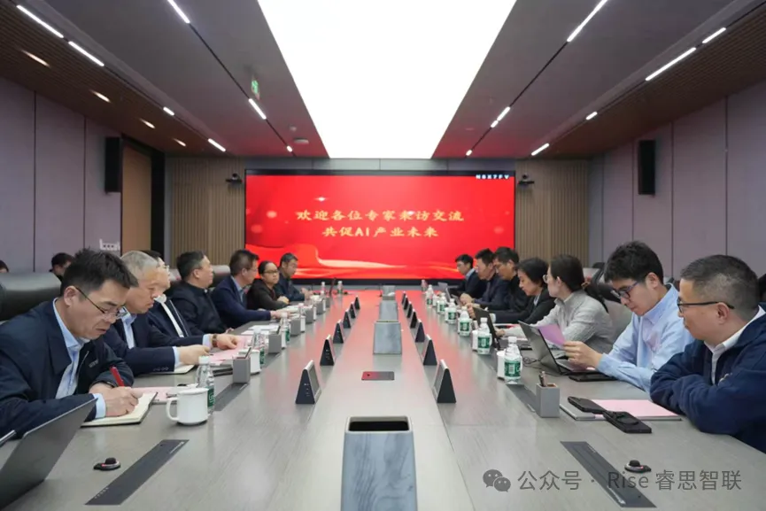

[简体中文](./README.md) · [All articles](../../README.en.md) · [Read on the website](https://www.theriseunion.com/en/blog/riseunion-compute-ai-fusion-2026.html)

# RiseUnion Attends Compute & AI Industry Convergence Symposium

RiseUnion · March 06, 2026 at 08:00 (UTC+08:00)

RiseUnion was invited to the Compute Development & AI Industry Convergence Symposium, sharing insights on full-stack AI compute center operations with AIIC, CESI, and industry partners.

To advance the "15th Five-Year Plan" compute development framework and the national "AI+" strategy, and to drive standardization and deployment of heterogeneous AI compute, on March 11, 2026, **Beijing RiseUnion Technology Co., Ltd.** was invited to the Compute Development & AI Industry Convergence Symposium hosted by Beijing Urban Construction Intelligent Control Technology Co., Ltd.

The symposium brought together the AI Industry Committee (AIIC), the China Electronics Standardization Institute (CESI), and other stakeholders from government, research, and enterprise to explore new opportunities in compute-AI convergence. RiseUnion participated as a core practitioner in the field.

## Industry Leaders Align on Direction

The symposium was chaired by Wang Linghong, General Manager of Urban Construction Intelligent Control. Discussions centered on heterogeneous AI compute standards, technical innovation, and cross-sector applications.

AIIC Secretary-General Gao Hongling provided an in-depth analysis of the compute development framework under the "15th Five-Year Plan" and the "AI+" national strategy. Chen Zhifeng, Director of the Cloud Computing Lab at CESI's Software Center, shared progress on heterogeneous AI compute standardization efforts.

## RiseUnion's Core Technology Showcase

As a key practitioner in compute and AI, RiseUnion delivered a featured presentation.

Chairman **Jin Meng** outlined the company's core business, R&D strengths, industry-wide deployment results, and future development plans.

VP **Shen Ou** focused on the practical needs of traditional infrastructure enterprises transitioning to intelligent operations, presenting RiseUnion's full-stack AI compute center asset management and precision operations solution built around three pillars:

- **Unified heterogeneous compute management** — [Rise VAST](https://www.theriseunion.com/en/product/vast.html) breaks down compute silos and eliminates asset opacity
- **Dynamic fine-grained GPU partitioning** — [Rise CAMP](https://www.theriseunion.com/en/product/camp.html) dramatically improves utilization of capital-intensive compute assets
- **Full-spectrum intelligent monitoring** — End-to-end observability from node to model, ensuring business continuity

The solution clearly illustrated a path for traditional infrastructure companies to evolve from physical data center providers to full-service AI operators, resonating strongly with attendees.

## Roundtable: Charting the Convergence Blueprint

During the roundtable session, RiseUnion and other participants discussed heterogeneous AI compute standards implementation, technology breakthroughs, cross-sector applications, and collaborative development. Drawing on extensive field experience, RiseUnion offered actionable recommendations for addressing industry pain points.

All parties reached consensus: compute is the foundation of the digital economy, and AI is the engine of industrial transformation. Strengthened collaboration between government, research, and enterprise is essential to advancing "AI + Compute" convergence.

RiseUnion will continue to deepen partnerships with Urban Construction Intelligent Control, AIIC, CESI, and other organizations, focusing on urban development and intelligent transportation to drive compute and AI innovation.

---

[Read this article on the RiseUnion website](https://www.theriseunion.com/en/blog/riseunion-compute-ai-fusion-2026.html) · [Explore more articles](https://www.theriseunion.com/en/blog.html)
