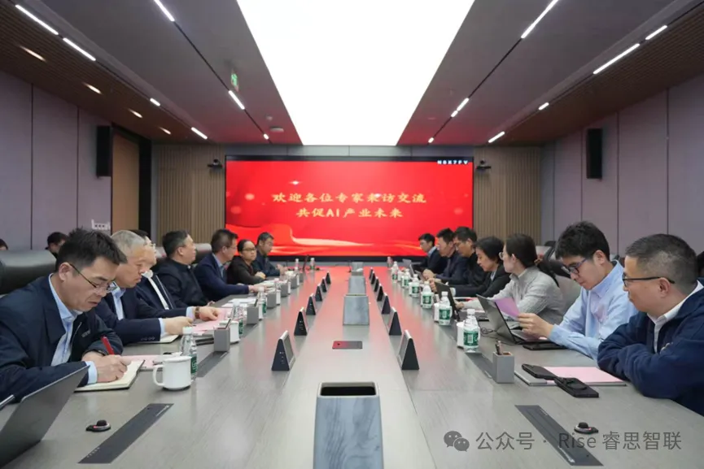

[English](./README.en.md) · [文章目录](../../README.md) · [官网阅读](https://www.theriseunion.com/zh/blog/riseunion-compute-ai-fusion-2026.html)

# 睿思智联受邀出席算力与 AI 产业融合研讨会，共探产业发展新路径

睿思智联 · 2026/03/06 08:00（北京时间）

睿思智联受邀参加算力发展与人工智能产业融合交流研讨会，与 AIIC、中国电子技术标准化研究院等多方力量共话算力与 AI 产业融合新机遇，分享智算中心全栈运营方案。

为深入落实"十五五"算力发展布局及"人工智能+"国家战略，推动人工智能异构算力领域标准建设与产业落地，2026 年 3 月 11 日，**北京睿思智联科技有限公司**受邀参加由北京城建智控科技股份有限公司主办的算力发展与人工智能产业融合交流研讨会。

本次会议汇聚人工智能产业工作委员会（AIIC）、中国电子技术标准化研究院等政研企多方力量，共话算力与 AI 产业融合新机遇。睿思智联作为领域内核心实践企业，受邀分享技术成果与实践经验。

## 多方齐聚论道，明晰产业发展方向

本次研讨会由城建智控党总支副书记、总经理汪令宏主持，各方围绕人工智能异构算力标准建设、技术创新、场景融合等核心议题展开深度交流。

会上，AIIC 秘书长高宏玲深入剖析"十五五"算力发展布局与"人工智能+"国家战略背景，解读行业政策环境与市场核心机遇；中国电子技术标准化研究院软件中心云计算研究室陈志峰主任，分享人工智能异构算力领域标准研究进展，为产业标准化、规范化发展明确方向。

## 睿思重磅分享，展现核心技术与实践实力

作为算力与人工智能领域的重要践行者，睿思智联在会上带来重磅分享。

公司董事长**金萌**从核心业务布局、技术研发优势、全产业链实践成果及未来发展规划等维度，系统阐述睿思智联在算力与 AI 领域的深耕积淀。

公司副总裁**沈鸥**紧扣传统基建企业向数智化转型的实际诉求，以"**建得好、管得住、营得赢**"为核心主线，对睿思智联智算中心全栈资产与精细化运营方案进行了全面讲解，解析了平台在以下方面的核心能力：

- **异构算力统一纳管** — [Rise VAST](https://www.theriseunion.com/zh/product/vast.html) 打破算力孤岛，消除资产黑盒化风险
- **GPU 动态细粒度切分** — [Rise CAMP](https://www.theriseunion.com/zh/product/camp.html) 将重资产的算力利用率大幅提升
- **全景智能监控** — 从节点到模型的全链路可观测，保障业务连续性

方案清晰描绘了帮助传统基建企业从"提供物理机房"向"AI 全维度服务商"跨越的商业落地路径，引发了现场高度共鸣。

## 深度座谈研讨，共绘产业融合新蓝图

在多方座谈环节，睿思智联与参会各方围绕人工智能异构算力标准落地、技术创新突破、跨领域场景融合、产业协同发展等关键问题展开热烈讨论。结合自身丰富的实践经验，睿思智联针对行业发展痛点提出多项建设性意见。

各方一致达成共识：算力是数字经济发展的核心底座，人工智能是产业升级的重要引擎，唯有加强政研企协同合作，推动标准与产业深度结合，才能更好探索"人工智能 + 算力"融合应用新路径。

未来，睿思智联将持续深化与城建智控、AIIC、中国电子技术标准化研究院等单位的合作，聚焦城市建设、智能交通等核心领域，持续推动算力与人工智能技术创新及场景落地，助力异构算力行业标准建设。

---

[在睿思智联官网阅读本文](https://www.theriseunion.com/zh/blog/riseunion-compute-ai-fusion-2026.html) · [浏览更多文章](https://www.theriseunion.com/zh/blog.html)
