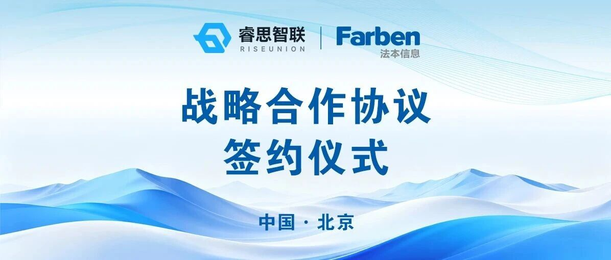
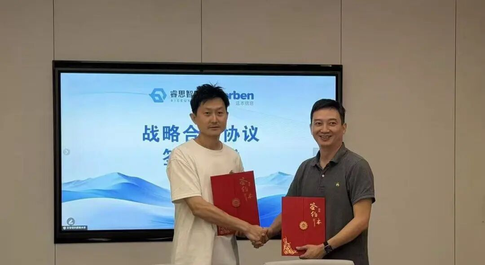

[简体中文](./README.md) · [All articles](../../README.en.md) · [Read on the website](https://www.theriseunion.com/en/blog/riseunion-farben-information-strategic-partnership.html)

# Joining Forces, Powering an Intelligent Future | RiseUnion × Farben Information Form a Strategic Partnership to Take Domestic AI Computing Services to New Heights

RiseUnion · September 14, 2026 at 09:59 (UTC+08:00) · [Original WeChat article (Chinese)](https://mp.weixin.qq.com/s/AypFNWXbxXFvanQ6MphpVA)

Recently, Beijing RiseUnion Technology Co., Ltd. and Shenzhen Farben Information Technology Co., Ltd. officially formed a strategic partnership.

Recently, **Beijing RiseUnion Technology Co., Ltd.** (RiseUnion) and Shenzhen Stock Exchange-listed **Shenzhen Farben Information Technology Co., Ltd.** (Farben Information) officially formed a strategic partnership, launching deep collaboration around **“compute foundation + digital delivery.”** RiseUnion’s Yang Shiqi and Farben Information’s Shan Xiaoming attended the signing ceremony.

RiseUnion’s Yang Shiqi (left) and Farben Information’s Shan Xiaoming (right) attend the signing ceremony

## 01 · The Intelligent Computing Industry’s “Shift Point”

This partnership did not emerge out of nowhere. It arrives at the convergence of **three major tailwinds in the intelligent computing industry:**

**Policy direction**  Intelligent computing power has been defined as a “foundation for new quality productive forces”—the first time computing power has been elevated to a position alongside land and energy.

**Platform support**  At the 2026 Big Data Expo, RiseUnion joined the National Integrated Computing Power Network Testing and Verification Platform, stepping onto a national-level testing ground.

**Market shift**  Telecom operators are accelerating their move from “traffic operations” into the era of “Token operations.” When “inference tokens” become the unit of pricing, the computing business is rewritten with them: what is sold is no longer resources, but capabilities.

Three forces are converging at the same moment, and the industry needs **an answer that can be implemented**.

## 02 · Compute Foundation x Digital Delivery

The answer lies in each company’s respective strengths—

Embed RiseUnion’s **AI intelligent computing management software** into Farben Information’s **digital capillaries**.

### Compute side: Put every chip to full use

Based on the Rise VAST and Rise Router platforms, RiseUnion enables heterogeneous pooling and memory overcommitment across more than 10 domestic chips, including Huawei Ascend, Hygon, Cambricon, and Kunlunxin. It not only breaks down hardware barriers and taps deeply into the potential of physical computing power, but also connects Token-level routing, metering, and governance above the infrastructure layer, transforming fragmented physical chips into highly reliable, high-throughput, out-of-the-box Token production and service engines.\

Resource utilization

30% → 85%+

Inference cost

Down 50%

In one sentence: unlock the potential of domestic computing power without replacing the chips.

### Service side: Turn computing power into something customers can use

With “productized solutions, value-driven business data, and intelligent operations services” as its core capability framework, Farben Information has cultivated five major industries—telecommunications, finance, automotive, energy, and intelligent manufacturing—where computing power is packaged into scenario-based solutions that can be delivered directly.

### Ecosystem side: Connect the full “compute → model → Token” chain

Together, the two companies are building a **full-chain closed loop** from computing supply to Token delivery, directly responding to the industry’s transition from “traffic operations” to “Token operations” and providing customers in **finance, energy, and central and state-owned enterprises** with an end-to-end path for AI upgrades.

## 03 · When the Compute Brain Meets a Scenario Powerhouse

### RiseUnion

The “underlying brain” for AI compute engines and Token governance

✦ Focuses deeply on three core customer needs: AI compute pooling, memory overcommitment, and Token-level routing governance

✦ Fully compatible with more than 10 domestic chips, including Huawei Ascend, Hygon, Cambricon, and Kunlunxin, breaking down compute silos

✦ Provides production-grade, cost-effective computing infrastructure for critical industries including finance, government and enterprise, transportation, and healthcare

### Farben Information

The “scenario powerhouse” for cross-industry digitalization and AI implementation\

✦ Operates three core businesses—telecommunications, computing, and intelligent services—with full-lifecycle digital delivery capabilities

✦ Covers key industries including telecommunications, finance, automotive, energy, and intelligent manufacturing, understanding business as deeply as technology

✦ Uses “productized solutions and value-driven business data” to bridge the “last mile” of AI large-model implementation

One reaches downward to tap the potential of domestic chips and turn physical computing power into efficiently produced Token assets; the other reaches upward to integrate deeply with industry operations and turn Token assets into business value that takes root. When the “brain” that best understands compute pooling meets the “hands” that best understand industry delivery, the next page of domestic AI computing services is being written by them together.

## Joining forces, powering an intelligent future

### About RiseUnion

Beijing RiseUnion Technology Co., Ltd. focuses on AI computing management and scheduling. It has completed compatibility certification for more than 10 domestic chips and is one of the core contributors to the CNCF Sandbox open-source project HAMi. The company is a National High-Tech Enterprise, a Beijing Specialized, Sophisticated, Distinctive, and Innovative SME, and the leader of the AIIC Computing Pooling Working Group. It has delivered large-scale production deployments in finance, government, enterprise and defense, transportation, healthcare, and other industries.

RiseUnion is committed to making computing power as readily available as water and electricity, building an intelligent, controllable, and efficient computing foundation for enterprise AI transformation.

For more information, visit **riseunion.ai** or contact us at **400-605-2336**.

---

[Read this article on the RiseUnion website](https://www.theriseunion.com/en/blog/riseunion-farben-information-strategic-partnership.html) · [Explore more articles](https://www.theriseunion.com/en/blog.html)
