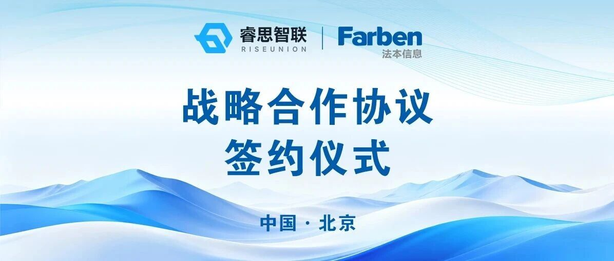
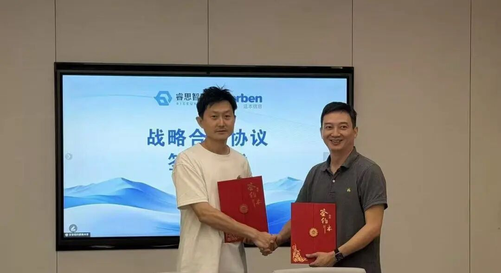

[English](./README.en.md) · [文章目录](../../README.md) · [官网阅读](https://www.theriseunion.com/zh/blog/riseunion-farben-information-strategic-partnership.html)

# 强强联袂,智启未来 | 睿思智联 × 法本信息达成战略合作,共筑国产 AI 算力服务新高地

睿思智联 · 2026/09/14 09:59（北京时间） · [微信公众号原文](https://mp.weixin.qq.com/s/AypFNWXbxXFvanQ6MphpVA)

近日，北京睿思智联科技有限公司与深圳市法本信息技术股份有限公司正式达成战略合作

近日，**北京睿思智联科技有限公司**（睿思智联）与深交所上市公司**深圳市法本信息技术股份有限公司**（法本信息）正式达成战略合作，围绕“**算力底座 + 数字化交付**”展开深度协同。睿思智联杨世琪与法本信息单晓明出席签约仪式。

睿思智联 杨世琪（左）和法本信息 单晓明（右）出席签约仪式

## 01 · 智算产业的“换挡时刻”

这次合作并非凭空而来，它踩在智算产业**三大风口的叠加点上：**

**政策定调**  智能算力定义为"新质生产力底座"——算力第一次被提到了与土地、能源同等的位置。

**平台加持**  就在2026数博会上，睿思智联入驻全国一体化算力网试验验证平台，站上国家级试验场。

**市场转向**  运营商正加速从"流量经营"驶入"Token 经营"时代。当"推理词元"成为计价单位，算力生意也随之改写：卖的不再是资源，而是能力。

三股力量同一时刻交汇，行业需要**能落地的答卷**。

## 02 · 算力底座x数字化交付

答卷的答案，藏在双方各自的长板里——

把睿思智联的 **AI 智算管理软件**，嵌入法本信息的 **数字化毛细血管**。

### 算力端：让每一张芯片物尽其用

睿思智联基于 Rise VAST 与 Rise Router 平台，跨华为昇腾、海光、寒武纪、昆仑芯等 10+ 国产芯片实现异构池化与显存超分：不仅打破硬件壁垒、深度榨干物理算力潜力，更向上打通 Token 级路由与计量治理，将碎片化的物理芯片转化为高可靠、高吞吐、开箱即用的 Token 生产与服务引擎。\

资源利用率

30% → 85%+

推理成本

下降 50%

一句话：不换芯片，也能把国产算力的潜力榨出来。

### 服务端：把算力变成客户用得上的东西

法本信息以“**解决方案产品化、业务数据价值化、运营服务智能化**”为核心能力框架，深耕 **通信、金融、汽车、能源、智能制造** 五大行业——算力在这里被封装成一个个可直接交付的场景化方案。

### 生态端：打通"算力 → 模型 → Token"全链路

双方联合构建从算力供给到 Token 交付的**全链路闭环**，直接呼应"流量经营"到"Token 经营"的产业转型，为**金融、能源、央国企**客户提供端到端的 AI 升级路径。

## 03 · 当算力大脑遇上场景巨擘

### 睿思智联

AI算力引擎与Token治理的“底层大脑”

✦ 深耕AI算力池化、显存超分与Token级路由治理三大客户核心需求

✦ 全面兼容华为昇腾、海光、寒武纪、昆仑芯等10+国产芯片，打破算力孤岛

✦ 为金融、政企、交通、医疗等关键行业提供生产级、高性价比的算力基础设施

### 法本信息

全行业数字化与AI落地的“场景巨擘”\

✦ 拥有“通信、算力、智能服务”三大主业与全生命周期数字化交付能力

✦ 覆盖通信、金融、汽车、能源、智能制造等核心行业，懂技术更懂业务

✦ 以“解决方案产品化、业务数据价值化”打通 AI 大模型落地的“最后一公里”

一个向下深挖国产芯片潜力，把物理算力变成高效输出的 Token 资产； 一个向上融合纵深行业业务，把 Token 资产变成落地生根的商业价值。当最懂算力池化的“大脑”，遇上最懂行业交付的“双手”——国产 AI 算力服务的下一页，正由他们共同书写。

## 强强联袂，智启未来

### 关于睿思智联

北京睿思智联科技有限公司（RiseUnion）专注于AI 算力管理与调度，已完成 10+ 国产芯片兼容认证，是 CNCF Sandbox 开源项目 HAMi 的核心贡献者之一。公司是国家高新技术企业、北京市专精特新中小企业、AIIC 算力池化工作组组长单位，在金融、政企军工、交通、医疗等行业实现大规模生产级落地。

睿思智联致力于让算力像水电一样随取随用，为企业 AI 转型构建智能、可控、高效的算力底座。

了解更多详细信息，欢迎访问官网：**riseunion.ai** 或联系：**400-605-2336**。

---

[在睿思智联官网阅读本文](https://www.theriseunion.com/zh/blog/riseunion-farben-information-strategic-partnership.html) · [浏览更多文章](https://www.theriseunion.com/zh/blog.html)
