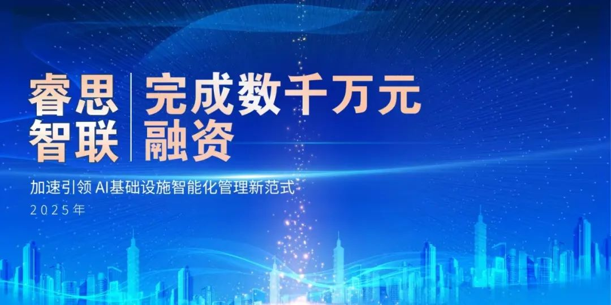
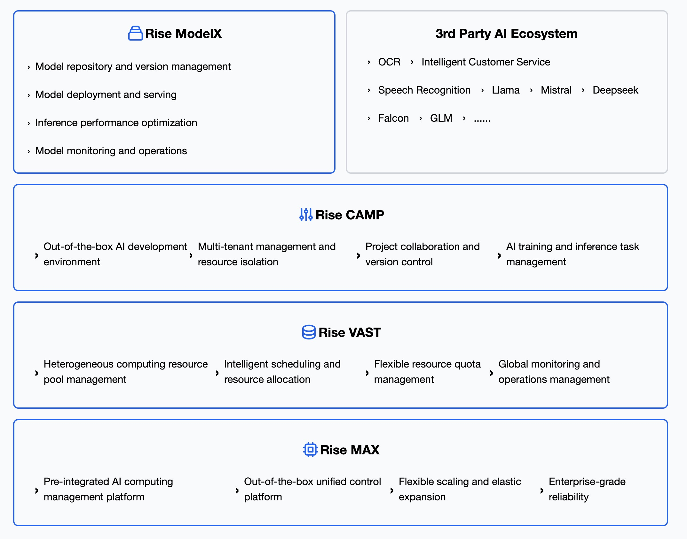

[简体中文](./README.md) · [All articles](../../README.en.md) · [Read on the website](https://www.theriseunion.com/en/blog/riseunion-financing-news-2025.html)

# RiseUnion Secures Multi-Million Funding for AI Infrastructure

RiseUnion · July 28, 2025 at 08:00 (UTC+08:00)

RiseUnion Technology announces multi-million-dollar funding from Plum Ventures for AI infrastructure management platform. Specializing in heterogeneous compute orchestration, GPU virtualization, and enterprise-grade multi-tenant solutions for intelligent compute infrastructure.

Beijing RiseUnion Technology Co., Ltd. (hereinafter referred to as "**RiseUnion**"), an innovative enterprise in the AI infrastructure sector, recently announced the completion of **a new round of multi-million-dollar financing**, exclusively invested by **Plum Ventures**. This funding will further strengthen the company's R&D investment and market expansion in the **AI infrastructure** space, consolidating its leading position in China's "**software-defined compute**" domain.

Image

Against the backdrop of artificial intelligence accelerating industrial transformation, RiseUnion focuses on **AI infrastructure intelligent management**, providing unified orchestration, intelligent operations, and secure, controllable solutions for compute platforms. Building on an autonomous and controllable underlying architecture, the company comprehensively integrates **heterogeneous chips, workload scheduling, model lifecycle management, and multi-tenant operations**, helping large enterprises and research institutions efficiently build future-ready intelligent compute infrastructure.

Operating in the same space as internationally recognized companies like Run:ai and CoreWeave, RiseUnion similarly centers on **cloud-native compute orchestration**, building highly integrated systems for model and workload orchestration while providing platform-level monitoring and governance capabilities. However, addressing China's diverse "heterogeneous chip + multi-tenant" ecosystem, RiseUnion has achieved **cross-vendor, cross-GPU unified management and elastic scheduling**, delivering localized solutions that better meet enterprise-grade requirements in areas such as policy isolation, edge-center integration, and operational adaptation, creating unique competitive advantages.

## Addressing Core AI Infrastructure Challenges with Intelligent Compute Management Platform

Today, the explosive development of large language models is driving the transformation of compute infrastructure from "resource stacking" to "fine-grained operations." Particularly facing China's flourishing heterogeneous compute ecosystem, RiseUnion is dedicated to solving the core challenges of transparent management and orchestration of heterogeneous compute resources. The company has built a comprehensive AI infrastructure platform covering heterogeneous compute management, model lifecycle management, multi-tenant self-service operations, scheduling optimization, and automated recovery capabilities, delivering "ready-to-use, on-demand scheduling, intelligent operations, and secure control" compute management experience for customers.

## Core Product Capabilities

- **Unified Heterogeneous Compute Orchestration**

Supports heterogeneous compute chips including NVIDIA, Ascend, Kunlun, Cambricon, and 10+ domestic and international accelerators. Builds unified abstraction layers supporting heterogeneous resource registration, adaptation, and dynamic scheduling, facilitating the construction of cross-chip, multi-model mixed deployment intelligent inference systems.

- **Development-Inference-Operations Full Lifecycle Management**

Provides comprehensive lifecycle operational tools including model management, inference logging, runtime profiling, job failure recovery, and resource fragmentation cleanup. Helps enterprises deploy AI models from lab to production more efficiently and reliably, making deployment more streamlined and operations more robust.

- **Multi-Tenant Resource Sharing with Policy Isolation**

Builds enterprise-grade self-service portals for large organizations with flexible permission systems and integration capabilities. Supports tenant-level resource pool partitioning, QoS priority controls, and policy quota restrictions, ensuring performance isolation while multiple teams share GPU resources. Meets enterprise-grade SLM multi-tenant concurrent deployment requirements while providing built-in metering and billing modules to support resource visibility operations and compute cost accounting.

- **Fine-Grained Workload and Model Matching Orchestration**

Features large-scale GPU cluster scheduling capabilities supporting flexible on-demand allocation across multiple regions, types, and clusters. Through "model identification + request characteristics" joint scheduling logic, automatically routes requests to optimal resource nodes, balancing response latency and cluster load.

- **Compute Pooling and Partitioning**

Supports logical compute resource pool partitioning with dual-dimensional GPU compute and memory allocation, improving resource utilization efficiency and enhancing return on investment.

- **Center-Edge Integrated Model Deployment**

Leveraging the "edge deployment advantage" of small models, implements center orchestration + edge inference collaborative architecture. Supports model image distribution, remote loading, and edge node runtime monitoring, adapting to edge AI deployment requirements in industrial, transportation, financial, and other scenarios.

## Industry Transformation Drives New AI Infrastructure Demands

AI large model development is driving exponential growth in compute resource demands. According to IDC forecasts, the global AI compute market will exceed $100 billion by 2025, while China's **heterogeneous compute management market** will reach a critical inflection point of "*technical standardization + product commercialization*." As large model training costs soar and model inference real-time requirements emerge, enterprises face multiple challenges in compute infrastructure: complexity from heterogeneous resource management, utilization decline from intensive workload scheduling, and lack of systematic compute service operational capabilities.

In this context, RiseUnion proposes the "**AI Compute Orchestration Platform**" concept, upgrading AI infrastructure platforms from "resource providers" to "**intelligent collaboration and fine-grained scheduling**" operational systems. This serves as a critical bridge "**unifying underlying heterogeneous resources while supporting intelligent workload orchestration**," making it a core hub for AI infrastructure intelligent evolution. Particularly under accelerating "**domestic substitution**" trends and enterprises' dual demands for cost and efficiency, RiseUnion's technical approach and business logic are gaining recognition from leading customers and investment institutions.

## Investor Perspective
> **Zhang Chi, Investment Vice President at Plum Ventures**, stated: "Efficient, controllable compute power is the foundation of the AI era. We are optimistic about RiseUnion's team and their deep expertise in AI infrastructure, particularly their practical experience in heterogeneous orchestration, intelligent operations, and enterprise-grade platform capabilities. We believe that under the trends of compute localization and AI infrastructure intelligentization, they have the potential to become a pillar force in China's AI infrastructure sector."

## Building Next-Generation Intelligent Compute Platforms for the Future

RiseUnion's founding team comes from leading cloud computing and AI infrastructure companies, bringing extensive experience in compute orchestration platform development and large-scale AI accelerator system operations. This funding will primarily support three strategic directions:

* Continuously refining core orchestration engines and expanding support for more AI chips and accelerators
* Advancing deep integration of model services, resource optimization, and data governance modules  
* Expanding into finance, research, energy, transportation, and other industry verticals to build comprehensive AI infrastructure ecosystems

As AI technology evolution and multi-model coexistence trends continue, RiseUnion will persistently advance "**AI Compute-as-a-Service**" paradigm implementation, helping customers address intelligent era compute challenges with lower costs, greater elasticity, and enhanced resilience.

---

[Read this article on the RiseUnion website](https://www.theriseunion.com/en/blog/riseunion-financing-news-2025.html) · [Explore more articles](https://www.theriseunion.com/en/blog.html)
