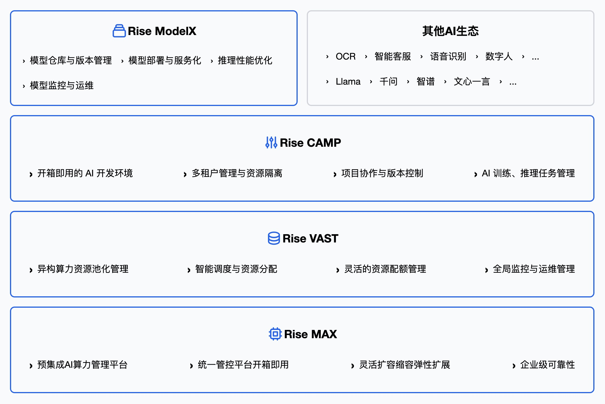

[English](./README.en.md) · [文章目录](../../README.md) · [官网阅读](https://www.theriseunion.com/zh/blog/riseunion-financing-news-2025.html)

# 睿思智联完成数千万元融资 - 加速引领AI基础设施智能化管理新范式

睿思智联 · 2025/07/28 08:00（北京时间）

睿思智联完成新一轮数千万元融资，梅花创投独家投资。专注AI基础设施智能化管理，提供异构算力调度、GPU虚拟化、多租户管理等企业级解决方案，助力构建高效智能算力底座。

近日，AI基础设施领域的创新企业 - 北京睿思智联科技有限公司（以下简称“**睿思智联**”）宣布完成**新一轮数千万元融资**，本轮融资由**梅花创投基金**独家投资。此次融资将进一步增强公司在**AI基础设施**赛道的研发投入与市场拓展，巩固其在国内“**软件定义算力**”方向的技术领先地位。

图片
在人工智能加速产业变革的时代背景下，睿思智联聚焦于**AI基础设施智能化管理**，为算力平台提供统一调度、智能运营和安全可控的解决方案。公司以自主可控的底层架构为基础，全面打通**异构芯片、任务调度、模型生命周期与多租户运营**，助力大型企业、科研机构等客户高效构建面向未来的智能算力底座。

与国际市场上备受关注的 Run:ai 和 CoreWeave 走在同一个赛道，睿思智联同样以**云原生算力调度**为核心，构建模型与任务高度一体化的编排系统，并提供平台级监控与治理能力 。不同的是，面对国内多样化的“异构芯片＋多租户”生态，睿思智联实现了**跨厂商、跨 GPU 型号**的统一纳管与弹性调度，并在策略隔离、边缘中心一体化、运营适配等方面提供了更贴合企业级需求的本地化方案，从而形成独特竞争优势。

## 聚焦AI Infra核心挑战，构建智能化算力管理平台
当前，大语言模型的爆发式发展推动了算力基础设施从“资源堆叠”向“精细化运营”的转变。尤其面向国产算力百花齐放的异构生态，睿思智联专注致力于解决异构算力透明化管理与调度的核心问题，构建了覆盖异构算力管理、模型生命周期管理、多租户自服务运营、调度优化与故障自愈等全链条能力的AI Infra平台，为客户打造“开箱即用、按需即调、智能运营、安全可控”的算力管理体验。

## 核心产品能力

- **异构算力统一调度**

支持异构算力芯片，包括英伟达、昇腾、昆仑芯、寒武纪等10+国内外芯片，构建统一抽象层，支持异构资源注册、适配与动态调度，便于构建跨芯片、多模型混布的智能体推理系统。

- **开发-推理-运营全周期管理闭环**

提供模型管理、推理日志、运行画像、任务失败恢复、资源碎片回收等完整生命周期运维工具，帮助企业更快、更稳地将AI模型从试验室推向实际应用，让部署更高效、运行更可靠。

- **多租户资源共享与策略隔离**

构建企业级自服务门户，面向大型组织提供灵活的权限体系和集成对接能力，支持租户级别的资源池划分、QoS 优先级控制、策略配额限制，确保多个团队在共用 GPU 的同时保持性能隔离，满足企业级SLM多租并发部署需求。同时内置计量与计费模块，助力客户进行资源可视化运营与算力成本核算。

- **任务与模型精细匹配调度**

具备大规模GPU集群调度能力，支持多区域、多类型、多集群GPU卡灵活按需分配，并通过“模型标识+请求特征”的联合调度逻辑，将请求自动路由至最匹配资源节点，兼顾响应时延与集群负载。

- **算力池化与切分**

支持逻辑算力资源池划分，支持显卡算力与显存双维度化整为零，提升资源利用效率，提高投入产出比。

- **中心-边缘一体化模型部署**

结合小模型“便于边缘部署”优势， 实现中心调度+边缘推理协同架构，支持模型镜像分发、远程加载与边缘节点运行态监控，适配工业、交通、金融等场景下的边缘智能体落地需求。

## 产业变革催生AI Infra新需求

AI大模型的发展正驱动着算力资源的指数级需求扩张。根据IDC预测，2025年全球AI算力市场规模将突破千亿美元，而中国市场的**异构算力管理需求**将迎来“*技术标准化 + 产品落地化*”的关键拐点。随着大模型训练成本飙升与模型推理实时化趋势显现，企业在算力基础设施方面面临多重挑战：一方面是异构资源带来的管理复杂性，另一方面是任务密集调度导致的利用率下降，以及算力服务体系化运营能力缺失。

在此背景下，睿思智联提出“**AI智算协同平台**”的理念，将AI基础设施平台从“资源供给者”升级为“**智能协同、精细调度**”的运营系统，承担起“**统一接管底层异构资源、向上支撑智能任务调度**”的承上启下角色，是AI基础设施智能化演进的核心枢纽。特别是在“**国产替代**”趋势加速、企业对成本与效率的双重诉求下，睿思智联的技术路线与商业逻辑得到了越来越多头部客户与投资机构的认可。

## 投资人视角
> 梅花创投**投资副总裁张驰**表示：“AI时代的根基是高效、可控的算力。我们看好睿思智联团队在AI基础设施领域的深度积累，特别是在异构调度、智能运维与企业级平台能力方面的实践，也相信其在算力国产化、AI基础设施智能化的趋势下，有望成为国内AI Infra领域的中坚力量。”

## 面向未来，打造下一代智能算力平台
睿思智联创始团队来自云计算与AI基础设施头部企业，具备丰富的算力调度平台研发与大规模AI加速卡系统运营经验。此次融资将主要用于三大方向：

* 持续打磨核心调度引擎，拓展对更多AI芯片、AI加速卡的支持；
* 推动模型服务、资源优化、数据治理模块的深度融合；
* 拓展金融、科研、能源、交通等行业客户，构建AI Infra生态闭环。

在未来AI技术演进与多模型并存的大趋势下，睿思智联将持续推进“**AI即服务**”范式落地，助力客户以更低成本、更高弹性、更强韧性应对智能化时代的算力挑战。

---

[在睿思智联官网阅读本文](https://www.theriseunion.com/zh/blog/riseunion-financing-news-2025.html) · [浏览更多文章](https://www.theriseunion.com/zh/blog.html)
