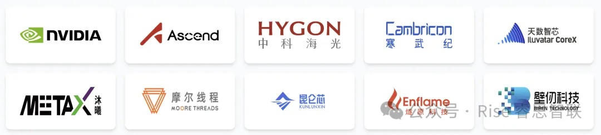
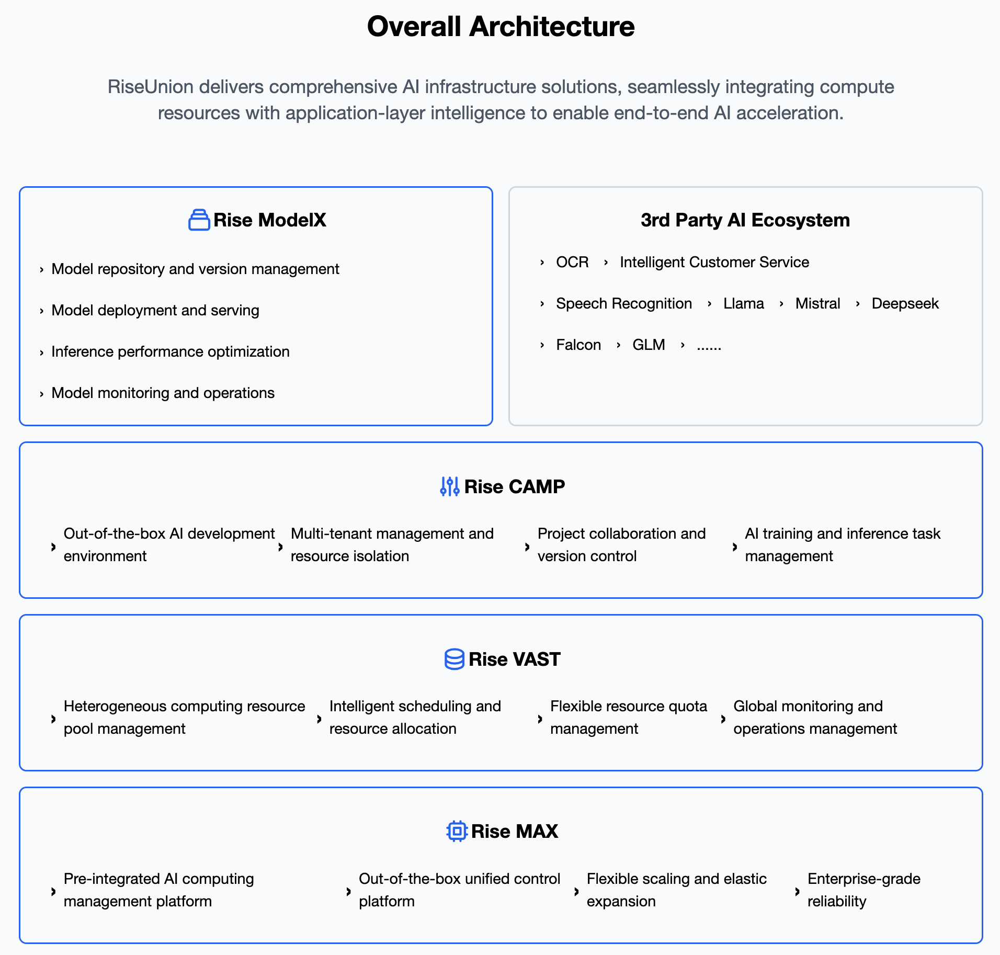

[简体中文](./README.md) · [All articles](../../README.en.md) · [Read on the website](https://www.theriseunion.com/en/blog/riseunion-flexai.html)

# When Compute Moves Beyond Brute Force: Multi-Chip Era

RiseUnion · January 01, 2025 at 08:00 (UTC+08:00)

Explore Flex:ai vs Run:ai and discover vendor-neutral Kubernetes GPU orchestration solutions. Learn how HAMi and RiseUnion enable heterogeneous AI compute management, multi-chip GPU scheduling, and improved GPU utilization in multi-vendor environments.

## Insight: When Compute Moves Beyond "Brute Force Growth"

Recently, Huawei officially open-sourced its AI container technology **Flex:ai**.

Just one year ago, NVIDIA acquired **Run:ai** for $700 million, signaling a major push into compute resource orchestration.

When two global compute giants—**NVIDIA and Huawei**—simultaneously invest heavily in **"compute partitioning" and "unified orchestration"**, a clear industry inflection point has emerged:

> The era of simply stockpiling GPUs for performance gains is over.

Today's competition is no longer about "who has more GPUs," but rather who can use each GPU more efficiently, orchestrate more precisely, and manage more transparently.

However, for enterprises in China, reality is far more complex than the technical blueprint.

**Real AI compute centers are a "multi-chip battlefield"**

Walk into a leading securities firm, large state-owned enterprise, or national supercomputing center, and you'll commonly find:

- **Legacy Infrastructure**: Large numbers of NVIDIA P100/T4/V100/A800 GPUs still running core business workloads;
- **Domestic Newcomers**: Huawei Ascend 910B2/B3/B4 deployed at scale in recent years;
- **Diverse Ecosystem**: Cambricon, Hygon DCU, Kunlunxin, Iluvatar, and other domestic accelerators rapidly coming online in newer racks.

This **highly heterogeneous environment with "multi-generational, multi-vendor, multi-architecture" coexistence** represents the true reality of China's AI infrastructure.

### Flex:ai's Open-Source Release: An Inevitable Vertical Ecosystem Move

Flex:ai claims compatibility with NVIDIA GPUs, which is undoubtedly a positive signal. It attempts to lower the migration barrier from CUDA to Ascend ecosystems through software-layer compatibility.

However, from an industry perspective, **any orchestration platform led by a hardware vendor naturally prioritizes its own chips**. This isn't a flaw, but an inevitable result of ecosystem positioning: vendor platforms' core mission is to maximize their own hardware's competitive moat.

Non-giant domestic chip vendors (such as Cambricon, Iluvatar, Muxi, Enflame, Moore Threads, etc.) often receive only "limited" support within giant ecosystems.

Yet, in today's multi-vendor compute landscape, enterprises truly need not another "optimizer within an ecosystem," but rather a **third-party platform that doesn't manufacture chips, doesn't take sides, and focuses solely on compute management:**

- It **doesn't care** whether the underlying hardware is Ascend or NVIDIA—only whether resources are efficiently utilized;
- It **doesn't bind** to any vendor's driver stack, but enables heterogeneous hardware to work together through abstraction layers;
- Its core KPI is **not** "how many cards were sold," but "how much has the enterprise's compute ROI improved."

This is not just a technical choice, but a **strategic balance between supply chain security and operational efficiency**. While hardware remains in a "Warring States" era, software must unify first.

## Kubernetes as Foundation, Orchestrator as "Brain"

Flex:ai's release once again confirms Kubernetes (K8s) as the **indisputable foundation for AI infrastructure**.

However, this doesn't mean native Kubernetes can directly handle AI compute management. On the contrary, there's a natural "mismatch" between native Kubernetes and AI workloads: it was designed for general-purpose computing, not optimized for expensive, scarce, high-throughput GPU/NPU resources.

This **"mismatch"** creates two core bottlenecks when native Kubernetes manages AI compute.

### Bottleneck One: Kubernetes' "Whole-Card Curse"

In standard Kubernetes scheduling logic, GPUs are treated as "extended resources" that can only be allocated as **entire cards**. This means:

- A Jupyter Notebook debugging task requiring only 2GB of memory monopolizes an entire 80GB A800;
- An Ascend 910B cannot simultaneously serve multiple small model inference requests;
- Once a task starts, the entire card is locked, even if actual utilization is below 10%.

This "one-size-fits-all" mechanism is the root cause of AI compute centers having **high allocation rates (>90%) but low utilization (<30%)**.

### Bottleneck Two: The Orchestrator "Doesn't Understand AI"

Native Kubernetes orchestrators only care about "whether nodes have idle resources," but AI workloads require far more from orchestration. A truly "AI-native" orchestrator must possess:

- **Topology Awareness**: Understanding NVLink/HCCS/XPULink interconnect topologies to double multi-card communication efficiency;
- **Priority Awareness**: Guaranteeing SLA for online inference and real-time agents, automatically yielding to offline training;
- **Resource Awareness**: Oversubscribing and multiplexing low-utilization resources to maximize idle compute;
- **Business Awareness**: Integrating enterprise organizational structure and quota management into orchestration logic.

**Native Kubernetes cannot provide these capabilities**, failing to meet the need for AI compute to be "managed like utilities."

## HAMi: The "Neutral" Plugin for Heterogeneous Orchestration

Behind Flex:ai and Run:ai, another technical path has been quietly growing in the open-source community: **[HAMi (Heterogeneous AI Computing Virtualization Middleware)](https://www.theriseunion.com/en/blog/project-hami.html)**.

HAMi: Open-source GPU virtualization solution for simpler AI compute management

HAMi originated from 4Paradigm's internal GPU virtualization project (k8s-vgpu-scheduler) in 2019, and was officially donated to the Cloud Native Computing Foundation (CNCF) in 2024, entering the Sandbox incubation stage. From its inception, HAMi's goal has been clear: build a **hardware vendor-agnostic** heterogeneous device management middleware on top of Kubernetes.

### Why Enterprises Need HAMi?

When AI compute centers simultaneously run NVIDIA, Ascend, Cambricon, Hygon, Kunlunxin, and over ten other chip types, enterprises face a real dilemma:

> The more diverse the hardware, the more fragmented the orchestration.

Building custom orchestration systems is costly and time-consuming; adopting a major vendor's solution may sacrifice orchestration potential for other vendors' hardware.

HAMi offers a third option:

- **Open-Source Neutrality**: Apache 2.0 license, community-driven, not aligned with any hardware vendor;
- **Broad Compatibility**: Currently covers NVIDIA, Ascend, Cambricon, Hygon, Kunlunxin, Iluvatar, Muxi, Moore Threads, and other mainstream chips.

### Flex:ai vs HAMi: Complementary, Not Opposing

- **Flex:ai is an "Ecosystem Enhancer"**: Led by Huawei, core goal is maximizing Ascend compute value; NVIDIA compatibility is an ecosystem expansion strategy; support depth for other domestic cards remains unclear;
- **HAMi is a "Universal Adapter"**: Community-driven, core goal is eliminating hardware differences, enabling Kubernetes to orchestrate any heterogeneous device without distinction.

For most enterprises in multi-chip environments, HAMi provides a safer starting point. Before hardware landscapes stabilize, use a neutral layer to stabilize orchestration fundamentals, avoiding premature binding to a single ecosystem.

## RiseUnion: From Open-Source Community to Enterprise AI Application Platform

HAMi proves the technical feasibility of "neutral orchestration," but enterprises truly need far more than "partitioning and orchestration." As AI applications grow increasingly complex—from large model inference and RAG systems to Autonomous Agent orchestration—enterprises urgently need a **"foundation for stable AI application operations"**:

>- Abstracting hardware differences downward,
>- Orchestrating optimal inference engines in the middle layer,
>- Supporting stable operations of next-generation AI applications like Agents upward.

As one of HAMi's core contributors, RiseUnion has built the Rise enterprise platform based on community practices: [Rise VAST (underlying virtualization engine)](https://www.theriseunion.com/en/product/vast.html), [Rise CAMP (middle-layer compute orchestration platform)](https://www.theriseunion.com/en/product/camp.html), and [Rise ModelX (upper-layer model serving platform)](https://www.theriseunion.com/en/product/modelx.html).

### Rise VAST: Making Domestic Chips "Usable and Usable Well"

Rise VAST deeply inherits HAMi's multi-vendor chip compatibility and **enhances orchestration depth for domestic cards**:

- **Dynamic Partitioning at Any Ratio**: Supports 1% granularity for compute and memory allocation; a single physical card can simultaneously serve dozens of tasks without plugin restart;
- **Memory Alignment and Isolation**: Automatically aligns requests and strictly isolates container memory for chips like Ascend and Kunlunxin with memory specification limits, preventing out-of-bounds crashes;
- **Oversubscription and Multiplexing**: Under isolation guarantees, resource allocation rates can exceed 100%, improving cluster utilization from 30–50% to 80–90%;
- **Automatic Fault Isolation**: Real-time monitoring of XID, ECC, and vendor error codes, automatically removing abnormal cards to ensure business continuity.

This is not just technical "compatibility," but **"true unlocking"** of domestic hardware potential.

### Rise CAMP: Transforming Compute from "Resource" to "Service"

Partitioning is just the beginning; operations are the endgame. Rise CAMP transforms virtualized compute into enterprise-manageable, measurable, auditable service units:

- **Unified Compute Orchestration**, whether the underlying interconnect is NVLink, HCCS, or XPU Link;
- **Multiple Intelligent Strategy Combinations**, guaranteeing SLA for high-priority tasks like agents and online inference while maximizing resource fragments for offline tasks;
- **FinOps Closed Loop**: Minute-level metering and billing, cost allocation by tenant/project/user dimensions, integrated with financial systems;

Enterprises now have the ability to manage GPU/NPU resources like cloud resources for the first time.

### Rise ModelX: Making Large Models Truly "Operational Assets"

As AI applications evolve from "calling a model" to "multi-model collaboration + Agent orchestration," enterprises need no longer training scripts, but **model serving capabilities**.

Rise ModelX builds on Rise CAMP, providing a runtime serving platform for large models:

- **Inference Acceleration**: Automatically adapts to inference engines like vLLM/SGLang/MindIE, finding optimal balance between throughput and latency;
- **Agent Foundation**: Provides stable API services, context persistence, and elastic scaling capabilities for agents;
- **Token-Level Billing**: Supports input/output token-based billing, realizing "models as assets, calls as value."

Through Rise ModelX, large models are no longer "one-time outputs," but **iterable, measurable, serviceable enterprise digital assets**.

### Neutrality: The Foundation of Enterprise Platforms

The premise enabling all these capabilities is RiseUnion's firm vendor-neutral stance:

- Not binding to a single vendor ecosystem, but collaborating with all;
- Goals focus on business value improvements like "how much has customer compute utilization improved" and "whether AI application delivery is stable."

In today's irreversible hardware fragmentation, this neutrality has evolved from a technical choice to a **strategic necessity** for enterprise AI infrastructure.

RiseUnion's positioning has been clear from the start. This choice is not a technical expediency, but a deep insight into industry fundamentals:

- **Open Collaboration**: We continuously collaborate deeply with major chip vendors to improve heterogeneous orchestration standards, ensuring openness and compatibility of underlying technology, and actively contribute back to the open-source community;
- **Precise Operations**: Transforming community best practices into enterprise products, through minute-level metering and billing, multi-dimensional cost allocation, and automated resource recycling, helping enterprises establish compute usage operations systems;
- **Business Enablement**: Our success metrics are directly tied to customer business outcomes. Customer success team KPIs are closely linked to customer compute utilization improvements, AI application delivery efficiency, and business innovation speed, ensuring technical investments translate into real business value.

> At a national supercomputing center, this philosophy delivered significant results: through precise compute orchestration and management, compute resources with 70% idle rates were efficiently reused, overall utilization increased 4x, saving tens of millions in annual hardware procurement costs.

> At a transportation state-owned enterprise, we helped the customer build a "compute-as-a-service" platform, enabling different departments to request, use, and release compute resources on demand. Results: resource allocation efficiency improved 70%, model training wait times shortened from 4 hours to 20 minutes, annual compute operations costs reduced by over 50%.

Value is not a slogan, but quantifiable business outcomes. As AI investments continue growing, enterprises need not just technical tools, but partners who deliver clear ROI. RiseUnion is committed to being such a partner:

> Making compute truly drive business innovation, not become a cost burden.

## Conclusion: Collaboration is the Optimal Solution in the Multi-Chip Era

As Flex:ai and Run:ai emerge, industry consensus is clear: **the second half of AI compute belongs to precise orchestration and efficient operations**.

However, under China's **"multi-chip battlefield"** reality, relying solely on a single vendor's orchestration solution cannot truly unlock the full potential of heterogeneous compute. Whether NVIDIA, Ascend, Cambricon, Hygon, or Kunlunxin, every domestic chip deserves equal orchestration, precise usage, and efficient collaboration.

This requires an **"open, neutral, extensible AI compute collaboration platform"** that doesn't replace any hardware, but enables all hardware to work together better; that doesn't bind to any ecosystem, but provides unified interfaces for all ecosystems.

**RiseUnion** firmly believes: **open source** is the best path to collaboration. We call on more chip vendors and software partners to embrace open-source technology, jointly improve heterogeneous orchestration standards, enabling domestic chips to deliver greater value on unified platforms.

Moving forward, RiseUnion will continue deepening the Rise enterprise platform while firmly contributing back to the HAMi community, promoting a **"open-source as foundation, commercial as application"** dual-drive model.

Our goal is not to become another orchestration plugin, but to **build a truly neutral, autonomous, controllable, extensible, operational AI compute collaboration foundation**—enabling every compute investment to translate into business innovation, ensuring AI applications run stably without excessive resource consumption, allowing technical teams to focus on creation rather than operations firefighting.

> The compute competition will ultimately be a competition of collaboration efficiency.

---

[Read this article on the RiseUnion website](https://www.theriseunion.com/en/blog/riseunion-flexai.html) · [Explore more articles](https://www.theriseunion.com/en/blog.html)
