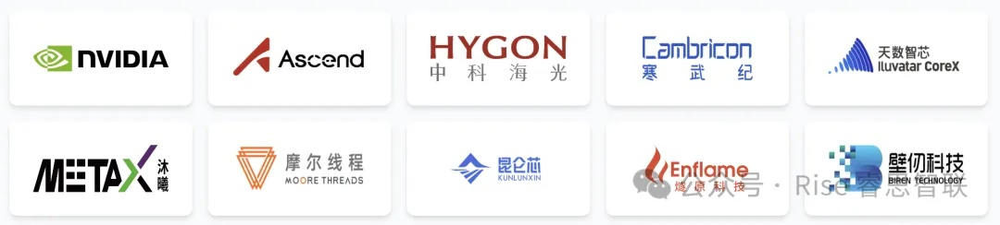
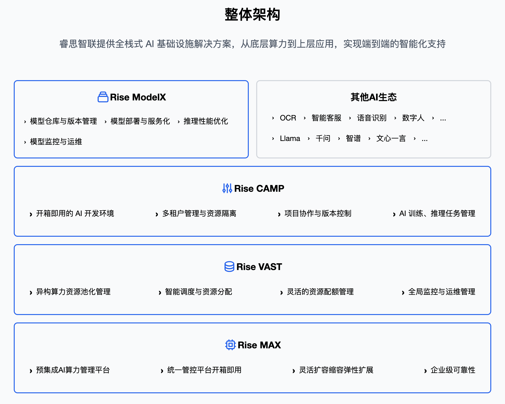

[English](./README.en.md) · [文章目录](../../README.md) · [官网阅读](https://www.theriseunion.com/zh/blog/riseunion-flexai.html)

# 当算力告别“野蛮生长”：多芯混战下的破局之道

睿思智联 · 2025/12/01 08:00（北京时间）

深度解析Flex:ai与Run:ai：探讨厂商中立的Kubernetes GPU调度方案。了解HAMi和睿思智联如何实现异构AI算力管理、多芯片GPU调度、GPU虚拟化切分，在NVIDIA、昇腾、寒武纪等多厂商环境中提升GPU利用率和算力ROI。

## 洞察：当算力告别“野蛮生长”

近期，华为正式开源 AI 容器技术 **Flex:ai**。

而就在一年前，英伟达以 7 亿美元收购 **Run:ai**，大举进军算力精细化管理领域。

当全球算力的两大巨头 - **英伟达与华为**，不约而同地开始在 **“算力切分”与“统一调度”** 上重金押注，一个积极且明确的 AI 行业分水岭已经出现：

> 单纯靠“囤卡”堆性能的草莽阶段已经过去。

当下的竞争，不再是“谁有更多卡”，而是谁能把每张卡“用得更细”、“调得更准”和“管得更清”。

但对中国的企业而言，现实远比技术蓝图复杂。

### 真实的智算中心，是一场“多芯混战”

走进一家头部券商、大型央企或国家级超算中心，更为常见的是：

- **存量主力**：依然是大量尚未淘汰、承载核心业务的 NVIDIA P100/T4/V100/A800；
- **国产新贵**：近年来大规模部署的 华为昇腾 910B2/B3/B4；
- **百花齐放**：更新的机架上，寒武纪、海光 DCU、昆仑芯、天数智芯等更多国产卡正在快速上线。

这种 **“多代际、多厂商、多架构”**并存的极度异构环境，才是中国 AI 基础设施的真实底色。

### Flex:ai 的开放，是纵向生态的必然

Flex:ai 宣称兼容 NVIDIA GPU，这无疑是积极信号，它试图通过软件层的兼容，降低客户从 CUDA 生态迁移到昇腾生态的门槛。

但从产业规律看，任何由硬件厂商主导的调度平台，其重心天然**向自家芯片倾斜**。这并非缺陷，而是生态定位的必然结果：厂商平台的核心使命，是最大化自有硬件的护城河。

而那些非巨头系的国产芯片（如 寒武纪、天数、沐曦、燧原、摩尔线程等），在巨头生态中往往只能获得“有限”的支持。

然而，在众多算力厂商共存的当下，企业真正需要的，不是一个又一个“生态内的优化器”，而是一个 **不造芯片、不站队、只做算力管理的第三方平台：**

- 它 **不关心** 底层是昇腾还是 NVIDIA，只关心资源是否被高效利用；
- 它 **不绑定** 任何厂商的驱动栈，而是通过抽象层让异构硬件协同工作；
- 它的核心 KPI **不是** “卖了多少卡”，而是“企业的算力 ROI 提升了多少”。

这不仅是技术选择，更是 **供应链安全与运营效率的战略平衡**。当硬件还在“战国七雄”时代，软件必须先行统一。

## K8s是底座，调度器是“大脑”

Flex:ai 的发布，再次印证了 Kubernetes（K8s）作为 **AI 基础设施底座** 的不可动摇地位。

但这并不意味着原生 K8s 就能直接胜任 AI 算力管理。恰恰相反，原生 K8s 与 AI 负载之间存在天然“错配”：它生来为通用计算设计，而非为昂贵、稀缺、高吞吐的 GPU/NPU 优化。

这种 **“错配”**，导致原生 K8s 在管理 AI 算力时存在两大核心瓶颈。

### 瓶颈一：K8s 的“整卡魔咒”

在标准 K8s 调度逻辑中，GPU 被视为“扩展资源”，只能按 **整卡** 分配。这意味着：

- 一个仅需 2GB 显存的 Jupyter Notebook 调试任务，会独占一张 80GB 的 A800；
- 一张昇腾 910B 无法同时服务多个小模型推理请求；
- 一旦任务启动，整张卡就被锁定，即使实际利用率不足 10%。

这种“一刀切”机制，是当前智算中心 **分配率高（>90%）但是使用率低（<30%）** 的根本原因。

### 瓶颈二：调度器“不懂 AI”

原生 K8s 调度器只关心“节点是否有空闲资源”，而 AI 任务对调度的要求远不止于此。一个真正“AI 原生”的调度器，必须具备：

- **拓扑感知**：理解 NVLink/HCCS/XPULink 等互联拓扑，让多卡通信效率翻倍；
- **优先级感知**：保障在线推理、实时 Agent 的 SLA，让离线训练自动让路；
- **资源感知**：对低利用率资源进行超分复用，压榨闲置算力；
- **业务感知**：将企业的组织架构、配额管理融入调度逻辑。

**这些能力，原生 K8s 均无法提供**，它无法满足 AI 算力“像管理水电一样管理算力”的需求。

## HAMi：异构调度的“中立”插件

在 Flex:ai 与 Run:ai 背后，另一条技术路径早已在开源社区悄然生长：[**HAMi**（Heterogeneous AI Computing Virtualization Middleware）](https://www.theriseunion.com/zh/blog/project-hami.html)。

HAMi：开源 GPU 虚拟化利器，让 AI 算力管理更简单

HAMi 起源于 2019 年第四范式的内部 GPU 虚拟化项目（k8s-vgpu-scheduler），2024 年正式捐赠给云原生计算基金会（CNCF），进入 Sandbox 孵化阶段。HAMi 自创建之初，目标就非常明确：在 Kubernetes 之上，构建一个 **不隶属于任何硬件厂商** 的异构设备管理中间件。

### 为什么企业需要 HAMi？

当智算中心同时运行 NVIDIA、昇腾、寒武纪、海光、昆仑芯等十余种芯片，企业面临一个现实困境：

> 硬件越多元，调度越分裂。

自研调度系统成本高、周期长；采用某家大厂方案，又可能牺牲其他厂商硬件的调度潜力。

HAMi 给出了第三个选择：

- **开源中立**：Apache 2.0 协议，由社区驱动，不为任何硬件厂商站台；
- **广泛兼容**：目前已覆盖 NVIDIA、昇腾、寒武纪、海光、昆仑芯、天数智芯、沐曦、摩尔线程等主流芯片。

### Flex:ai vs HAMi：互补而非对立

- **Flex:ai 是“生态增强器”**：由华为主导，核心目标是最大化昇腾算力价值，对 NVIDIA 的兼容是生态扩展策略，对其他国产卡的支持深度尚不明确；
- **HAMi 是“通用适配器”**：由社区驱动，核心目标是抹平硬件差异，让 K8s 能无差别地调度任何异构设备。

对多数处于多芯混战中的企业而言，HAMi 提供了更安全的起点，在硬件格局未定之前，先用一个中立层稳住调度基本盘，避免过早绑定单一生态。

## 睿思智联：从开源社区到企业级 AI 应用平台

HAMi 证明了“中立调度”的技术可行性，但企业真正需要的，远不止于“能切分、能调度”。在 AI 应用日益复杂的今天，从大模型推理、RAG 系统，到 Autonomous Agent 编排，企业亟需一个 **"让AI应用平稳运行的底座”**：

>- 向下屏蔽硬件差异，
>- 中层调度最优推理引擎，
>- 向上支撑 Agent 等新一代 AI 应用的稳定运行。

作为 HAMi 的核心贡献者之一，睿思智联基于社区实践，已经打造了 Rise 企业级平台：[Rise VAST（底层虚拟化引擎）](https://www.theriseunion.com/zh/product/vast.html)、[Rise CAMP（中层算力调度平台）](https://www.theriseunion.com/zh/product/camp.html)和 [Rise ModelX（上层模型服务平台）](https://www.theriseunion.com/zh/product/modelx.html)。

### Rise VAST：让国产芯片“用得起来、用得好”

Rise VAST 深度继承 HAMi 对多厂商芯片的兼容能力，并在此基础上 **增强国产卡的调度深度**：

- **任意比例动态切分**：支持 1% 级别的算力与显存分配，一张物理卡可同时服务数十个任务，无需重启插件；
- **显存对齐与隔离**：针对昇腾、昆仑芯等芯片的显存规格限制，自动对齐请求并严格隔离容器间显存，防止越界崩溃；
- **超分复用**：在保障隔离前提下，资源分配率可超 100%，将集群利用率从 30–50% 提升至 80–90%；
- **故障自动隔离**：实时监控 XID、ECC、厂商错误码，自动剔除异常卡，保障业务连续性。

这不仅是技术“兼容”，更是对国产硬件潜力的 **“真正释放”**。

### Rise CAMP：让算力从“资源”变成“服务”

切分只是起点，运营才是终局。Rise CAMP 将虚拟化算力转化为企业可管理、可计量、可审计的服务单元：

- **统一调度算力**，无论底层是 NVLink、HCCS 还是 XPU Link；
- **多种智能策略组合**，在保障 Agent、在线推理等高优任务 SLA 的同时，压榨离线任务的资源碎片；
- FinOps 闭环**：分钟级计量计费，按租户/项目/用户维度分摊成本，并与财务系统对接；

企业首次拥有了像管理云资源一样管理 GPU/NPU 的能力。

### Rise ModelX：让大模型真正成为“可运营资产”

当 AI 应用从“调用一个模型”演进为“多模型协同 + Agent 编排”，企业需要的不再是训练脚本，而是 **模型的服务化能力**。

### Rise ModelX 构建于 Rise CAMP 之上，面向大模型提供的运行态服务平台：

- **推理加速**：自动适配 vLLM/SGLang/MindIE 等推理引擎，在吞吐与延迟间寻找最优解；
- **Agent 底座**：为 Agent 提供稳定的 API 服务、上下文持久化与弹性扩缩容能力；
- **Token 级计费**：支持按 输入/输出 Token 计费，实现“模型即资产，调用即价值”。

通过 Rise ModelX，大模型不再是“一次性产出”，而是 **可迭代、可计量、可服务的企业数字资产**。

### 中立，是企业级平台的基石

这一切能力得以成立的前提，是睿思智联 坚定的厂商中立立场：

- 不绑定单一大厂生态，而是协同合作；
- 目标是“客户算力利用率提升了多少”、“AI 应用交付是否稳定”等业务价值的提升。

在硬件碎片化不可逆的今天，这种中立性，已从技术选择升维为企业 AI 基础设施的**战略必需品**。

睿思智联的定位从创立之初就很清晰，这一选择不是技术路线的权宜之计，而是对行业本质的深刻洞察：

- **开放协作**：我们持续与各大芯片厂商深度合作，共同完善异构调度标准，确保底层技术的开放性与兼容性，并积极回馈给开源社区；
- **精细运营**：将社区最佳实践转化为企业级产品，通过分钟级计量计费、多维度成本分摊、自动化资源回收，帮助企业建立算力使用运营体系；
- **业务赋能**：我们的成功标准与客户业务成果直接挂钩，客户成功团队的KPI与客户算力利用率提升、AI应用交付效率、业务创新速度紧密关联，确保技术投入转化为真实业务价值。

### 案例 1：
在某国家级超算中心，这一理念带来显著成效：通过精细化的算力调度与管理，原本闲置率高达 **70%** 的算力资源得以高效复用，整体利用率提升 **4 倍**，每年节省硬件采购成本 **数千万元**。

### 案例 2：
在某交通央企，我们帮助客户构建了"算力即服务"平台，让不同部门按需申请、使用和释放算力资源。结果：资源分配效率提升 **70%**，模型训练等待时间从 4小时 缩短至 **20分钟**，年度算力运营成本降低 **50%** 以上。

价值不是口号，而是可量化的业务成果。在AI投入持续增长的今天，企业需要的不仅是技术工具，更是能带来明确投资回报的合作伙伴。睿思智联致力于成为这样的伙伴：

> 让算力真正驱动业务创新，而非成为成本负担。

## 结语：协同是多芯时代的最优解

当 Flex:ai 与 Run:ai 相继登场，行业共识已然清晰：**AI 算力的下半场，属于精细化调度与高效运营**。

但在中国 **“多芯混战”** 的现实下，单靠某一家厂商的调度方案，难以真正释放异构算力的全部潜力。无论是 NVIDIA、昇腾，还是寒武纪、海光、昆仑芯，每一块国产芯片都值得被平等调度、被精细使用、被高效协同。

这需要一个 **“开放、中立、可扩展”的 AI 算力协同平台“**，它不替代任何硬件，而是让所有硬件更好地协同工作；它不绑定任何生态，而是为所有生态提供统一接口。

**睿思智联** 始终相信：**开源** 是实现协同的最佳路径。我们呼吁更多芯片厂商、软件伙伴拥抱开源技术，共同完善异构调度标准，让国产芯片在统一平台上发挥更大价值。

未来，睿思智联将继续深耕 Rise 企业级平台，同时坚定回馈 HAMi 社区，推动 **“开源为基、商业为用”** 的双轮驱动模式。

我们的目标不是成为又一个调度插件，而是 **构建一个真正中立、自主可控、可扩展、可运营的 AI 算力协同底座** - 让每一份算力投入都能转化为业务创新，让AI应用稳定运行而不过度消耗资源，让技术团队专注创造而非运维救火。

> 算力之争，终将是协同效率之争。

---

[在睿思智联官网阅读本文](https://www.theriseunion.com/zh/blog/riseunion-flexai.html) · [浏览更多文章](https://www.theriseunion.com/zh/blog.html)
