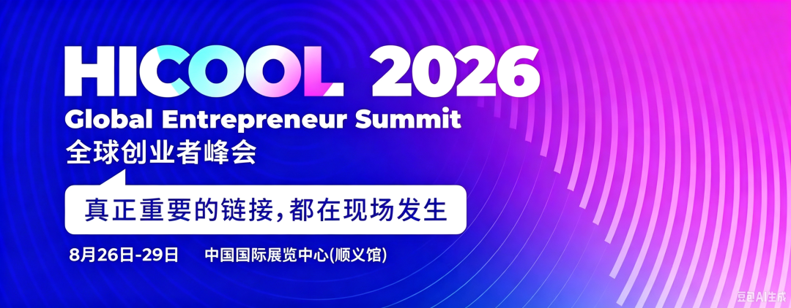
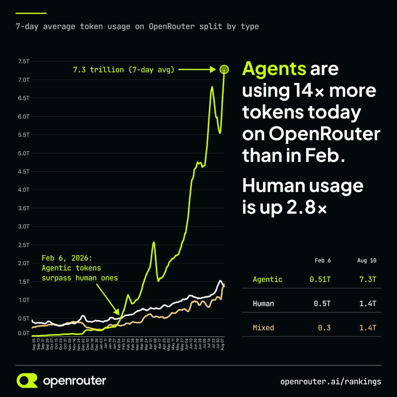
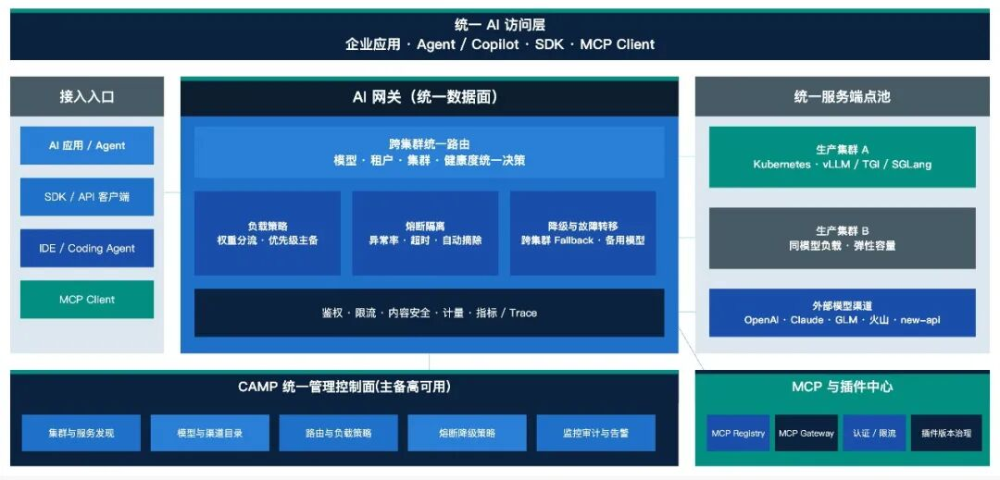
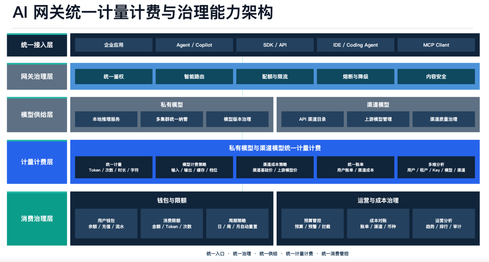
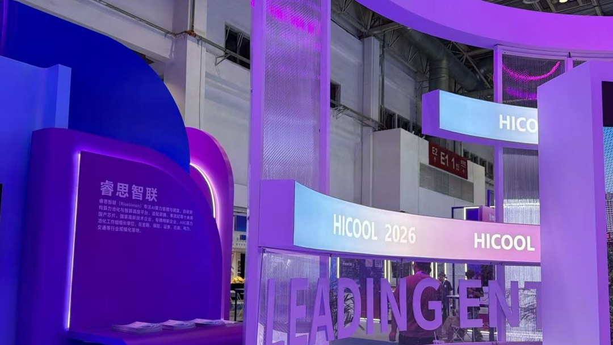

[简体中文](./README.md) · [All articles](../../README.en.md) · [Read on the website](https://www.theriseunion.com/en/blog/riseunion-hicool-2026-agentic-ai.html)

# Meet Us at HICOOL 2026 | RiseUnion Showcases at the Global Entrepreneur Summit to Explore New Opportunities in AI Computing

RiseUnion · August 27, 2026 at 16:50 (UTC+08:00) · [Original WeChat article (Chinese)](https://mp.weixin.qq.com/s/AVEHBKhDlACgOMvA4oC1_g)

At this year’s summit, RiseUnion is showcasing its end-to-end solution for Agentic AI—not a single-purpose tool or a prescription for how entrepreneurs should build Agents, but a support system connecting internal compute, external model services, and Token governance so every Agent can run affordably, reliably, transparently, and under control.

“

## I. A New Era Begins: Agents Are Becoming Models’ New Customers

On August 26, the HICOOL 2026 Global Entrepreneur Summit opened in Beijing under the theme “From the Source of Innovation to the Forefront of Industry.” Cutting-edge achievements in large models, intelligent agents, embodied intelligence, and other fields took center stage. Entrepreneurs, investment institutions, and industry partners from around the world came together to chart the next destination for artificial intelligence. RiseUnion joined peers from across the industry with its core AI computing products to discuss the future of the AI computing industry.

A clear trend is emerging: AI is moving from “answering” to “acting.”

In the past, people asked models questions and received one-off answers. Now, an Agent continuously plans around a goal, calls models, accesses data, uses tools, and may even break the work down into more subtasks. The users of model services are expanding from people to programs capable of operating autonomously.

According to OpenRouter data, since February 2026, Agentic Token consumption on the platform has grown from 0.51 trillion to 7.3 trillion—about 14 times its previous level. Over the same period, direct human Token usage grew by 2.8 times, and calls initiated by Agents have already surpassed direct human calls.

Similar changes are taking place within enterprises. A few months after one corporate group launched its internal AI store, more than 200 employees had already created over 550 Agents; Microsoft, meanwhile, has deployed more than 500,000 Agents internally. More and more companies are moving from “building as many Agents as possible” to determining which Agents genuinely create value and which merely continue to consume resources.

When a single business task triggers a chain of reasoning, tool calls, failed retries, and task decomposition, simply calculating “the cost of one call” no longer reflects the true cost. Enterprises also need to know how many model calls an Agent made to complete a task, how many Tokens it consumed, which resources it used, and what result it produced.

At this summit, RiseUnion is showcasing an end-to-end solution for Agentic AI. We aim to connect internal compute, external model services, and Token governance so that every Agent can run affordably, reliably, transparently, and under control.

## II. Rise’s End-to-End Solution for Agentic AI

-

### Turning Internal Compute into Reliable Capacity

Enterprise computing resources often come from different phases of infrastructure development and are distributed across different clusters and departments. Fragmented resources are not only prone to sitting idle; they can also undermine the stability of model services.

Rise brings computing resources of different brands and architectures under unified management, allocating them flexibly according to model characteristics, task requirements, and business priorities. This turns scattered resources into an integrated computing pool capable of providing continuous service.

In a project for a large state-owned bank, Rise brought more than 600 servers under unified management to build a heterogeneous computing resource pool, improving resource utilization by more than 50%. The same hardware investment can therefore support more models and business scenarios.

### Moving Models from “Demo-Ready” to “Production-Ready”

To complete a task, an Agent may use both internal models and multiple external models. The two forms of supply each provide value and require different approaches to management.

- Internal compute: Well suited to sensitive data, core operations, and stable long-term workloads, with a focus on improving resource utilization and ensuring the stability of model services.

- External channels: Able to supplement model capabilities and absorb traffic spikes, with a focus on managing channel quality, call costs, and data boundaries.

Early-stage startups do not need to commit to one path in advance. External services are usually more flexible when requirements change frequently. When workloads become stable, or when data security and long-term costs become the primary concerns, suitable models and tasks can be migrated in-house.

The decision should not be based on a fixed Token threshold. It should instead consider the actual cost of achieving a business outcome, traffic stability, cache hit rates, data boundaries, and the team’s operational capabilities.

Above both types of supply, Rise establishes a unified Token governance layer. Whether Tokens come from internal compute or external channels, their usage and ownership can be measured by department, project, application, and Agent, then incorporated into budget controls, cost analysis, and usage audits.

### Moving Beyond “Managing Identity” to “Managing Operations”

Identity and permissions determine whether an Agent “can use” a resource, but enterprises also need to know “how much it used.”

Agents can run for long periods, call models continuously, and repeatedly retry tasks. Even when every call complies with access controls, total consumption may still exceed expectations. Agent governance therefore also needs to cover the operational process: setting quotas and budgets, recording model calls, and issuing alerts, making adjustments, or stopping execution when usage is abnormal or costs approach their limits.

The way Agents are evaluated must change accordingly. In addition to the cost of a single call, enterprises should examine how much it costs to achieve a business outcome and how many model calls it takes.

The former measures value; the latter reveals waste.

## III. From “Stacking GPUs” to “Operating AI”

At the summit, the questions people care about are no longer limited to “how many GPUs do we have?” or “how large a model can we run?” The focus is now on how to truly operate internal compute, external model services, and ever-growing Token consumption.

These questions can be summarized as three ledgers:

- • **Identity and permissions:** Who is using the resources, and what can they access?

- • **Usage and operations:** What did an Agent call, how much did it consume, and does it need to be adjusted or stopped?

- • **Compute and channels:** Which businesses use internal compute, which call external services, and will capacity expansion or procurement be needed next?

Many enterprises already manage the first ledger and are beginning to plan the third, but they can easily overlook the operational process in between. Without real operational data, capacity planning can only rely on experience. Without constraints on Agent call behavior, even inexpensive resources can be consumed inefficiently.

This is the chain that Rise’s end-to-end solution aims to connect:

> Look upward to understand each Agent’s usage, cost, and boundaries; look downward to guide the selection, scheduling, and capacity planning of internal compute and external channels.

From heterogeneous computing and model services to governance of both internal and external Tokens, products including **Rise VAST, CAMP, ModelX, and Router** work together to provide users with one continuous Agentic AI operating experience.

“Operating AI” does not mean adding another management interface. It means using real usage data to connect Agent operations with resource supply, so that every use, every cost, and every business outcome can be accounted for.

## IV. Moving Forward with Global Entrepreneurs to Make Intelligence Happen

> “The value of computing power lies not in piling it up, but in awakening it. The value of AI infrastructure is not merely to get models running, but to keep intelligent agents operating over the long term—stably and under control.” — RiseUnion

In the Agentic AI era, Rise will continue to connect internal compute, external model services, and Token governance: enabling heterogeneous computing resources to work together efficiently, allowing internal and external supply to each serve the right workloads, ensuring that every Token consumed has a source and an owner, and making every Agent’s operation traceable and bounded.

Let entrepreneurs devote more of their energy to products, users, and innovation, while infrastructure becomes a support for innovation instead of a burden.

 

### About RiseUnion

Beijing RiseUnion Technology Co., Ltd. focuses on AI computing management and scheduling. It has completed compatibility certifications for more than 10 domestic chips and is one of the core contributors to the CNCF Sandbox open-source project HAMi. The company is a National High-Tech Enterprise, a Beijing Specialized, Sophisticated, Distinctive, and Innovative SME, and the leader of the AIIC Computing Pooling Working Group. It has delivered large-scale production deployments in finance, government and enterprise, telecommunications, transportation, healthcare, and other industries.

RiseUnion is committed to making computing power as readily available as water and electricity, building an intelligent, controllable, and efficient computing foundation for enterprise AI transformation.

For more information, visit **riseunion.ai** or contact us at **400-605-2336**.

---

[Read this article on the RiseUnion website](https://www.theriseunion.com/en/blog/riseunion-hicool-2026-agentic-ai.html) · [Explore more articles](https://www.theriseunion.com/en/blog.html)
