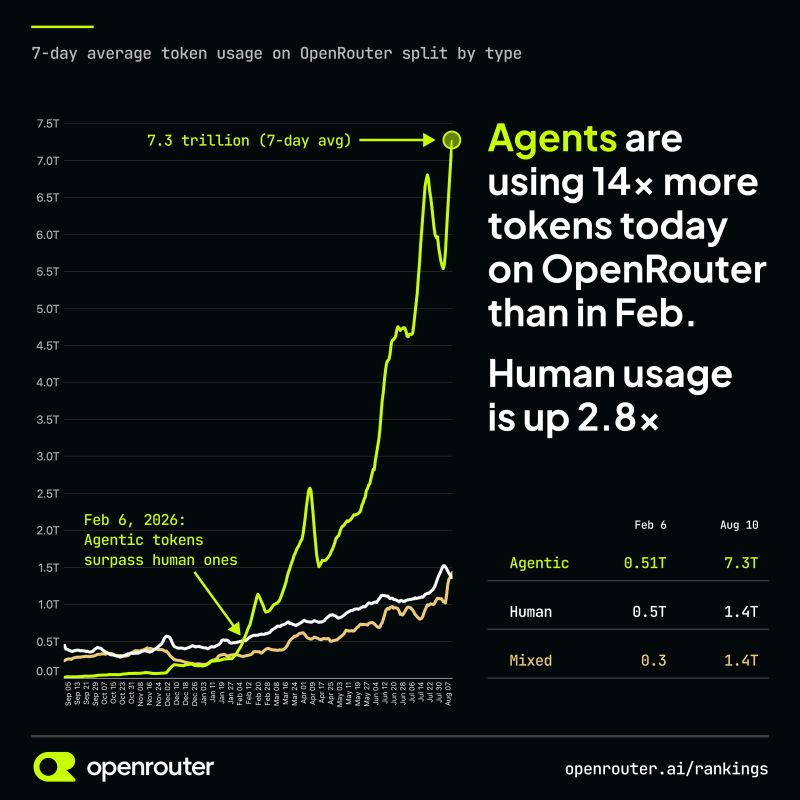
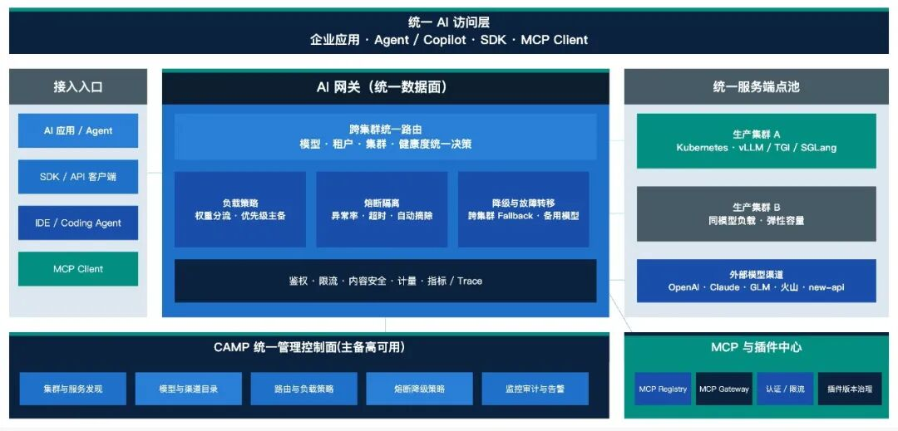
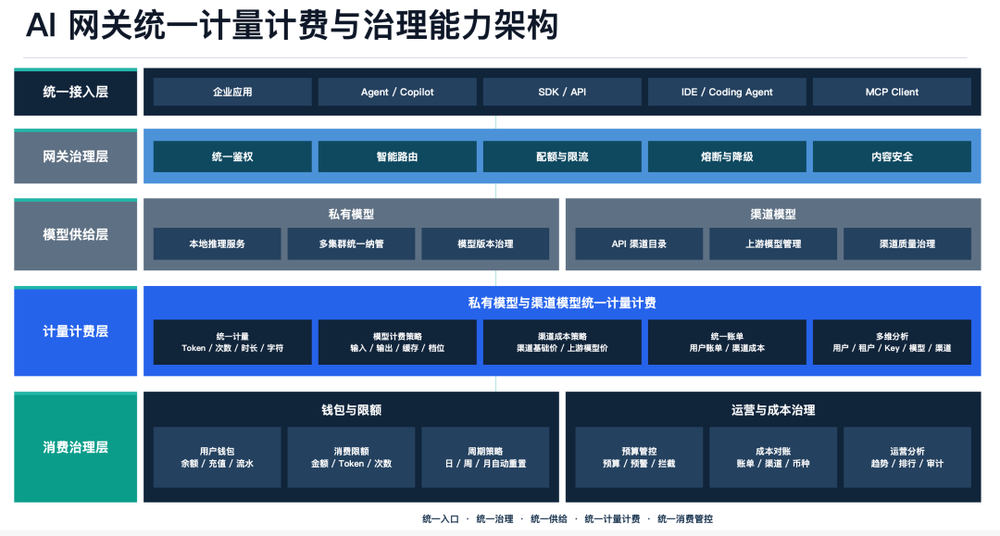
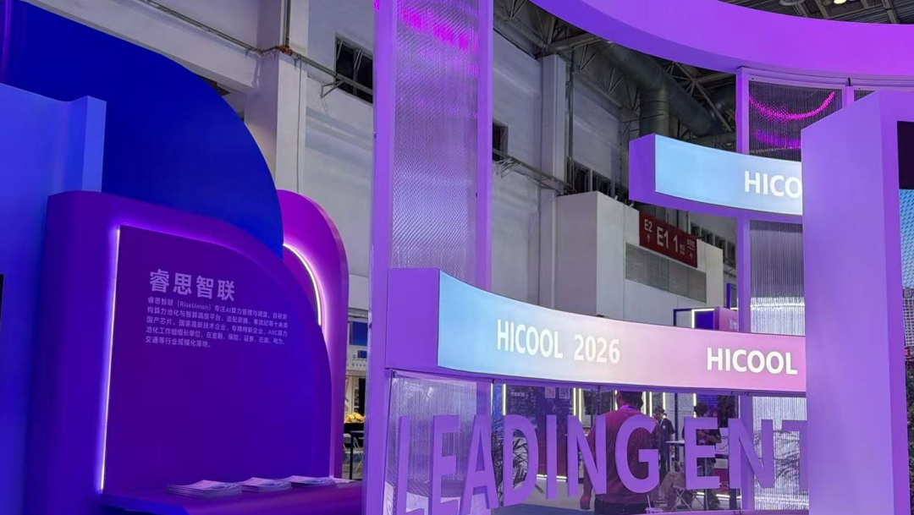

[English](./README.en.md) · [文章目录](../../README.md) · [官网阅读](https://www.theriseunion.com/zh/blog/riseunion-hicool-2026-agentic-ai.html)

# 相约 HICOOL 2026 | 睿思智联亮相全球创业者大会，共探AI算力产业新机遇

睿思智联 · 2026/08/27 16:50（北京时间） · [微信公众号原文](https://mp.weixin.qq.com/s/AVEHBKhDlACgOMvA4oC1_g)

本届峰会，睿思智联携面向 Agentic AI 的整体解决方案亮相。我们带来的不是某一个单点工具，也不是替创业者定义 Agent 应该怎么做，而是一套连接内部算力、外部模型服务与 Token 治理的支撑体系，让每一个 Agent 都能 “跑得起、跑得稳、算得清、管得住”。

“

## 一、盛会启幕：Agent 正在成为模型的新客户

8 月 26 日，以“从创新源头到产业潮头”为主题的 **HICOOL 2026 全球创业者峰会** 在北京开幕。大模型、智能体、具身智能等前沿成果集中亮相，来自全球的创业者、投资机构与产业伙伴，共同描绘人工智能的下一站。睿思智联携AI算力核心产品与各界同仁相聚盛会，共话人工智能算力产业发展新未来。

一个清晰的趋势正在形成：AI 正从“会回答”走向“会行动”。

过去，人向模型提出问题，获得一次回答。现在，Agent 会围绕一个目标持续规划、调用模型、访问数据、使用工具，甚至拆解出更多子任务。模型服务的使用者，正在从人扩展到能够自主运行的程序。

据 OpenRouter 的数据称，自 2026 年 2 月以来，平台上的 Agentic Token 消耗量从 0.51 万亿增长至 7.3 万亿，约为原来的 14 倍；同期人类直接使用的 Token 增长了 2.8 倍，Agent 发起的调用已经超过人类直接调用。

企业内部也在经历类似变化。某集团公司内部的 AI 商店上线数月后，200 多名员工已经创建了 550 多个 Agent；微软内部部署的 Agent 数量则超过 50 万个。越来越多企业开始从“尽可能多地构建 Agent”，转向盘点哪些 Agent 真正创造价值、哪些只是在持续消耗资源。

当一次业务任务背后变成一连串推理、工具调用、失败重试与任务拆解，仅仅计算“调用一次多少钱”，已经无法反映真实成本。企业还需要知道：Agent 完成一项任务调用了多少次模型、消耗了多少 Token、使用了哪些资源，又带来了什么结果。

本届峰会，睿思智联携面向 Agentic AI 的整体解决方案亮相。我们希望连接内部算力、外部模型服务与 Token 治理，让每一个 Agent 都能跑得起、跑得稳、算得清、管得住。

## 二、Rise 面向 Agentic AI 的整体解法

-

### 让内部算力成为可靠产能

企业的算力资源往往来自不同建设阶段，分布在不同集群和部门。资源彼此割裂，不仅容易闲置，也会影响模型服务的稳定性。

Rise 将不同品牌、不同架构的算力统一管理，根据模型特点、任务需求和业务优先级灵活分配，让分散资源形成可以持续提供服务的整体算力池。

在某国有大型银行项目中，Rise 统一纳管 600 余台服务器，构建异构算力资源池，资源利用率提升 50% 以上。同样的硬件投入，由此可以支撑更多模型和业务场景。

### 让模型从“演示可用”走向“长期可用”

一个 Agent 完成任务，可能同时使用内部模型和多个外部模型。两类供给各有价值，也需要采用不同的管理方式。

- 内部算力：适合承载敏感数据、核心业务和长期稳定的负载，重点是提高资源利用率、保障模型服务稳定。

- 外部渠道：可以补充模型能力、承接突发流量，重点是管理渠道质量、调用成本与数据边界。

早期创业团队不必预先押注某一条路线。需求多变时，外部服务通常更加灵活；当负载趋于稳定，或者数据安全与长期成本成为主要问题时，再将适合的模型和任务迁入内部。

判断依据不应是固定的 Token 阈值，而应是完成一项业务结果的实际成本、流量稳定性、缓存命中率、数据边界和团队运维能力。

在两类供给之上，Rise 建立统一的 Token 治理层。无论 Token 来自内部算力还是外部渠道，都可以按部门、项目、应用和 Agent 进行计量与归属，并纳入预算控制、成本分析和使用审计。

### 从“管身份”进一步走向“管运行”

身份与权限解决的是 Agent “能不能用”，但企业还需要知道它“用了多少”。

Agent 可以长时间运行、连续调用模型、反复重试任务。即使每次调用都符合权限要求，最终消耗仍可能超出预期。因此，Agent 治理还需要覆盖运行过程：设置额度和预算，记录模型调用，在用量异常或费用接近上限时及时预警、调整或中止。

衡量 Agent 的方式也应随之改变。企业除了关注单次调用成本，更要看完成一项业务结果花了多少钱、调用了多少次模型。

前者衡量价值，后者发现浪费。

## 三、从“堆卡”到“运营 AI”

峰会现场，大家关注的问题已经不再只是“有多少张卡”、“能跑多大的模型”，而是如何把内部算力、外部模型服务和持续增长的 Token 消耗真正运营起来。

这些问题可以归结为三本账：

- • **身份与权限账：** 谁在使用，可以访问什么。

- • **用量与运行账：** Agent 调用了什么、消耗了多少，是否需要调整或中止。

- • **算力与渠道账：** 哪些业务使用内部算力，哪些调用外部服务，下一步是否需要扩容或采购。

很多企业已经在管理第一本账，也开始规划第三本账，却容易忽略中间的运行过程。但没有真实的运行数据，容量规划只能依靠经验；没有对 Agent 调用行为的约束，再便宜的资源也可能被低效消耗。

这正是 Rise 整体解决方案希望打通的链路：

> 向上看清每个 Agent 的使用、成本与边界，向下指导内部算力和外部渠道的选择、调度与容量规划。

从异构算力、模型服务到内外 Token 治理，**Rise VAST、CAMP、ModelX 与 Router** 等产品协同支撑，对使用者呈现为一套连续的 Agentic AI 运行体验。

“运营 AI”不是增加一套管理界面，而是用真实的使用数据连接 Agent 运行与资源供给，让每一次使用、每一笔成本和每一个业务结果都能对应起来。

## 四、与全球创业者同行，让智能真正发生

> “算力的价值，不在于堆砌，而在于唤醒；AI 基础设施的价值，也不只是让模型跑起来，更要让智能体长期、稳定、可控地运行” - 睿思智联。

面向 Agentic AI 时代，Rise 将继续连接内部算力、外部模型服务与 Token 治理：让异构算力高效协同，让内外两类供给各得其所，让每一次 Token 消耗都有来源、有归属，让每一个 Agent 的运行过程有据可查、有界可控。

让创业者把更多精力留给产品、用户和创新，让基础设施成为创新的支撑，而不是负担。

 

### 关于睿思智联

北京睿思智联科技有限公司（RiseUnion）专注于AI 算力管理与调度，已完成 10+ 国产芯片兼容认证，是 CNCF Sandbox 开源项目 HAMi 的核心贡献者之一。公司是国家高新技术企业、北京市专精特新中小企业、AIIC 算力池化工作组组长单位，在金融、政企、通信、交通、医疗等行业实现大规模生产级落地。

睿思智联致力于让算力像水电一样随取随用，为企业 AI 转型构建智能、可控、高效的算力底座。

了解更多详细信息，欢迎访问官网：**riseunion.ai** 或联系：**400-605-2336**。

---

[在睿思智联官网阅读本文](https://www.theriseunion.com/zh/blog/riseunion-hicool-2026-agentic-ai.html) · [浏览更多文章](https://www.theriseunion.com/zh/blog.html)
