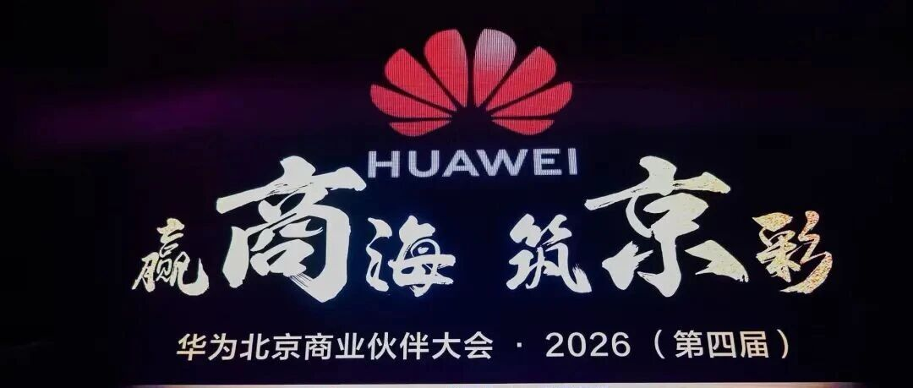
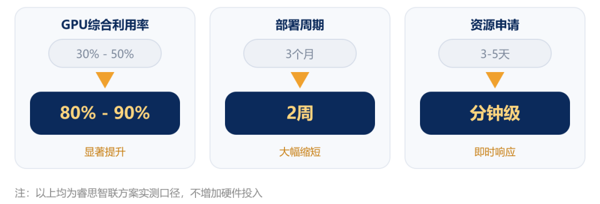
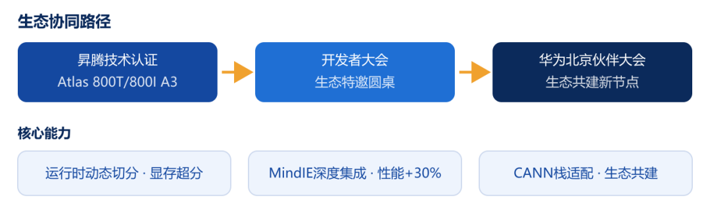
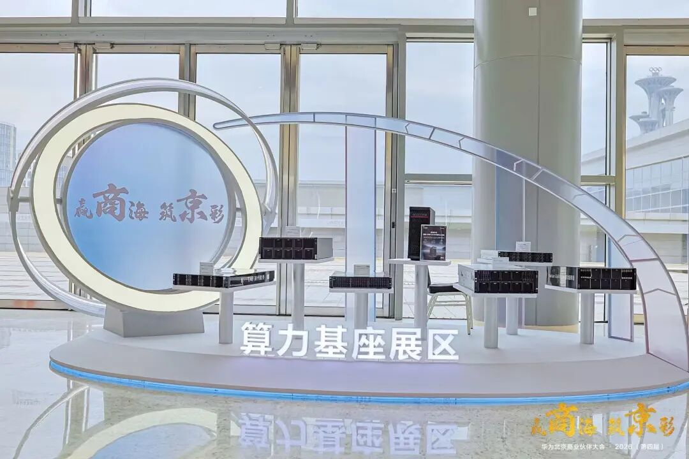

[简体中文](./README.md) · [All articles](../../README.en.md) · [Read on the website](https://www.theriseunion.com/en/blog/riseunion-huawei-beijing-business-partner-conference-2026.html)

# Win the Market, Build Beijing’s Brilliance | RiseUnion and Huawei Join Forces to Shape a New Model for Beijing’s Digital Intelligence Ecosystem

RiseUnion · September 07, 2026 at 10:00 (UTC+08:00) · [Original WeChat article (Chinese)](https://mp.weixin.qq.com/s/s8l-Jv6-3NdG0Dk_tBrDMw)

Recently, RiseUnion has appeared in succession on several major industry stages.

> “
>
> Recently, RiseUnion has appeared in succession on several major industry stages. At the 2026 China International Big Data Industry Expo, the company officially joined the National Integrated Computing Power Network Monitoring, Scheduling, Testing and Verification Platform; at the same time, the company appeared at the 2026 Huawei Beijing Business Partner Conference, joining industry partners to explore innovative paths for AI computing infrastructure development.

## Technical Strength: The Hard Skills Behind Compute Scheduling

**On the technology front**, earlier this year, the Rise VAST AI Computing Management Platform passed Huawei Atlas 800T/800I A3 technical certification based on Ascend 910C, becoming one of the few domestic vendors capable of **runtime dynamic partitioning and memory overcommitment** on the 910C—raising compute utilization from 30% to over 80% with zero downtime throughout. After deep integration with the MindIE inference acceleration engine, inference performance improved by an additional 30%, while model deployment time was compressed from days to hours.

It serves benchmark customers including **BYD, Huatai Futures, and the National Supercomputing Center in Jinan**, with large-scale deployments across finance, government and enterprise, supercomputing, education, healthcare, and other sectors.

Ecosystem Collaboration: A Two-Way Commitment with Huawei’s Ecosystem

**On the ecosystem front**, RiseUnion continues to optimize adaptation around Ascend Atlas servers and the CANN software stack: at the 2026 Kunpeng Ascend Developer Conference, it participated as an invited ecosystem partner in the “Ascend Ecosystem Partner Developers” roundtable, discussing developer community building; at the Huawei Beijing Business Partner Conference, it again took the stage and explored new opportunities in Beijing’s computing power market with industry partners.

## Conclusion

From Ascend certification to the partner conference, collaboration between RiseUnion and Huawei’s ecosystem is moving from “point-to-point adaptation” to “systematic co-development.” RiseUnion will continue to focus on AI computing management and scheduling and work with Huawei and its wider ecosystem of partners to make computing power as readily available as water and electricity.

### About RiseUnion

Beijing RiseUnion Technology Co., Ltd. focuses on AI computing management and scheduling. It has completed compatibility certification for more than 10 domestic chips and is one of the core contributors to the CNCF Sandbox open-source project HAMi. The company is a National High-Tech Enterprise, a Beijing Specialized, Sophisticated, Distinctive, and Innovative SME, and the leader of the AIIC Computing Pooling Working Group. It has delivered large-scale production deployments in finance, government, enterprise and defense, transportation, healthcare, and other industries.

RiseUnion is committed to making computing power as readily available as water and electricity, building an intelligent, controllable, and efficient computing foundation for enterprise AI transformation.

For more information, visit **riseunion.ai** or contact us at **400-605-2336**.

---

[Read this article on the RiseUnion website](https://www.theriseunion.com/en/blog/riseunion-huawei-beijing-business-partner-conference-2026.html) · [Explore more articles](https://www.theriseunion.com/en/blog.html)
