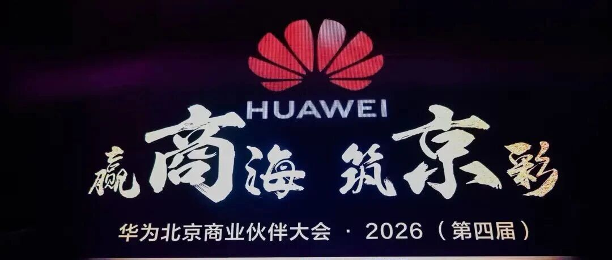
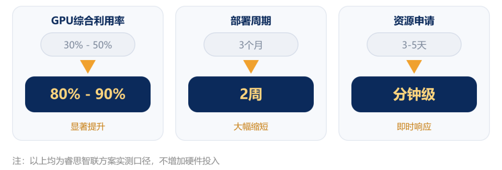
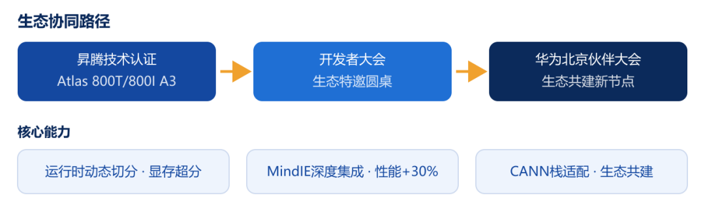
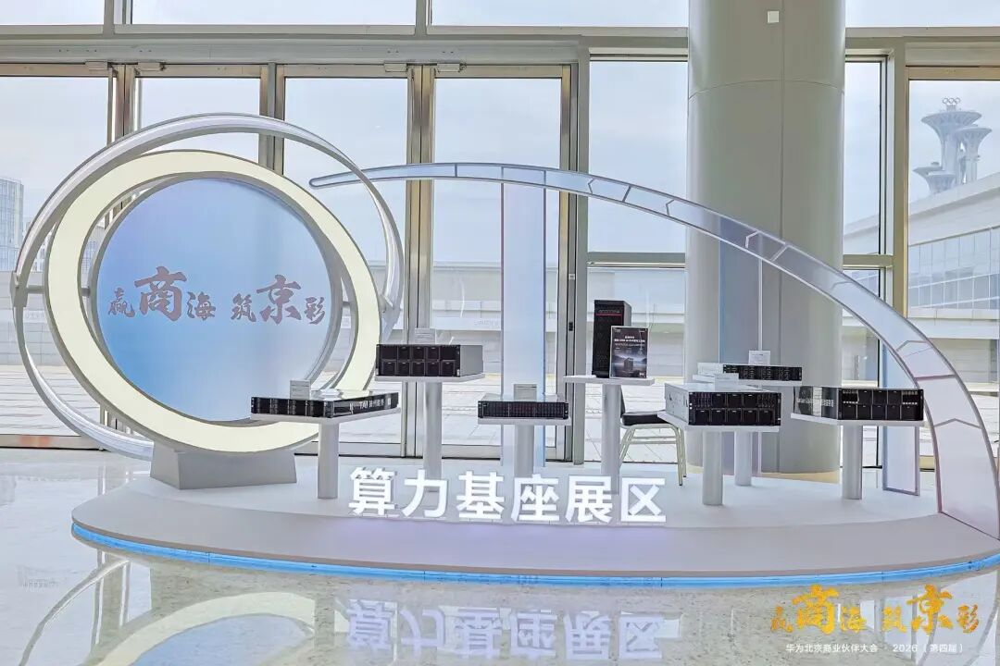

[English](./README.en.md) · [文章目录](../../README.md) · [官网阅读](https://www.theriseunion.com/zh/blog/riseunion-huawei-beijing-business-partner-conference-2026.html)

# 赢商海 筑京彩 | 睿思智联与华为，聚力打造京地数智生态新范

睿思智联 · 2026/09/07 10:00（北京时间） · [微信公众号原文](https://mp.weixin.qq.com/s/s8l-Jv6-3NdG0Dk_tBrDMw)

近期，睿思智联接连登上多个行业重要舞台。

> “
>
> 近期，睿思智联接连登上多个行业重要舞台。在 2026 中国国际大数据产业博览会上，公司正式入驻全国一体化算力网监测调度试验验证平台；与此同时，公司亮相 2026 华为北京商业伙伴大会，与产业伙伴共探 AI 算力基础设施创新发展路。

##  技术实力：算力调度的硬功夫  

**技术层面**，年初Rise VAST AI算力管理平台通过基于昇腾910C的华为Atlas 800T/800I A3技术认证，成为国内少数能在910C上实现**运行时动态切分与显存超分**的厂商——算力利用率从30%拉升至80%+、全程零停机；深度集成MindIE推理加速引擎后，推理性能额外提升30%，模型上线周期从数天压缩至数小时。

服务**比亚迪、华泰期货、国家超算济南中心**等标杆客户，在金融、政企、超算、教育、医疗等行业大规模落地。

 生态协同：与华为生态的双向奔赴

**生态层面**，睿思智联持续围绕昇腾Atlas服务器、CANN软件栈开展适配优化：在2026鲲鹏昇腾开发者大会上以生态特邀伙伴身份参与"昇腾生态伙伴开发者"圆桌会，共议开发者社区建设；在华为北京商业伙伴大会上再度亮相，与行业伙伴共探首都算力市场新机遇。

## 结   语

从昇腾认证到伙伴大会，睿思智联与华为生态的协同正从"单点适配"走向"体系化共建"。睿思智联将继续深耕AI算力管理与调度，携手华为及广大生态伙伴，让算力像水电一样随取随用。

### 关于睿思智联

北京睿思智联科技有限公司（RiseUnion）专注于AI 算力管理与调度，已完成 10+ 国产芯片兼容认证，是 CNCF Sandbox 开源项目 HAMi 的核心贡献者之一。公司是国家高新技术企业、北京市专精特新中小企业、AIIC 算力池化工作组组长单位，在金融、政企军工、交通、医疗等行业实现大规模生产级落地。

睿思智联致力于让算力像水电一样随取随用，为企业 AI 转型构建智能、可控、高效的算力底座。

了解更多详细信息，欢迎访问官网：**riseunion.ai** 或联系：**400-605-2336**。

---

[在睿思智联官网阅读本文](https://www.theriseunion.com/zh/blog/riseunion-huawei-beijing-business-partner-conference-2026.html) · [浏览更多文章](https://www.theriseunion.com/zh/blog.html)
