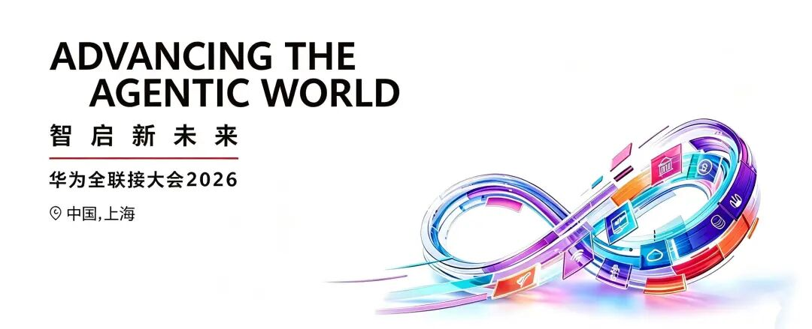
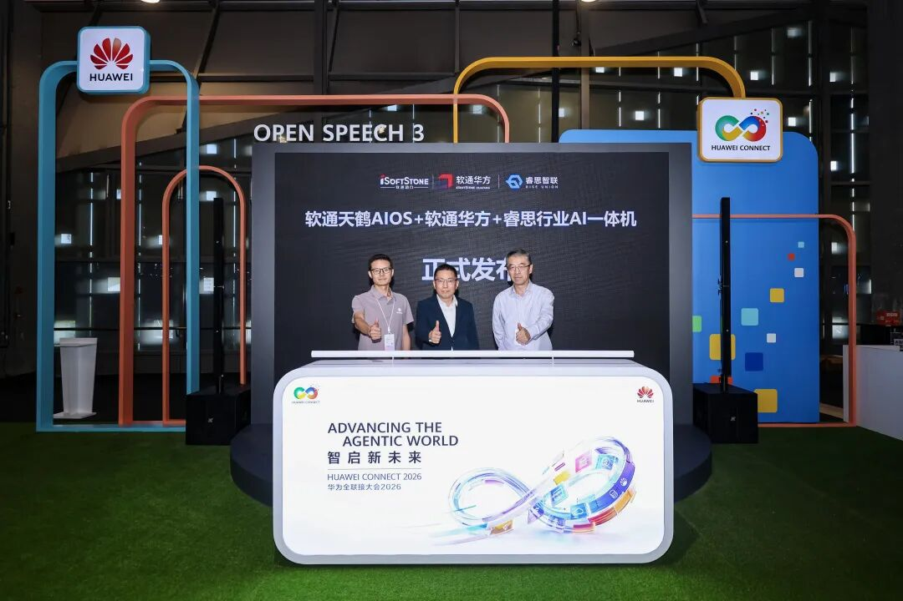

[简体中文](./README.md) · [All articles](../../README.en.md) · [Read on the website](https://www.theriseunion.com/en/blog/riseunion-huawei-connect-2026.html)

# RiseUnion at HUAWEI CONNECT 2026

RiseUnion · September 20, 2026 at 10:00 (UTC+08:00) · [Original WeChat article (Chinese)](https://mp.weixin.qq.com/s/b1JX5e7n7PfCjkOuhw9lqg)

RiseUnion joined HUAWEI CONNECT 2026 and launched an industry AI appliance together with iSoftStone.

On September 17, **HUAWEI CONNECT 2026** opened at the Shanghai World Expo Center. As an important partner in Huawei's ecosystem, **RiseUnion was invited to attend**, joining industry leaders and technical experts from around the world to explore new paths toward intelligent transformation.

01

## Appearing on the Huangpu River: Joining HUAWEI CONNECT

At the conference, RiseUnion and iSoftStone jointly launched the **RiseUnion Industry AI Appliance**, combining iSoftStone Huafang's domestic computing hardware, an openEuler-native AI operating system (iSoftStone Tianhe AIOS), and RiseUnion's industry-grade compute scheduling platform. It brings industries an **out-of-the-box, privately deployed, full-stack Agent solution**. Li Chengpeng, senior technical director of iSoftStone's Euler ecosystem; Shen Ou, COO of RiseUnion; and Chu Ming, head of iSoftStone's Computing Products and Solutions Center, attended the joint launch.

From left: Li Chengpeng of iSoftStone, Shen Ou of RiseUnion, and Chu Ming of iSoftStone

02

## A Three-Layer Core That Addresses Compute Challenges

In this appliance, iSoftStone Huafang hardware and Tianhe AIOS form the "body," while **RiseUnion's scheduling platform serves as the "brain."** Its scheduling core consists of internally developed RiseVAST, RiseCAMP and RiseRouter, directly addressing four industry challenges: low compute utilization, high inference latency, missing Token governance and difficult heterogeneous resource management:

Integrated compute

Dynamic GPU memory partitioning and oversubscription enabled a joint-stock bank to deploy 16 business models on an eight-card node, raising compute utilization from 30–50% to **80–90%**.

Industrialized model operations

Multiple models coexist on the same machine and switch instantly without waiting. Topology-aware and priority-based scheduling keep high-priority applications such as financial risk control running reliably.

Token as a service

An AI gateway provides unified access to internal and external models, bringing key management, metering, auditing and intelligent routing together in one place.

The solution is already running reliably in **production environments across banking, securities, energy, manufacturing and education**, demonstrating its feasibility in industries with demanding compliance requirements.

03

## Growing Together: Ecosystem Collaboration and Independent Control

RiseUnion has passed **Huawei Ascend technical certification** and supports Ascend and other domestic compute platforms in depth. This collaboration with iSoftStone Huafang and Tianhe AIOS connects the complete chain from domestic chips and an AI-native operating system to the compute scheduling platform, achieving **independent control across the entire stack**.

RiseUnion looks forward to working with Huawei and ecosystem partners\
to bring industry Agents into business production\
and accelerate intelligent transformation across industries

### About RiseUnion

Beijing RiseUnion Technology Co., Ltd. (RiseUnion) focuses on AI compute management and scheduling. It has completed compatibility certifications with more than 10 domestic chip platforms and is a core contributor to HAMi, a CNCF Sandbox open-source project. A National High-Tech Enterprise, a Beijing specialized and innovative SME, and chair of the AIIC Compute Pooling Working Group, the company has achieved large-scale production deployments across finance, government and enterprise, defense, transportation and healthcare.

RiseUnion is committed to making compute as readily available as water and electricity, building an intelligent, controllable and efficient computing foundation for enterprise AI transformation.

---

[Read this article on the RiseUnion website](https://www.theriseunion.com/en/blog/riseunion-huawei-connect-2026.html) · [Explore more articles](https://www.theriseunion.com/en/blog.html)
