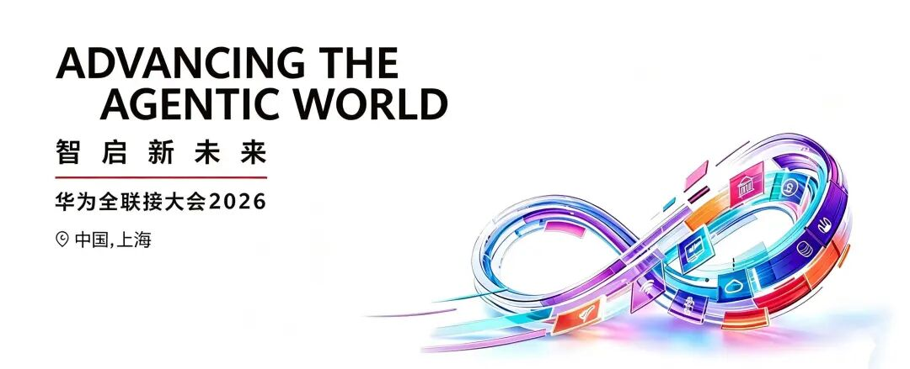
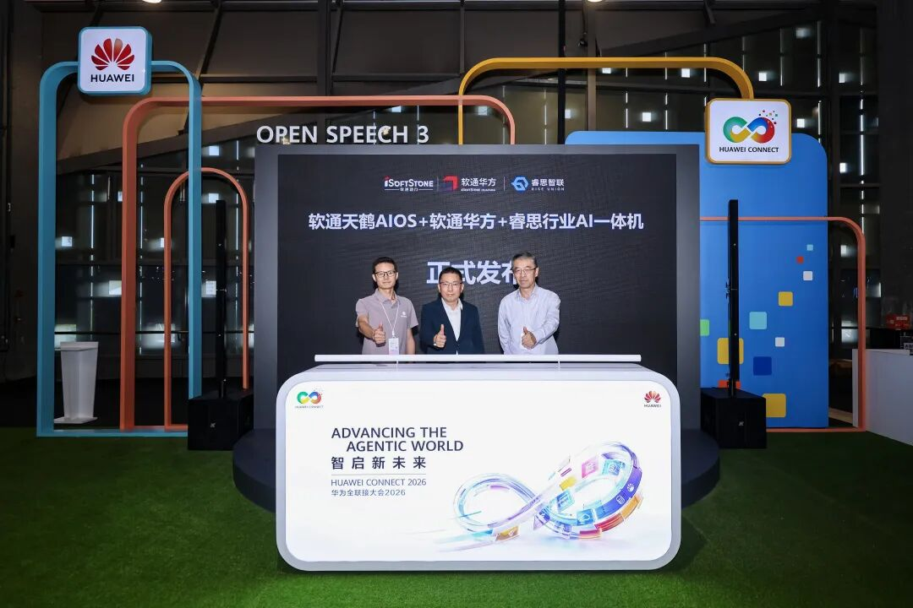

[English](./README.en.md) · [文章目录](../../README.md) · [官网阅读](https://www.theriseunion.com/zh/blog/riseunion-huawei-connect-2026.html)

# 重磅！睿思智联亮相2026华为全联接大会

睿思智联 · 2026/09/20 10:00（北京时间） · [微信公众号原文](https://mp.weixin.qq.com/s/b1JX5e7n7PfCjkOuhw9lqg)

睿思智联亮相2026华为全联接大会，携手软通动力联合发布睿思行业AI一体机。

9 月 17 日，**华为全联接大会 2026** 在上海世博中心启幕。作为华为生态的重要伙伴，**睿思智联受邀参会**，与来自全球的行业领袖、技术专家齐聚一堂，共话智能化升级新路径。

01

## 亮相 · 黄浦江畔，赴全联接盛会

大会现场，睿思智联携手软通动力，联合发布**睿思行业 AI 一体机**——软通华方国产化算力硬件 × openEuler 原生 AI 操作系统（软通天鹤 AIOS）× 睿思行业级算力调度平台，为千行百业带来**开箱即用的私有化 Agent 全栈方案**。软通动力欧拉生态高级技术总监李成鹏、睿思智联 COO 沈鸥、软通动力计算产品与解决方案中心部长初明出席了共同发布。

从左至右为：软通动力李成鹏、 睿思智联沈鸥、软通动力初明

02

## 亮剑 · 三层内核，直击算力痛点

在这台一体机中，软通华方硬件与天鹤 AIOS 是"躯干"，**睿思的调度平台是"大脑"**——以自研 RiseVAST、RiseCAMP、RiseRouter 构成调度内核，直面算力利用率低、推理时延高、Token 治理缺失、异构资源难管四大行业痛点：

算力一体化

显存动态切分与超分技术，让某股份制银行 8 卡节点部署 16 个业务模型，算力利用率由 30–50% 提升至 **80–90%**。

模型工厂化

多模型同机共驻、零等待热切换，拓扑与优先级调度保障金融风控等高优先级业务稳定运行。

Token 服务化

AI 网关统一接入内外模型，密钥管控、计量审计、智能路由一站式完成。

目前，这套解决方案已在**银行、证券、能源、制造、教育等行业生产环境**稳定落地，验证了高合规行业的可行性。

03

## 共生 · 生态共振，自主可控

睿思智联已通过**华为昇腾技术认证**，深度适配昇腾等国产算力。此次与软通华方、天鹤 AIOS 联合，打通从国产芯片、AI 原生操作系统到算力调度平台的完整链路，实现**全链路自主可控**。

睿思智联愿与华为及生态伙伴同行\
让行业 Agent 走向业务生产\
加速千行百业智能化升级

### 关于睿思智联

北京睿思智联科技有限公司（RiseUnion）专注于AI 算力管理与调度，已完成 10+ 国产芯片兼容认证，是 CNCF Sandbox 开源项目 HAMi 的核心贡献者之一。公司是国家高新技术企业、北京市专精特新中小企业、AIIC 算力池化工作组组长单位，在金融、政企军工、交通、医疗等行业实现大规模生产级落地。

睿思智联致力于让算力像水电一样随取随用，为企业 AI 转型构建智能、可控、高效的算力底座。

---

[在睿思智联官网阅读本文](https://www.theriseunion.com/zh/blog/riseunion-huawei-connect-2026.html) · [浏览更多文章](https://www.theriseunion.com/zh/blog.html)
