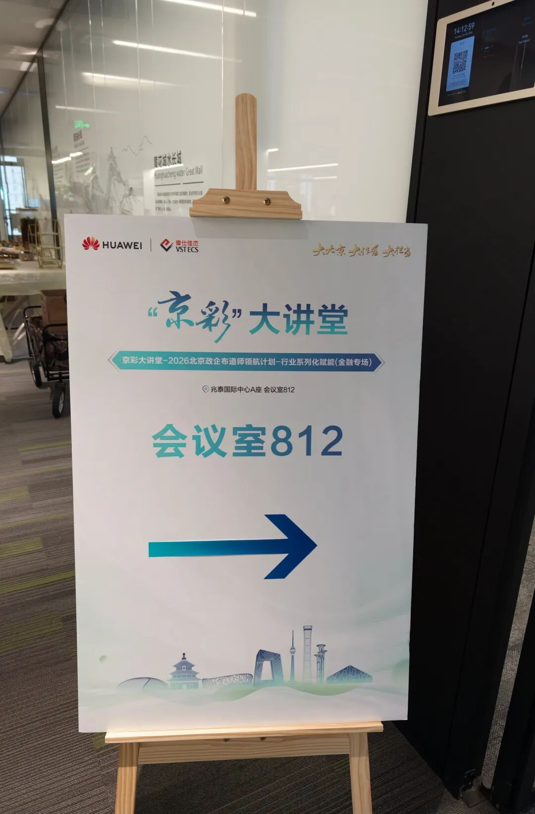
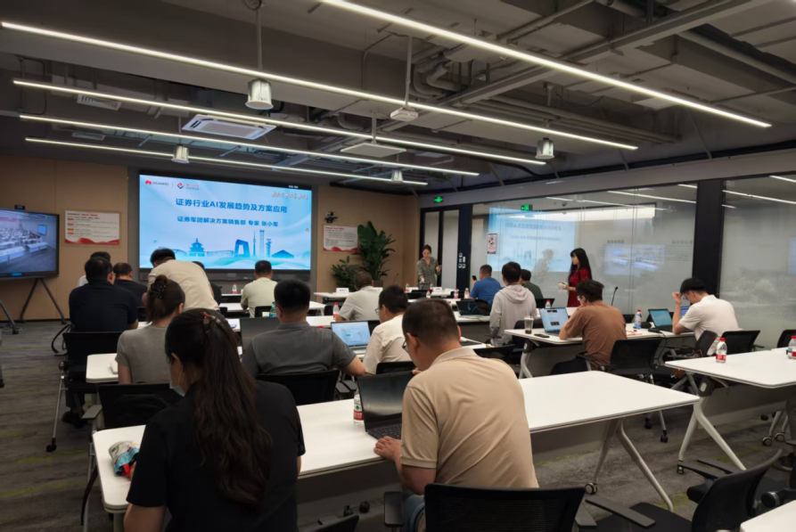

[简体中文](./README.md) · [All articles](../../README.en.md) · [Read on the website](https://www.theriseunion.com/en/blog/riseunion-huawei-jingcai-finance-session.html)

# Joining Hands with Ascend to Unlock New Momentum for Finance—RiseUnion Invited to Huawei’s “Jingcai” Lecture Hall Finance Session

RiseUnion · August 04, 2026 at 10:00 (UTC+08:00) · [Original WeChat article (Chinese)](https://mp.weixin.qq.com/s/kHrWubKukIfzPAJAcCSRkQ)

On July 30, 2026, the “Jingcai” Lecture Hall—2026 Beijing Government and Enterprise Evangelist Leadership Program · Industry Empowerment Series · Finance Session, hosted by Huawei together with VSTECS, was held at Beijing Zhaotai International Center.

> Introduction: On July 30, 2026, the “Jingcai” Lecture Hall—2026 Beijing Government and Enterprise Evangelist Leadership Program · Industry Empowerment Series · Finance Session, hosted by Huawei together with VSTECS, was held at Beijing Zhaotai International Center. As a Huawei Ascend certified partner, RiseUnion participated in this finance-focused empowerment event, joining industry experts and ecosystem partners to discuss financial AI trends, technical practices, and implementation paths.

## Focusing on Financial Scenarios and Discussing AI Implementation

The financial industry’s digital transformation continues to deepen. AI technology is being integrated into business processes across banking, securities, insurance, and other fields at an accelerating pace. At the same time, it is placing higher demands on the performance, stability, security, and controllability of the underlying compute infrastructure.

The finance session centered on the core issues of industry digital transformation, reviewed key pain points in implementing AI applications across banking, securities, and insurance, and shared advanced technical solutions and practices with government and enterprise partners. At the event, experts from Huawei and the industry drew on practical experience across different sectors. Moving from trend analysis to application cases, they systematically presented the efficiency improvements and business value that AI brings to finance and further deepened participants’ understanding of the industry-enablement value of the Ascend compute foundation.

## Cultivating the Ascend Technology Foundation to Strengthen Compute Support for Financial AI

As a Huawei Ascend ecosystem partner, RiseUnion continues to cultivate domestic compute. It develops adaptation and optimization capabilities for the financial industry around Ascend NPUs, providing efficient and stable compute support for implementing financial AI applications.

### Title: Full-Stack Deep Adaptation to Unlock Ascend’s Native Compute

RiseUnion has completed full-chain adaptation and optimization between mainstream financial large models and Ascend Atlas series hardware, covering core scenarios such as inference deployment, model training, and multimodal inference. Through low-level tuning of the CANN software stack and operator-level optimization, it further unlocks the native compute of Ascend NPUs, ensures efficient model operation in financial scenarios, and helps customers migrate their businesses smoothly to domestic compute platforms while balancing performance with secure and controllable data.

### Optimizing Model Partitioning and Scheduling to Break Through Large-Model Deployment Bottlenecks

To address the large parameter scale of financial large models and the difficulty of fitting them into the memory of a single accelerator, RiseUnion independently developed Ascend NPU over-partitioning technology. It enables fine-grained tensor partitioning and pipeline-parallel scheduling for large models across multiple accelerators and nodes. This technology helps overcome the memory and compute limitations of a single accelerator, supports efficient deployment of financial large models with tens of billions of parameters on Ascend compute clusters, improves inference throughput while accounting for inter-accelerator and inter-node communication efficiency, and reduces the overall compute cost of large-model deployment.

### Title: Full-Stack Deep Adaptation to Unlock Ascend’s Native Compute

For frequent scenarios such as bank risk control and anti-fraud, intelligent customer service, intelligent securities research and market simulation, intelligent insurance underwriting, and claim-loss assessment, RiseUnion has created customized Ascend compute optimization solutions. Through technologies including compute management, memory reuse, and high-concurrency scheduling, these solutions meet financial businesses’ requirements for low latency, high concurrency, and high stability. They promote deeper integration of AI into business processes and support financial institutions in improving quality and efficiency and pursuing business innovation.

## Working with the Ascend Ecosystem to Explore a New Future for Financial AI

The financial industry’s intelligent upgrade requires both a solid domestic AI compute foundation and coordinated innovation across the industry chain in technology, solutions, and scenarios. Building an open and collaborative industrial ecosystem on Ascend will provide stronger support for financial AI as it moves from scenario validation to large-scale application.

In the future, RiseUnion will continue deepening its ecosystem cooperation with Huawei Ascend, iterating its core technical capabilities, and refining more compute solutions suited to financial scenarios. It will also join upstream and downstream industry partners to pool their strengths, jointly expand the boundaries of financial AI applications, and inject sustained domestic-compute momentum into the financial industry’s digital transformation.

### About RiseUnion

**Beijing RiseUnion Technology Co., Ltd.** is committed to building a next-generation intelligent management platform for AI infrastructure, serving high-compute application scenarios such as artificial intelligence, large models, and scientific research and training. Through core technologies including heterogeneous GPU resource pooling, compute partitioning and scheduling optimization, multi-model collaborative scheduling, and edge-inference support, the company’s core products are widely used by large government and enterprise organizations, leading financial institutions, AI innovators, universities, and research institutes. Guided by the concept of an **“AI intelligent-computing collaboration platform,”** RiseUnion helps build an intelligent, controllable, and efficient compute foundation for the future.

For more information, visit the official website: **riseunion.ai**, or contact: **400-605-2336**.

---

[Read this article on the RiseUnion website](https://www.theriseunion.com/en/blog/riseunion-huawei-jingcai-finance-session.html) · [Explore more articles](https://www.theriseunion.com/en/blog.html)
