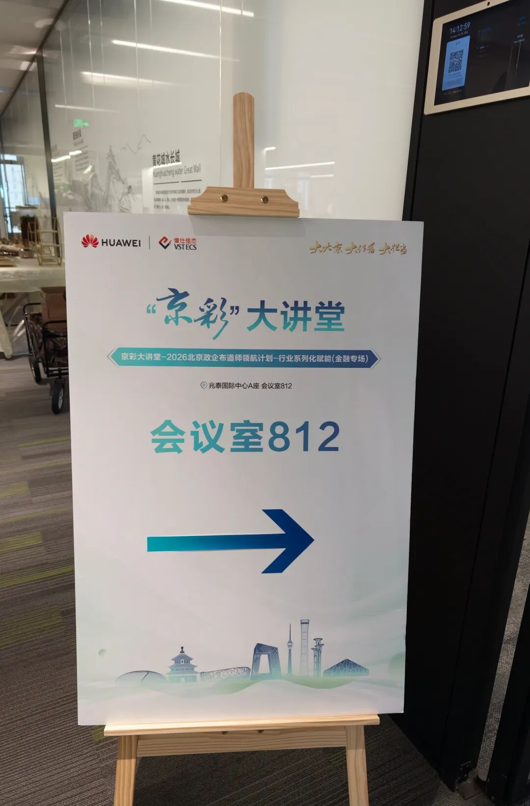
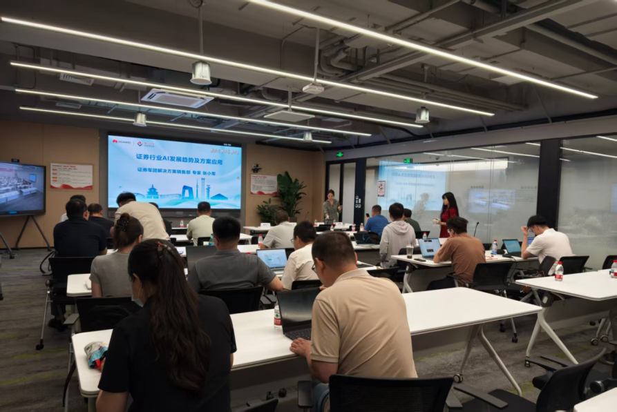

[English](./README.en.md) · [文章目录](../../README.md) · [官网阅读](https://www.theriseunion.com/zh/blog/riseunion-huawei-jingcai-finance-session.html)

# 携手昇腾，智启金融新动能——睿思智联受邀参加华为“京彩”大讲堂金融专场

睿思智联 · 2026/08/04 10:00（北京时间） · [微信公众号原文](https://mp.weixin.qq.com/s/kHrWubKukIfzPAJAcCSRkQ)

2026 年 7 月 30 日，由华为联合伟仕佳杰主办的“京彩”大讲堂——2026 北京政企布道师领航计划·行业系列化赋能·金融专场在北京兆泰国际中心举行。

> 导语：2026 年 7 月 30 日，由华为联合伟仕佳杰主办的“京彩”大讲堂——2026 北京政企布道师领航计划·行业系列化赋能·金融专场在北京兆泰国际中心举行。作为华为昇腾认证合作伙伴，睿思智联参与本次金融专项赋能活动，与行业专家及生态伙伴共同交流金融 AI 的发展趋势、技术实践与落地路径。

## 聚焦金融场景，共话 AI 落地

当前，金融行业数字化转型持续向纵深推进。AI 技术正在银行、证券、保险等领域加速融入业务流程，同时也对底层算力的性能、稳定性以及安全可控能力提出了更高要求。

本次金融专场紧扣行业数字化转型的核心议题，围绕银行、证券、保险三大领域梳理 AI 应用落地中的关键痛点，为政企伙伴分享前沿技术方案与实践方法。活动现场，来自华为及行业领域的专家结合不同赛道的实践经验，从趋势研判到应用案例层层展开，系统呈现 AI 技术为金融行业带来的效率提升与业务价值，也进一步加深了参会各方对昇腾算力底座行业赋能价值的认识。

## 深耕昇腾技术底座，夯实金融 AI 算力支撑

作为华为昇腾生态合作伙伴，睿思智联持续深耕国产化算力方向，围绕昇腾 NPU 打磨面向金融行业的适配与优化能力，为金融 AI 应用落地提供高效、稳定的算力支撑。

###   标题全栈深度适配，释放昇腾原生算力

睿思智联已完成主流金融大模型与昇腾 Atlas 系列硬件的全链路适配优化，覆盖推理部署、模型训练和多模态推理等核心场景。通过对 CANN 软件栈的底层调优与算子级优化，进一步释放昇腾 NPU 的原生算力，保障金融场景下的模型运行效率，助力客户在国产化算力平台上实现业务平滑迁移，并兼顾性能表现与数据安全可控要求。

###  优化模型切分与调度，突破大模型部署瓶颈

针对金融大模型参数规模大、单卡显存难以承载等问题，睿思智联自主研发昇腾 NPU 超分切分技术，实现大模型在多卡、多节点间的精细化张量切分与流水线并行调度。该技术有助于突破单卡显存与算力限制，支持百亿级参数金融大模型在昇腾算力集群中的高效部署，同时兼顾跨卡、跨节点通信效率，提升推理吞吐能力，降低大模型部署的综合算力成本。

###   标题全栈深度适配，释放昇腾原生算力

面向银行风控反欺诈与智能客服、证券智能投研与行情推演、保险智能核保与理赔定损等高频场景，睿思智联打造定制化的昇腾算力优化方案。通过算力管理、显存复用和高并发调度等技术手段，满足金融业务对低延迟、高并发和高稳定性的要求，推动 AI 技术更深入地融入业务流程，为金融机构提质增效与业务创新提供支撑。

## 携手昇腾生态，共拓金融 AI 新未来

金融行业智能化升级，既需要坚实的国产化 AI 算力底座，也需要产业链各方在技术、方案与场景层面协同创新。以昇腾为基础构建开放、协同的产业生态，将为金融 AI 从场景验证走向规模化应用提供更加有力的支撑。

未来，睿思智联将持续深化与华为昇腾的生态合作，迭代核心技术能力，打磨更多贴合金融场景的算力解决方案；同时携手产业链上下游伙伴汇聚合力，共同拓展金融 AI 的应用边界，为金融行业数字化转型注入持续的国产算力动能。

### 关于睿思智联

**北京睿思智联科技有限公司 **致力于构建新一代AI基础设施智能管理平台，服务于人工智能、大模型、科研训练等高算力应用场景。公司核心产品通过异构 GPU 资源池化、算力分片与调度优化、多模型协同调度、边缘推理支持等核心技术，广泛应用于大型政企、头部金融、AI创新企业、高校科研院所等。睿思智联以 **“AI智算协同平台”** 为理念，助力构建智能、可控、高效的未来算力底座。

了解更多详细信息，欢迎访问官网：**riseunion.ai** 或联系：**400-605-2336**。

---

[在睿思智联官网阅读本文](https://www.theriseunion.com/zh/blog/riseunion-huawei-jingcai-finance-session.html) · [浏览更多文章](https://www.theriseunion.com/zh/blog.html)
