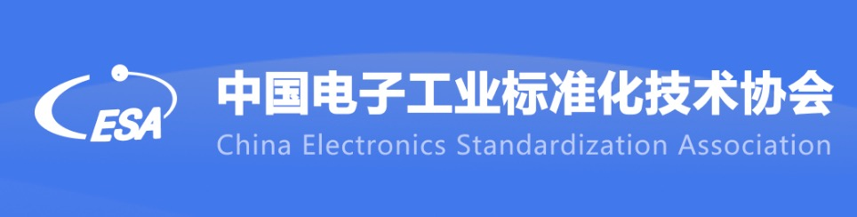

[简体中文](./README.md) · [All articles](../../README.en.md) · [Read on the website](https://www.theriseunion.com/en/blog/riseunion-initiated-the-group-standard-project.html)

# RiseUnion Initiated the Group Standard Project

RiseUnion · January 01, 2025 at 08:00 (UTC+08:00)

阅读关于 RiseUnion Initiated the Group Standard Project 的详细内容。

**RiseUnion Technology Co., Ltd.**, a leading intelligent computing service provider in China, is committed to advancing the standardization and industrialization of AI and cloud computing technologies. We are pleased to announce that the group standard project **"Information Technology - Intelligent Computing Services - Requirements for Heterogeneous Computing Virtualization and Resource Pooling Systems,"** initiated by RiseUnion, has been officially approved and entered the standard development process. We are now openly recruiting member organizations to participate in drafting this standard and invite relevant institutions to join us in promoting the development and implementation of industry standards.

## I. Background and Objectives

With the rapid advancement of artificial intelligence technology, the demand for computing power has grown exponentially. Single compute architectures can no longer meet the diverse requirements of AI applications, making the integration of heterogeneous AI compute resources (such as GPUs, NPUs, FPGAs, ASICs) inevitable. However, efficient management and utilization of heterogeneous compute resources face numerous challenges, including resource silos, compatibility issues, and performance overhead.

[As the chair organization of the **"AI Compute Resource Pooling Working Group"**](https://www.theriseunion.com/en/blog/riseunion-aiic-leadership.html) under the Artificial Intelligence Industry Committee, RiseUnion has initiated the development of this group standard. The standard aims to abstract different types of physical computing hardware into unified logical resources through virtualization technology and achieve [centralized management and dynamic allocation through resource pooling](https://www.theriseunion.com/en/product/vast.html). This will break down resource silos and enable flexible resource orchestration and sharing. The standard will fill the gap in existing frameworks regarding heterogeneous compute resource management, promoting the standardization and industrialization of related technologies.

## II. Standard Specifications

This standard specifies key metrics, architecture, functional characteristics, interface specifications, and implementation guidelines for heterogeneous compute virtualization and resource pooling technologies based on cloud-native standards, particularly leveraging Kubernetes and container technology stack. It applies to organizations involved in AI system development, compute infrastructure construction and operations, and related technical services. The standard aims to promote efficient integration and utilization of heterogeneous compute resources, enhancing overall AI application performance and industry competitiveness.

## III. Call for Participating Organizations

To ensure broad representation and industry applicability, we are openly recruiting organizations to participate in drafting this standard. We invite enterprises, research institutions, and industry associations with relevant technical backgrounds and practical experience to join the standard development process.

Eligibility Requirements:

- Possess relevant experience in AI and heterogeneous compute management, capable of providing technical experts for standard development
- Participating organizations should designate fixed representatives (generally no more than 2 people) who can ensure attendance at standard development meetings and complete assigned tasks on schedule

## IV. Application Process

Interested organizations should scan the QR code below before April 15, 2025 (inclusive) and submit the required information. The working group will review applications and arrange subsequent work based on submissions.

## V. Contact Information

- Contact: Ms. Wang
- Email: sammiwang@riseunion.io

The development of this group standard will provide crucial support for technological advancement in China's AI and cloud computing sectors. We sincerely invite relevant organizations to actively participate in drafting this standard, jointly promoting industry standardization and implementation, and helping China's AI industry advance to a higher quality development stage.

---

[Read this article on the RiseUnion website](https://www.theriseunion.com/en/blog/riseunion-initiated-the-group-standard-project.html) · [Explore more articles](https://www.theriseunion.com/en/blog.html)
