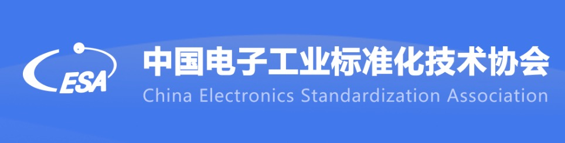

[English](./README.en.md) · [文章目录](../../README.md) · [官网阅读](https://www.theriseunion.com/zh/blog/riseunion-initiated-the-group-standard-project.html)

# RiseUnion Initiated the Group Standard Project

睿思智联 · 2025/01/01 08:00（北京时间）

阅读关于 RiseUnion Initiated the Group Standard Project 的详细内容。

北京睿思智联科技有限公司 作为国内领先的智能计算服务提供商，始终致力于推动人工智能和云计算技术的标准化与产业化发展。我们很高兴地宣布，由睿思智联发起起草的 《信息技术 智算服务 异构算力虚拟化及池化系统要求》 团体标准，已正式立项，并进入标准研制工作流程。现面向全社会公开征集标准起草成员单位，诚邀各相关单位共同参与，推动行业标准的制定与实施。

## 一、标准背景与目的

随着人工智能技术的快速发展，对计算能力的需求呈现爆发式增长。单一的算力类型已无法满足多样化的人工智能应用需求，异构AI算力（如GPU、NPU、FPGA、ASIC等）的融合成为必然趋势。然而，异构算力资源的高效管理与利用面临诸多挑战，包括资源孤岛、兼容性差、性能损耗等问题。 

作为人工智能产业工作委员会- [“AI算力资源池化工作组”的组长单位](https://www.theriseunion.com/zh/blog/riseunion-aiic-leadership.html)，睿思智联发起《信息技术 智算服务 异构算力虚拟化及池化系统要求》团体标准的制定工作，旨在通过虚拟化技术将不同类型的物理计算硬件抽象为统一的逻辑资源，并通过 池化技术 实现资源的集中管理和动态分配，打破资源孤岛，实现资源的灵活调配与共享。该标准将填补现有标准体系在 [异构算力资源管理](https://www.theriseunion.com/zh/product/vast.html) 方面的空白，推动相关技术的标准化和产业化。

## 二、标准主要内容

本标准详细规定了基于云原生技术标准，尤其是依托 Kubernetes 及容器技术栈实现的异构算力虚拟化及池化技术的关键指标、架构、功能特性、接口规范与实施建议。适用于参与人工智能系统开发、算力基础设施建设与运维、相关技术服务提供的各类企事业单位与组织，旨在推动异构算力资源的高效整合与利用，提升人工智能应用的整体效能与产业竞争力。

## 三、征集起草成员单位

为确保标准的广泛代表性和行业适用性，现面向全社会公开征集标准起草成员单位。我们诚邀具备相关技术背景和实践经验的企事业单位、科研机构、行业协会等共同参与标准的制定工作。 

报名条件：

- 具备人工智能、异构算力管理方面相关的工作经验，能够为标准编制提供技术专家。
- 参编单位应指定固定的参编人员（原则上不超过2名），要求能够确保参与标准制修订过程中的各项会议，按时完成标准编制组分配的工作任务。

## 四、申报方式

意向单位请于2025年4月15日之前（含4月15日当日）扫描下方二维码，按要求反馈参编单位信息，工作组将根据报名情况对参编单位资格进行审查并安排后续工作。

## 五、申报联系方式

- 联系人：王老师
- 邮箱：sammiwang@riseunion.io

《信息技术 智算服务 异构算力虚拟化及池化系统要求》团体标准的制定，将为我国人工智能和云计算领域的技术发展提供重要支撑。我们诚挚邀请各相关单位积极参与标准的起草工作，共同推动行业标准的制定与实施，助力我国人工智能产业迈向更高质量的发展阶段。

---

[在睿思智联官网阅读本文](https://www.theriseunion.com/zh/blog/riseunion-initiated-the-group-standard-project.html) · [浏览更多文章](https://www.theriseunion.com/zh/blog.html)
