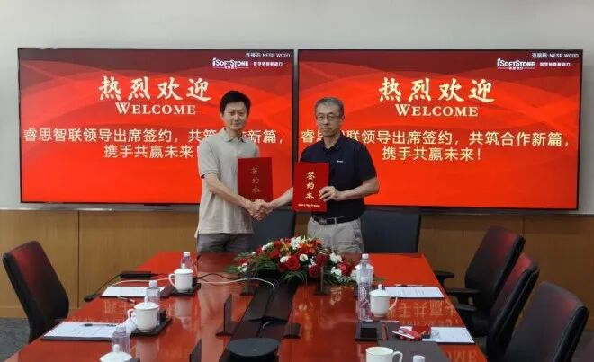

[简体中文](./README.md) · [All articles](../../README.en.md) · [Read on the website](https://www.theriseunion.com/en/blog/riseunion-isoftstone-huafang-strategic-partnership.html)

# Software-Hardware Synergy, Intelligent Computing in Concert: RiseUnion and iSoftStone Huafang Form a Strategic Partnership

RiseUnion · August 13, 2026 at 09:43 (UTC+08:00) · [Original WeChat article (Chinese)](https://mp.weixin.qq.com/s/nwRvqi2hIx-7cYsNcX3qrA)

Recently, Beijing RiseUnion Technology Co., Ltd. (“RiseUnion”) and Beijing iSoftStone Huafang Computer Co., Ltd. (“iSoftStone Huafang”) successfully held a strategic cooperation signing ceremony.

Recently, Beijing RiseUnion Technology Co., Ltd. (“RiseUnion”) and Beijing iSoftStone Huafang Computer Co., Ltd. (“iSoftStone Huafang”) successfully held a strategic cooperation signing ceremony.

RiseUnion Chief Technology Officer Yang Shiqi and Chu Ming, Director of the Compute Products and Solutions Center in the Enterprise Product Management Department of iSoftStone’s Compute Products and Solutions Business Group, signed the strategic cooperation framework agreement on behalf of the two parties. Guided by the principles of “equality and mutual benefit, complementary strengths,” the two companies will jointly create an “integrated hardware-software solution for AI resource management” and promote the large-scale, efficient adoption of domestic compute across industries.

iSoftStone Huafang is a leading Chinese provider of full-stack intelligent-computing products and solutions. As the successor brand that acquired Tsinghua Tongfang’s computer products business, iSoftStone Huafang carries forward three decades of brand heritage, its core team, technical patents, and service network. It has advanced strategically from a pioneer of domestic complete systems into an industry pillar integrating hardware and software with full-stack intelligence.

## Hardware and Software as One: Jointly Building an “Integrated Hardware-Software Solution for AI Resource Management”

Under the agreement, the two parties will deeply integrate their core capabilities and jointly market an “integrated hardware-software solution for AI resource management.” Positioned around “software-defined compute,” the solution builds full-stack capabilities spanning GPU resource management, intelligent scheduling, and model-service delivery:

- **Robust foundation | iSoftStone Huafang**: Provides domestic compute infrastructure for all scenarios, from the iSoftStone Huafang Chaoxuan 3700 AI four-GPU liquid-cooled workstation and iSoftStone Huafang Chaoqiang A800I server to intelligent-computing clusters. It achieves full-stack domestic deployment based on Kunpeng CPUs, Ascend NPUs, and Tianhe OS. With a mature system-integration and delivery-service system, it is responsible for hardware production, adaptation, supply, and after-sales technical support.

- **Scheduling engine | RiseUnion**: Provides the Rise CAMP AI compute scheduling platform covering both the resource-management layer and the scheduling-service layer—unified management of heterogeneous GPUs, full-chain observation, dynamic partitioning, four layers of intelligent scheduling, memory overcommitment, deep domestic-accelerator adaptation, and free migration between training and inference. Rise Router serves as a unified Token service platform for metering, billing, and multi-tenant operations, ensuring that every unit of domestic compute is put to full use.

- **Integrated delivery | Both parties**: Hardware and software are preinstalled as one and ready out of the box. The two parties jointly complete solution design, adaptation, and validation. Without adding hardware investment, GPU utilization can increase from 30%–50% to 80%–90%, deployment cycles can fall from three months under traditional models to two weeks, and resource requests can fall from three to five days to minutes.

## Three Tiers of Solutions Unlock the Full Potential of Domestic Compute

For compute requirements of different sizes, the joint solution offers a three-tier product system—department, enterprise, and industry levels—that flexibly matches customers’ business scenarios and growth paths:

- **Single cluster (department level)**: One iSoftStone Huafang Chaoxuan 3700 AI all-in-one system can support an algorithm team’s everyday development and testing as well as small-model inference validation. With mainstream frameworks preinstalled and second-level startup, it is like equipping every team with a “PC for the AI era.”

- **Multiple clusters (enterprise level)**: Unified cross-cluster scheduling, mixed inference and training scheduling, and parallel development across multiple projects break down compute silos and enable unified management and sharing, meeting the parallel compute needs of multiple business lines in group enterprises.

- **Intelligent-computing center (industry level)**: Provides elastic compute services at a scale of more than 200 accelerators for industry intelligent-computing centers, supporting multi-tenant operations, Token metering and billing, and external services. It helps regional and industry compute infrastructure achieve commercial operation.

The value of the solution has been validated by benchmark customers. At a national supercomputing center, more than 90 GPU servers achieved unified management and intelligent scheduling, increasing GPU utilization from 30% to 80% and reducing queue time from hours to minutes. At a centrally administered state-owned enterprise in the transportation industry, 64 domestic AI servers and 16 NVIDIA servers, totaling 528 AI accelerators, achieved heterogeneous compute virtualization, partitioning, and fine-grained control, comprehensively improving resource utilization efficiency.

## Shared Channels and Joint Branding to Explore a New Blue Ocean for Domestic Compute

Under the agreement, the two parties will share industry channel resources and jointly engage key customers in finance, scientific research, energy, transportation, education, and other sectors. From resource management and intelligent scheduling to service delivery and metered operations, the joint solution frees AI R&D teams from “searching for accelerators, waiting for accelerators, and configuring environments,” creating a one-stop experience for “request, use, and delivery” and turning GPU resources from “fixed assets” into “elastic services.” From deploying integrated hardware-software solutions, to extending compute-operation services, and then to building a domestic AI compute ecosystem, the two parties will advance their cooperation from “one solution” to “an ecosystem.”

In the future, RiseUnion will continue to apply its core strengths in compute scheduling software, work with iSoftStone Huafang to cultivate implementation scenarios across industries, and continuously optimize the integrated hardware-software solution for AI resource management. Together, the two companies will turn domestic compute from a high-investment fixed asset into an efficient, elastic, and operable digital service, help industries complete their intelligent transformation, and continue strengthening the independent and controllable domestic AI compute ecosystem.

### About RiseUnion

Beijing RiseUnion Technology Co., Ltd. (RiseUnion) specializes in AI compute management and scheduling. It has completed compatibility certifications for more than 10 domestic chips and is one of the core contributors to HAMi, a CNCF Sandbox open-source project. The company is a National High-Tech Enterprise, a Beijing Specialized and Innovative SME, and the leader of the AIIC Compute Pooling Working Group. It has achieved large-scale production deployments in finance, government and defense enterprises, transportation, healthcare, and other industries.

RiseUnion is committed to making compute as readily available as water and electricity and to building an intelligent, controllable, and efficient compute foundation for enterprise AI transformation.

For more information, visit the official website: **riseunion.ai**, or contact: **400-605-2336**.

---

[Read this article on the RiseUnion website](https://www.theriseunion.com/en/blog/riseunion-isoftstone-huafang-strategic-partnership.html) · [Explore more articles](https://www.theriseunion.com/en/blog.html)
