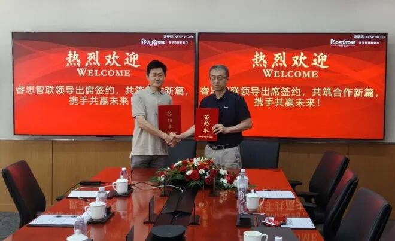

[English](./README.en.md) · [文章目录](../../README.md) · [官网阅读](https://www.theriseunion.com/zh/blog/riseunion-isoftstone-huafang-strategic-partnership.html)

# 软硬协同，智算共生：睿思智联携手软通华方达成战略合作，共筑国产算力高效调度新生态

睿思智联 · 2026/08/13 09:43（北京时间） · [微信公众号原文](https://mp.weixin.qq.com/s/nwRvqi2hIx-7cYsNcX3qrA)

近日，北京睿思智联科技有限公司（“睿思智联”）与北京软通华方计算机有限公司（“软通华方”）战略合作签约仪式顺利举行。

近日，北京睿思智联科技有限公司（“睿思智联”）与北京软通华方计算机有限公司（“软通华方”）战略合作签约仪式顺利举行。

睿思智联首席技术官杨世琪与软通动力计算产品与解决方案事业群企业级产品管理部计算产品与解决方案部中心部长初明代表双方签署战略合作框架协议。双方将本着"平等互利、优势互补"的原则，联合打造"AI资源管理软硬一体解决方案"，共同推动国产算力在各行业的规模化、高效化落地。

软通华方是中国领先的全栈智算产品及解决方案提供商，作为收购清华同方计算机产品业务的传承品牌，软通华方承接其三十载品牌基因、核心团队、技术专利及服务网络等。从国产整机奠基者到行业支柱，实现软硬一体、全栈智能的战略升级。

## 软硬一体 共铸"AI资源管理软硬一体解决方案"

根据协议，双方将深度集成各自核心能力，以"AI资源管理软硬一体解决方案"联合产品对外开展市场推广。方案以"软件定义算力"为整体定位，构建从GPU资源纳管、智能调度到模型服务交付的全栈能力：

- 硬核底座｜软通华方：提供从软通华方超炫3700 AI四卡液冷工作站、软通华方超强A800I服务器到智算集群的全场景国产算力基础设施，基于鲲鹏CPU、昇腾NPU与天鹤OS实现全栈国产化，并依托成熟的系统集成与交付服务体系，承担硬件生产、适配、供货及售后技术支撑。

- 调度引擎｜睿思智联：提供覆盖资源管理层与调度服务层的Rise CAMP AI算力调度平台——异构GPU统一纳管、全链路观测、动态切分、四重智能调度、显存超配、国产卡深度适配、训练推理自由迁移，并以RiseRouter统一Token服务中台实现计量计费与多租户运营，让每一份国产算力都物尽其用。

- 一体交付｜双方联合：软硬件一体预装、开箱即用，共同完成方案的设计、适配与验证，不增加硬件投入即可将GPU利用率从30%-50%提升至80%-90%，部署周期从传统模式的3个月缩短至2周，资源申请从3-5天缩短至分钟级。

## 三级方案全覆盖 释放国产算力全部潜能

面向不同规模的算力需求，联合方案形成"部门级—企业级—行业级"三级产品体系，灵活匹配客户的业务场景与成长路径：

- 单集群（部门级）：一台软通华方超炫3700 AI一体机即可支撑算法团队日常开发测试与小型模型推理验证，预装主流框架、秒级启动，如同为每个团队配备了一台"AI时代的PC机"。

- 多集群（企业级）：跨集群统一调度、推理训练混合调度、多项目并行开发，打破算力孤岛、统一纳管共享，适配集团型企业多业务线并行的算力需求。

- 智算中心（行业级）：面向行业智算中心提供200+卡规模的弹性算力服务，支持多租户运营、Token计量计费与对外运营，助力区域与行业算力基础设施实现商业化运营。

方案价值已获标杆客户验证：在某国家级超算中心，90余台GPU服务器实现统一纳管与智能调度，GPU利用率从30%提升至80%，排队时间从数小时缩短至分钟级；在某交通行业央企，64台国产AI服务器与16台NVIDIA服务器共计528张AI加速卡实现异构算力虚拟化切分与精细化管控，全面提升资源利用效率。

## 渠道共享品牌共建 共拓国产算力新蓝海

根据协议，双方将共享行业渠道资源，联合对接金融、科研、能源、交通、教育等重点行业客户。从资源纳管、智能调度到服务交付、计量运营，联合方案帮助客户将AI研发团队从"找卡、等卡、配环境"中解放出来，实现"申请、使用、交付"的一站式体验，让GPU资源从"固定资产"转变为"弹性服务"。从软硬一体方案进场部署，到算力运营服务延伸，再到国产AI算力生态的构建，双方将推动合作从"一套方案"走向"一个生态"。

未来，睿思智联将持续发挥算力调度软件核心优势，联合软通华方深耕各行业落地场景，持续优化AI 资源管理软硬一体解决方案，让国产算力从高投入的固定资产，转变为高效、弹性、可运营的数字化服务，携手千行百业完成智能化转型，持续壮大自主可控国产 AI 算力产业生态。

### 关于睿思智联

北京睿思智联科技有限公司（RiseUnion）专注于AI 算力管理与调度，已完成 10+ 国产芯片兼容认证，是 CNCF Sandbox 开源项目 HAMi 的核心贡献者之一。公司是国家高新技术企业、北京市专精特新中小企业、AIIC 算力池化工作组组长单位，在金融、政企军工、交通、医疗等行业实现大规模生产级落地。

睿思智联致力于让算力像水电一样随取随用，为企业 AI 转型构建智能、可控、高效的算力底座。

了解更多详细信息，欢迎访问官网：**riseunion.ai** 或联系：**400-605-2336**。

---

[在睿思智联官网阅读本文](https://www.theriseunion.com/zh/blog/riseunion-isoftstone-huafang-strategic-partnership.html) · [浏览更多文章](https://www.theriseunion.com/zh/blog.html)
