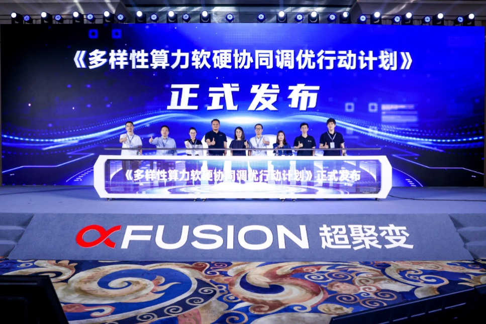

[English](./README.en.md) · [文章目录](../../README.md) · [官网阅读](https://www.theriseunion.com/zh/blog/riseunion-joins-diverse-computing-optimization-initiative.html)

# 睿思智联参编《多样性算力软硬协同调优行动计划》， 共筑 AI 算力高效协同新生态

睿思智联 · 2025/07/29 08:00（北京时间）

睿思智联与超聚变联合发布《多样性算力软硬协同调优行动计划》，通过算力异构池化技术解决AI算力协同难题，提升企业AI应用部署效率，降低软硬适配成本，实现按需分配高效协同的算力资源管理。

在大模型、AIGC（生成式人工智能）等技术持续突破的当下，人工智能产业已加速迈入 “场景效能竞速” 的全新发展阶段。这一变革不仅推动 AI 技术从实验室走向千行百业的实际应用场景，更从底层逻辑上重构行业发展模式 —— 既重塑企业业务流程与商业变现路径，也对数智平台底座的算力支撑能力、数智应用的落地效率提出了全新要求。

作为超聚变数字技术有限公司在算力异构池化领域的重要合作伙伴，睿思智联深度参与行业前沿探索，近日参编了超聚变在智能体与应用专题论坛中正式发布的《**多样性算力软硬协同调优行动计划**》（以下简称《行动计划》）。该《行动计划》由中国计算机行业协会人工智能工委会全程指导，超聚变牵头联合睿思智联等多家产业链伙伴共同编制，是针对当前 AI 算力应用痛点的 “实战指南”。

在 AI 应用规模化落地过程中，企业常面临算力资源分散、不同类型算力协同效率低、软硬适配成本高等问题。而《行动计划》通过梳理多样性算力（如通用算力、智能算力、超算算力等）的技术特性，提出了一套完整的软硬协同调优路径：从硬件层的算力资源池化管理，到软件层的调度算法优化，再到应用层的适配方案落地，形成全链路的效能提升方案。这将帮助企业突破算力瓶颈，提升 AI 模型训练与推理效率，同时降低技术开发门槛与综合成本，让算力资源真正实现 “按需分配、高效协同”。

睿思智联相关负责人表示：“**算力异构池化**是破解多样性算力协同难题的关键方向，此次参编《行动计划》，既是对睿思智联在该领域技术积累的认可，也是我们与超聚变等伙伴深化合作的重要成果。未来，我们将持续以技术创新为核心，推动算力异构池化技术与《行动计划》的落地融合，为企业 AI 应用降本增效提供更坚实的支撑。”此次《行动计划》的发布，为 AI 算力产业的协同发展提供了清晰的实践框架。睿思智联将以本次参编为契机，进一步携手产业链伙伴，共同**推动多样性算力的高效利用**，助力人工智能产业从 “技术突破” 向 “场景效能” 的高质量转型。

---

[在睿思智联官网阅读本文](https://www.theriseunion.com/zh/blog/riseunion-joins-diverse-computing-optimization-initiative.html) · [浏览更多文章](https://www.theriseunion.com/zh/blog.html)
