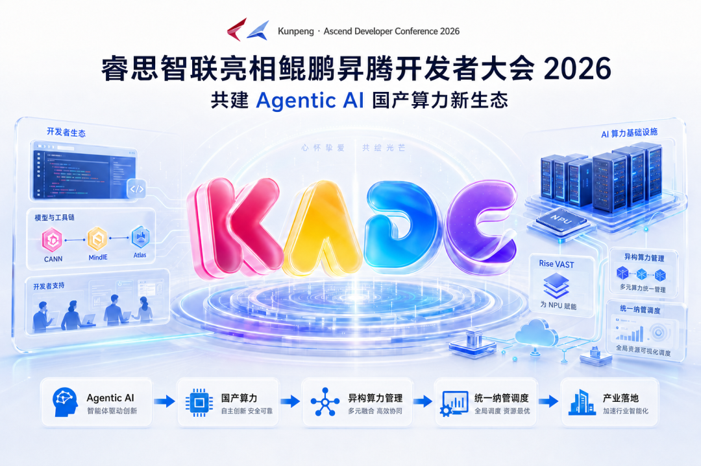

[简体中文](./README.md) · [All articles](../../README.en.md) · [Read on the website](https://www.theriseunion.com/en/blog/riseunion-kunpeng-ascend-developer-conference-2026.html)

# RiseUnion Attends the 2026 Kunpeng Ascend Developer Conference to Build a New Domestic Computing Ecosystem for Agentic AI

RiseUnion · May 26, 2026 at 10:00 (UTC+08:00) · [Original WeChat article (Chinese)](https://mp.weixin.qq.com/s/D8ooLYXCiVFyeoyTc9_w-Q)

To upgrade computing infrastructure for the Agentic AI era, RiseUnion continues to deepen adaptation and collaboration with the Ascend ecosystem, moving domestic heterogeneous computing from “usable” to “easy to use, easy to manage, and sustainable to operate.”

> To upgrade computing infrastructure for the **Agentic AI** era, RiseUnion continues to deepen adaptation and collaboration with the Ascend ecosystem, moving domestic heterogeneous computing from “usable” to “easy to use, easy to manage, and sustainable to operate.”

## Attending the Developer Conference and Focusing on New Agentic AI Trends

RiseUnion was recently invited to attend the **Kunpeng Ascend Developer Conference 2026**, joining industry partners, developers, and industry users to explore directions for computing infrastructure innovation in the Agentic AI era and the long-term path for building the domestic computing ecosystem.

As large models move from one-off question answering to complex task execution, AI applications are entering the **Agentic AI** stage. Agents need to plan continuously, call tools, process long contexts, and complete complex business processes across multiple rounds of interaction. This places higher demands on the underlying computing resources: not only sufficient computing capacity, but also stronger elastic scheduling, resource isolation, stable operations and maintenance, and cost metering.

Against this background, the value of AI infrastructure is being upgraded from “providing computing resources” to “managing, scheduling, and governing computing resources.” Whoever can manage heterogeneous resources more efficiently has a greater opportunity to support large-scale implementation of enterprise AI applications.

## What Kind of Computing Infrastructure Does Agentic AI Need?

**Agentic AI computing infrastructure** is an AI computing foundation designed for agent applications. It needs to support concurrent inference across multiple models, long-context processing, complex task orchestration, low-latency response, and unified resource scheduling across chips and clusters.

Compared with traditional training or single-model inference scenarios, Agentic AI depends more heavily on stable, elastic, observable, and measurable computing-management capabilities. Particularly in government, finance, telecommunications, energy, manufacturing, and other industry scenarios, AI applications often need to balance domestic-platform adaptation, data security, resource utilization, and controllable operations and maintenance.

This means that when enterprises build AI platforms, they cannot focus only on a single card, a single model, or a single deployment. They must incorporate **compute pooling, heterogeneous resource management, dynamic resource partitioning, full-chain observability, and multi-tenant governance** into the overall plan.

## Deepening Ascend Ecosystem Adaptation and Jointly Advancing Efficient Domestic Computing Implementation

As an Ascend ecosystem partner, RiseUnion VAST 2.0 passed technical certification at the beginning of the year for the Huawei Atlas 800I A3/Atlas 800T A3 based on the 910C; RiseUnion continues to carry out adaptation and optimization around Ascend Atlas servers, the CANN software stack, and domestic AI computing clusters, helping users build, manage, and operate domestic AI computing resources more efficiently.\

At this conference, RiseUnion participated as a specially invited ecosystem partner in the roundtable themed **“Building the Ecosystem Together, Gathering in the AI Era—Ascend Ecosystem Partner Developers.”** It provided an in-depth interpretation of the Ascend developer target program and related incentive policies and discussed how to jointly build the Ascend developer community and promote a thriving Ascend ecosystem.

In the large-scale deployment of domestic computing resources, users face more than the question of whether they can “get them running.” They must also determine how resources can be brought under unified management, how tasks can be scheduled efficiently, how different chips can collaborate, how failures can be located, how costs can be measured, and how the platform can support long-term use by multiple teams.

RiseUnion hopes to draw on its accumulated capabilities in **heterogeneous computing management, vGPU partitioning, overcommitment, resource scheduling, observable operations, and operations and maintenance** to provide more complete infrastructure-management capabilities for Ascend and other domestic computing platforms, making domestic computing resources easier to use, more stable, and more cost-effective in real businesses.

## Building the AI Computing Management Foundation

For AI infrastructure scenarios involving multiple chips, clusters, and tenants, RiseUnion’s independently developed **AI computing management platform** focuses on unified computing-resource management, dynamic partitioning, scheduling and orchestration, full-chain observability, and operational metering.

The AI computing management platform can work with NVIDIA, Ascend, Hygon, Cambricon, Kunlunxin, MetaX, Moore Threads, Iluvatar CoreX, Enflame, and other types of computing resources, helping users build a unified AI computing resource pool and reduce the complexity of platform development and operations and maintenance in heterogeneous environments.

In enterprise AI scenarios, the value of the AI computing management platform is reflected not only in resource management but also in application implementation efficiency. Through unified management and refined scheduling, the platform can help users improve resource utilization, reduce idle resources and duplicate construction, and support coordinated operation of training, inference, and agent applications on the same computing foundation.

## Building a New Domestic AI Computing Ecosystem for Industry Scenarios

The development of Agentic AI will further magnify the importance of AI infrastructure. Future enterprise AI platforms need domestic-platform adaptation, heterogeneous resource management, integrated training and inference, elastic scaling, and refined cost-governance capabilities at the same time.

RiseUnion will continue to collaborate with the Ascend ecosystem and more industry partners. Around the development of domestic AI computing infrastructure, it will continue advancing product adaptation, scenario implementation, and ecosystem co-development, helping more industry users genuinely put domestic computing resources to use, bring them under management, and keep them running stably.

For the Agentic AI era, RiseUnion will also continue to use open, compatible, and engineered AI Infra capabilities to move heterogeneous computing resources from resource supply toward platform-based operations, providing a solid foundation for the long-term development of China’s AI industry.

### About RiseUnion

Beijing RiseUnion Technology Co., Ltd. (RiseUnion) focuses on AI computing management and scheduling. It has completed compatibility certification with more than 10 domestic chips and is one of the core contributors to the CNCF Sandbox open-source project HAMi. The company is a National High-Tech Enterprise, a Beijing Specialized, Refined, Distinctive, and Innovative SME, and chair organization of the AIIC Compute Pooling Working Group, with large-scale production deployments in finance, government and military enterprises, transportation, healthcare, and other industries.

RiseUnion is committed to making computing power as readily available as water and electricity, building an intelligent, controllable, and efficient computing foundation for enterprise AI transformation.

---

[Read this article on the RiseUnion website](https://www.theriseunion.com/en/blog/riseunion-kunpeng-ascend-developer-conference-2026.html) · [Explore more articles](https://www.theriseunion.com/en/blog.html)
