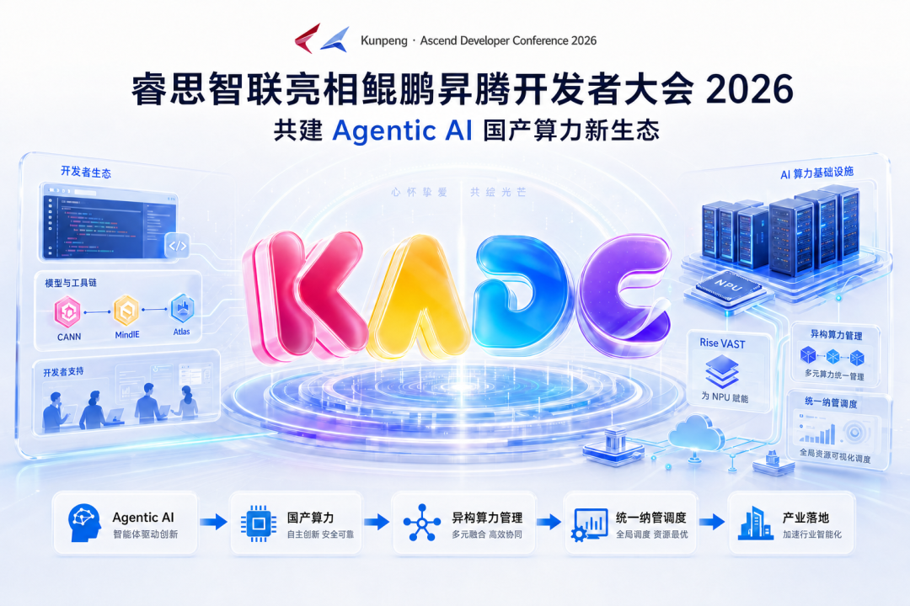

[English](./README.en.md) · [文章目录](../../README.md) · [官网阅读](https://www.theriseunion.com/zh/blog/riseunion-kunpeng-ascend-developer-conference-2026.html)

# 睿思智联赴2026鲲鹏昇腾开发者大会，共建 Agentic AI 国产算力新生态

睿思智联 · 2026/05/26 10:00（北京时间） · [微信公众号原文](https://mp.weixin.qq.com/s/D8ooLYXCiVFyeoyTc9_w-Q)

围绕 Agentic AI 时代的算力基础设施升级，睿思智联持续深化与昇腾生态的适配合作，推动国产异构算力从“可用”走向“好用、易管、可持续运营”。

> 围绕 **Agentic AI** 时代的算力基础设施升级，睿思智联持续深化与昇腾生态的适配合作，推动国产异构算力从“可用”走向“好用、易管、可持续运营”。

## 共赴开发者大会，聚焦 Agentic AI 新趋势

近日，睿思智联受邀出席**鲲鹏昇腾开发者大会2026**，与产业伙伴、开发者和行业用户共同探讨 Agentic AI 时代的算力基础设施创新方向，以及国产算力生态的长期建设路径。

随着大模型从单次问答走向复杂任务执行，AI 应用正在进入 **Agentic AI** 阶段。智能体需要持续规划、调用工具、处理长上下文，并在多轮交互中完成复杂业务流程。这对底层算力提出了更高要求：不仅要有充足的计算资源，还要具备更强的弹性调度、资源隔离、稳定运维和成本计量能力。

在这一背景下，AI 基础设施的价值正在从“提供算力”升级为“管理算力、调度算力、治理算力”。谁能更高效地管理异构资源，谁就更有机会支撑企业级 AI 应用的大规模落地。

## Agentic AI 需要怎样的算力基础设施？

**Agentic AI 算力基础设施**，是面向智能体应用的 AI 计算底座，需要支持多模型并发推理、长上下文处理、复杂任务编排、低时延响应，以及跨芯片、跨集群的统一资源调度。

相比传统训练或单模型推理场景，Agentic AI 更依赖稳定、弹性、可观测、可计量的算力管理能力。尤其在政府、金融、运营商、能源和制造等行业场景中，AI 应用往往需要同时兼顾国产化适配、数据安全、资源利用率和运维可控性。

这意味着，企业建设 AI 平台时，不能只关注单张卡、单个模型或单次部署，而要把 **算力池化、异构纳管、动态资源切分、全链路可观测和多租户治理** 纳入整体规划。

## 深化昇腾生态适配，共同推动国产算力高效落地

作为昇腾生态合作伙伴，睿思智联VAST 2.0在年初通过了基于910C的华为Atlas 800I A3/Atlas 800T A3的技术认证；睿思智联持续围绕昇腾 Atlas 服务器、CANN 软件栈和国产 AI 算力集群开展适配与优化工作，帮助用户更高效地建设、管理和运营国产 AI 算力资源。\

在本次大会中，睿思智联以生态特邀伙伴身份参加主题为 **《同筑生态，聚 AI 时代——昇腾生态伙伴开发者》** 的圆桌会，深度解读昇腾开发者目标计划和相关激励政策，并围绕如何共建昇腾开发者社区、繁荣昇腾生态展开研讨。

在国产算力规模化部署过程中，用户面临的不只是“能否跑起来”的问题，更包括资源如何统一纳管、任务如何高效调度、不同芯片如何协同、故障如何定位、成本如何计量，以及平台如何支撑多团队长期使用。

睿思智联希望通过自身在 **异构算力管理、vGPU 切分、超分、资源调度、可观测运营及运维** 等方面的积累，为昇腾等国产算力平台提供更完善的基础设施管理能力，让国产算力在真实业务中更易用、更稳定、更具性价比。

## 打造 AI 算力管理底座

面向多芯片、多集群、多租户的 AI 基础设施场景，睿思智联自研的 **AI 算力管理平台**，聚焦算力资源的统一纳管、动态切分、调度编排、全链路可观测和运营计量。

AI 算力管理平台可面向 NVIDIA、昇腾、海光、寒武纪、昆仑芯、沐曦、摩尔线程、天数智芯、燧原等多类型算力资源，帮助用户构建统一的 AI 算力资源池，降低异构环境下的平台建设和运维复杂度。

在企业级 AI 场景中，AI 算力管理平台的价值不仅体现在资源管理层面，也体现在应用落地效率上。通过统一纳管和精细化调度，平台可以帮助用户提升资源利用率，降低资源闲置和重复建设，支撑训练、推理和智能体应用在同一算力底座上的协同运行。

## 面向产业场景，共建国产 AI 算力新生态

Agentic AI 的发展，将进一步放大 AI 基础设施的重要性。未来的企业 AI 平台，需要同时具备国产化适配能力、异构资源管理能力、训推一体能力、弹性扩缩容能力和精细化成本治理能力。

睿思智联将继续与昇腾生态及更多产业伙伴协同，围绕国产 AI 算力基础设施建设，持续推进产品适配、场景落地和生态共建，帮助更多行业用户把国产算力真正用起来、管起来、跑得稳。

面向 Agentic AI 时代，睿思智联也将持续以开放、兼容、工程化的 AI Infra 能力，推动异构算力从资源供给走向平台化运营，为中国 AI 产业的长期发展提供坚实底座。

### 关于睿思智联

北京睿思智联科技有限公司（RiseUnion）专注于AI 算力管理与调度，已完成 10+ 国产芯片兼容认证，是 CNCF Sandbox 开源项目 HAMi 的核心贡献者之一。公司是国家高新技术企业、北京市专精特新中小企业、AIIC 算力池化工作组组长单位，在金融、政企军工、交通、医疗等行业实现大规模生产级落地。

睿思智联致力于让算力像水电一样随取随用，为企业 AI 转型构建智能、可控、高效的算力底座。

---

[在睿思智联官网阅读本文](https://www.theriseunion.com/zh/blog/riseunion-kunpeng-ascend-developer-conference-2026.html) · [浏览更多文章](https://www.theriseunion.com/zh/blog.html)
