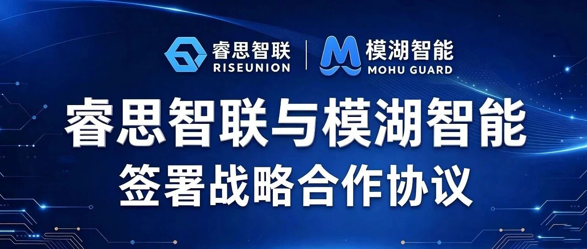
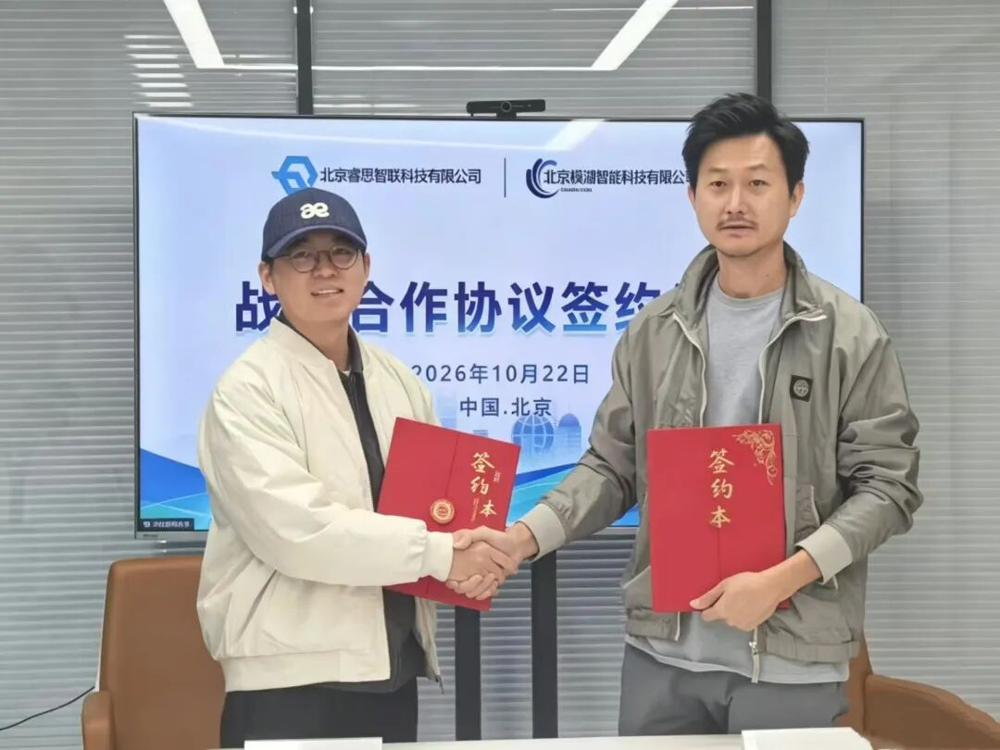

[简体中文](./README.md) · [All articles](../../README.en.md) · [Read on the website](https://www.theriseunion.com/en/blog/riseunion-mohu-ai-security-partnership.html)

# From Computing Support to Security Protection: RiseUnion and Mohu Intelligence Sign a Strategic Cooperation Agreement

RiseUnion · October 28, 2026 at 10:40 (UTC+08:00) · [Original WeChat article (Chinese)](https://mp.weixin.qq.com/s/Stxok7dUiVYUpV7Qe_DPsg)

RiseUnion and Mohu Intelligence signed a strategic cooperation agreement to explore collaboration between AI infrastructure management, large-model security assessment and runtime protection.

Recently, Beijing RiseUnion Technology Co., Ltd. (RiseUnion) and Beijing Mohu Intelligence Technology Co., Ltd. (Mohu Intelligence) officially signed a strategic cooperation agreement. Combining their capabilities in AI infrastructure management, large-model security assessment and runtime protection, the two companies will explore collaboration between platform and security products to support enterprise deployments of large-model and Agent applications.

Left: Lin Jirui, CTO of Mohu Intelligence; right: Yang Shiqi, CTO of RiseUnion

As AI gradually enters enterprise workflows, the questions enterprises ask are changing. In addition to whether compute is sufficient and models can be deployed, they need to understand applications' security risks, how to protect them during operation, and how to improve continuously after problems are identified.

**Keeping AI applications running reliably requires compute and platform support, as well as security capabilities suited to the business context.** This is the starting point for the cooperation.

## 01 As AI Enters Business Operations, Security Must Cover Deployment and Runtime

From knowledge-based Q&A and intelligent customer service to assisted analysis and tool use, large-model applications are becoming more closely connected with enterprise data, software frameworks and business systems. Security programs therefore need to cover more stages.

Malicious prompts may cause models to deviate from their tasks, sensitive information may leak during interactions, complex inputs may consume large amounts of inference resources, and AI frameworks and external tools may introduce new attack surfaces. These risks involve models, applications and runtime environments, requiring assessment and protection in the context of specific use cases.

For enterprises, security needs to become a continuous process: identifying risks before launch, configuring protection during operation, remediating and retesting identified problems, and updating policies as applications change.

At the same time, security products need to connect with enterprises' existing model services and infrastructure. Integration methods, deployment environments and operational workflows all affect how well security capabilities work in practice.

Through this cooperation, the two companies will explore connections between AI infrastructure management, security assessment and runtime protection, helping security capabilities fit more effectively into enterprise model and application environments.

## 02 Exploring Joint Solutions for Assessment, Protection and Continuous Improvement

### Before Launch: Identify Risks in the Application Context

Enterprises use different models, data and tools, and their security risks vary accordingly.

The companies will explore combining enterprise model service environments with security assessment capabilities to test specific application scenarios, providing input for model selection, application launches and subsequent remediation. Assessments will cover generated content as well as prompt attacks, sensitive information leakage, AI frameworks and tool use.

### During Operation: Connect Security Protection with Model Services

For the operational stage, the companies will explore integrating a large-model security guardian with model service platforms to detect risks within the integrated protection scope and take appropriate action, such as alerts or blocking, according to the deployment approach and configured policies.

By connecting security products with real service environments, they aim to help enterprises detect and respond to relevant risks during operation, providing evidence for security operations and troubleshooting.

### Continuous Improvement: Use Assessment Findings to Improve Protection

Problems identified in assessments need to result in remediation and protective measures; new risks encountered during operation also need to feed into later assessments.

Coordination between large-model security assessment and protection can inform improvements to protection policies. Building on this, the companies will explore using the platform's runtime environment to connect assessment findings, protection policies and security alerts, helping enterprises continuously improve protection configurations and verify remediation through retesting.

### Deployment: Validate against Customer Environments

Enterprises differ in infrastructure, model architecture and operational practices, so joint solutions need validation in actual environments.

Based on customer deployment requirements, the companies will explore on-premises deployment, product interface integration and operational coordination, progressively defining applicable scenarios, compatibility conditions and delivery scope.

## 03 Integrating Security into AI Application Deployment

This cooperation connects two specialist fields: AI infrastructure and large-model security. RiseUnion contributes infrastructure management and platform integration capabilities, while Mohu Intelligence provides security assessment and runtime protection capabilities.

Through this collaboration, the companies aim to help enterprise users integrate security products more smoothly into model service environments, connecting pre-launch assessments, runtime protection and subsequent remediation more closely.

Starting with this agreement, the companies will continue exploring technical integration and scenario validation, linking AI application security with infrastructure development to provide stronger support for enterprise AI deployments.

------------------------------------------------------------------------

**About RiseUnion**

Beijing RiseUnion Technology Co., Ltd. is committed to building a next-generation intelligent management platform for AI infrastructure. It provides products and services for enterprise AI infrastructure development and operation, covering heterogeneous compute management, resource scheduling, model lifecycle management and model invocation management.

**About Mohu Intelligence**

Beijing Mohu Intelligence Technology Co., Ltd. specializes in large-model security technologies and products, building its product portfolio around attack, assessment, defense and governance. Its principal products include the Hetun large-model security exercise range, Huxun large-model security assessment platform and Shuita large-model security guardian, providing security exercises, security assessments and runtime protection.

---

[Read this article on the RiseUnion website](https://www.theriseunion.com/en/blog/riseunion-mohu-ai-security-partnership.html) · [Explore more articles](https://www.theriseunion.com/en/blog.html)
