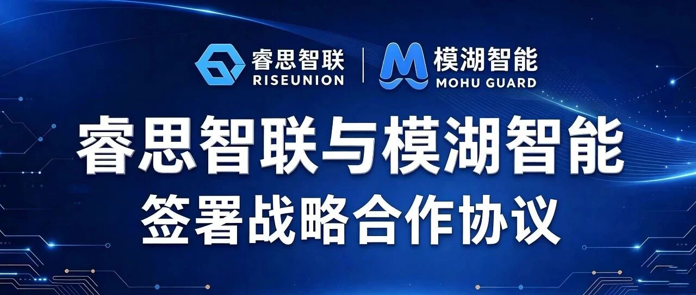
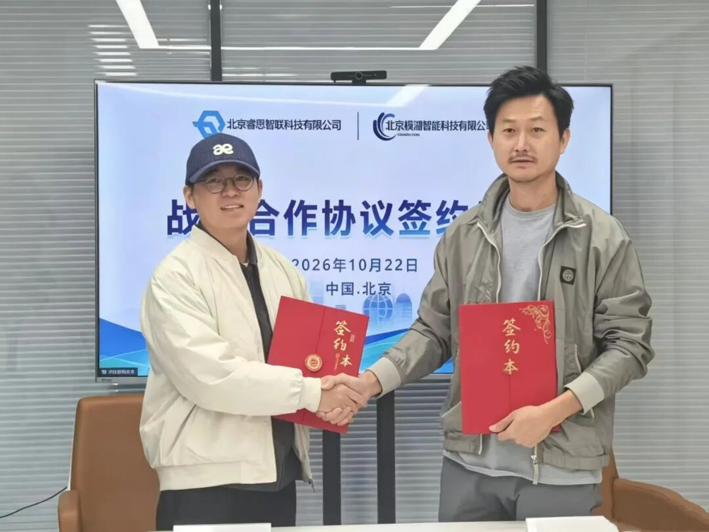

[English](./README.en.md) · [文章目录](../../README.md) · [官网阅读](https://www.theriseunion.com/zh/blog/riseunion-mohu-ai-security-partnership.html)

# 从算力支撑到安全防护 睿思智联与模湖智能签署战略合作协议

睿思智联 · 2026/10/28 10:40（北京时间） · [微信公众号原文](https://mp.weixin.qq.com/s/Stxok7dUiVYUpV7Qe_DPsg)

睿思智联与模湖智能签署战略合作协议，探索AI基础设施管理与大模型安全测评、运行防护的协同。

近日，北京睿思智联科技有限公司（睿思智联）与北京模湖智能科技有限公司（模湖智能）正式签署战略合作协议。双方将结合各自在AI基础设施管理、大模型安全测评与运行防护方面的能力，探索平台与安全产品的协同，为企业大模型及智能体应用落地提供支撑。

左：模湖智能CTO林继锐；右：睿思智联CTO杨世琪

当AI逐步进入企业业务流程，企业关注的问题也在变化：除了算力是否够用、模型能否部署，还需要了解应用存在哪些安全风险、运行过程中如何防护，以及发现问题后如何持续改进。

**让AI应用稳定运行，需要算力和平台支撑，也需要与业务场景相适应的安全能力。** 这正是双方此次合作的出发点。

## 01  AI走进业务，安全需要贯穿上线与运行

从知识问答、智能客服到辅助分析和工具调用，大模型应用与企业数据、软件框架及业务系统的联系日益紧密。安全建设也需要关注更多环节。

恶意提示词可能诱导模型偏离任务，敏感信息可能在交互中泄露，复杂输入可能消耗大量推理资源，AI框架及外部工具也可能引入新的攻击面。这些风险分别涉及模型、应用和运行环境，需要结合具体场景开展评估与防护。

对企业而言，安全建设需要形成持续的工作过程：上线前识别风险，运行中配置防护，发现问题后开展整改与复测，并根据应用变化更新策略。

与此同时，安全产品还需要与企业已有的模型服务和基础设施相衔接。接入方式、部署环境和运行维护流程，都会影响安全能力在实际业务中的使用效果。

在此次合作中，双方将探索AI基础设施管理与安全测评、运行防护之间的衔接，让安全能力更好地融入企业模型和应用的运行环境。

## 02  围绕评估、防护与持续优化，探索联合方案

### 上线前：结合应用场景识别风险

企业使用的模型、数据和工具不同，面临的安全风险也各有侧重。

双方将探索结合企业模型服务环境与安全测评能力，围绕具体应用场景开展测试，为模型选型、应用上线及后续整改提供参考。测评既关注生成内容，也关注提示词攻击、敏感信息泄露、AI框架和工具调用等相关风险。

### 运行中：推动安全防护与模型服务对接

针对应用运行阶段，双方将探索大模型安全卫士与模型服务平台的集成，在已接入的防护范围内开展风险检测，并根据部署方式和配置策略执行告警、拦截等相应处置。

通过将安全产品与实际服务环境相结合，帮助企业在运行过程中发现和应对相关风险，为安全运营和问题排查提供依据。

### 持续优化：让测评结果服务防护改进

测评发现的问题，需要落实为整改和防护措施；运行中出现的新风险，也需要反馈到后续评估中。

通过大模型安全测评与防护的协同，测评结论可为防护策略优化提供参考。双方将以此为基础，探索结合平台运行环境，推动测评结果、防护策略与安全告警之间的信息衔接，帮助企业持续优化防护配置，并通过复测检验整改效果。

### 部署落地：结合客户环境开展验证

企业在基础设施、模型架构和运维方式上存在差异，联合方案需要结合实际环境验证。

双方将围绕客户的部署需求，探索本地化部署、产品接口对接和运行维护协同，逐步明确方案的适用场景、兼容条件与交付范围。

## 03 让安全能力融入AI应用落地过程

此次合作连接了AI基础设施与大模型安全两个专业领域：睿思智联提供基础设施管理与平台集成能力，模湖智能提供安全测评与运行防护能力。

对于企业用户，双方希望通过协同，帮助安全产品更顺畅地接入模型服务环境，让上线前的测评、运行中的防护和后续整改形成更紧密的联系。

以此次签约为起点，双方将持续探索技术对接与场景验证，推动AI应用的安全建设与基础设施建设相互衔接，为企业AI应用落地提供更扎实的支撑。

------------------------------------------------------------------------

**关于睿思智联**

北京睿思智联科技有限公司致力于构建新一代AI基础设施智能管理平台，围绕异构算力管理、资源调度、模型生命周期管理及模型调用管理等方向，为企业AI基础设施建设与运营提供产品和服务。

**关于模湖智能**

北京模湖智能科技有限公司专注大模型安全技术与产品，围绕“攻、测、防、治”构建产品体系，主要产品包括河豚大模型安全演练靶场、湖鲟大模型安全测评平台、水獭大模型安全卫士，提供安全演练、安全测评与运行防护等能力。

---

[在睿思智联官网阅读本文](https://www.theriseunion.com/zh/blog/riseunion-mohu-ai-security-partnership.html) · [浏览更多文章](https://www.theriseunion.com/zh/blog.html)
