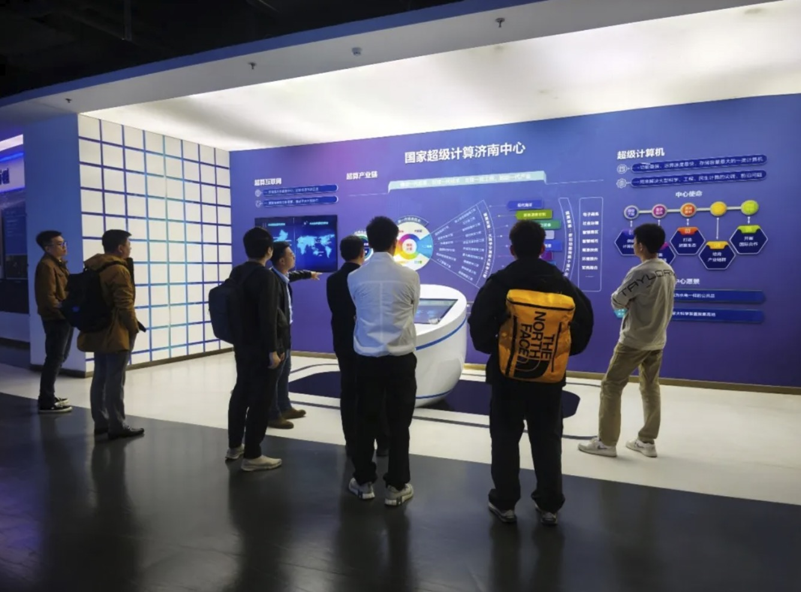
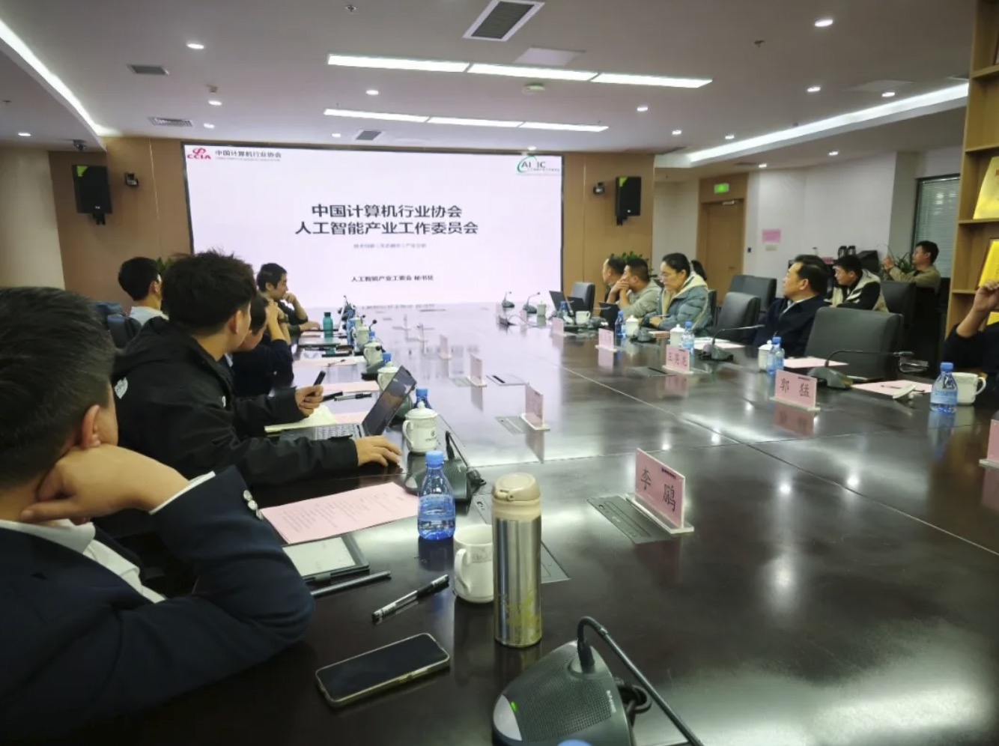

[简体中文](./README.md) · [All articles](../../README.en.md) · [Read on the website](https://www.theriseunion.com/en/blog/riseunion-nscc-jn-1.html)

# AI Committee & NSCC-JN Forge Strong Partnership

RiseUnion · January 01, 2025 at 08:00 (UTC+08:00)

AI Industry Committee partners with Jinan Supercomputing Center, with RiseUnion providing technical support through Rise VAST platform to enable efficient AI computing services and drive innovative applications.

Summary: The AI Industry Committee has established a strategic partnership with Jinan Supercomputing Center, with RiseUnion as technical support provider, will help the supercomputing center deliver more efficient AI computing services through the Rise VAST platform. This collaboration will drive innovative applications of supercomputing resources in AI and promote industry development.

On October 23, 2024, the AI Industry Working Committee held a discussion meeting with the National Supercomputing Center in Jinan.

Expert leaders from the committee's member units, Beijing RiseUnion Technology Co., Ltd. and Zhongke Jiahe Beijing Technology Co., Ltd., participated in this exchange activity. Both parties shared experiences regarding heterogeneous computing power management and collaborative work, and explored opportunities for cooperation.

During the meeting, Jiao Honglin from the AI Industry Working Committee Secretariat introduced the committee's recent achievements and work plans. Zang Lu, COO of Zhongke Jiahe Beijing Technology Co., Ltd., shared technical insights on building domestic computing power ecosystems centered on compilation technology, while Yang Shiqi, Vice President of Beijing RiseUnion Technology Co., Ltd., shared experiences on AI heterogeneous computing resource pooling.

Guo Meng, Assistant Director of the National Supercomputing Center in Jinan, introduced that the Jinan Center has deep technical accumulation and experience in the supercomputing field. He expressed hope to strengthen cooperation with the working committee and promote further development and breakthroughs in AI heterogeneous computing power collaboration.

> Source: [AI Industry Working Committee Holds Discussion Meeting with National Supercomputing Center in Jinan](https://mp.weixin.qq.com/s/ygwo6t_ui7gLjoQaHFfEwQ)

---

[Read this article on the RiseUnion website](https://www.theriseunion.com/en/blog/riseunion-nscc-jn-1.html) · [Explore more articles](https://www.theriseunion.com/en/blog.html)
