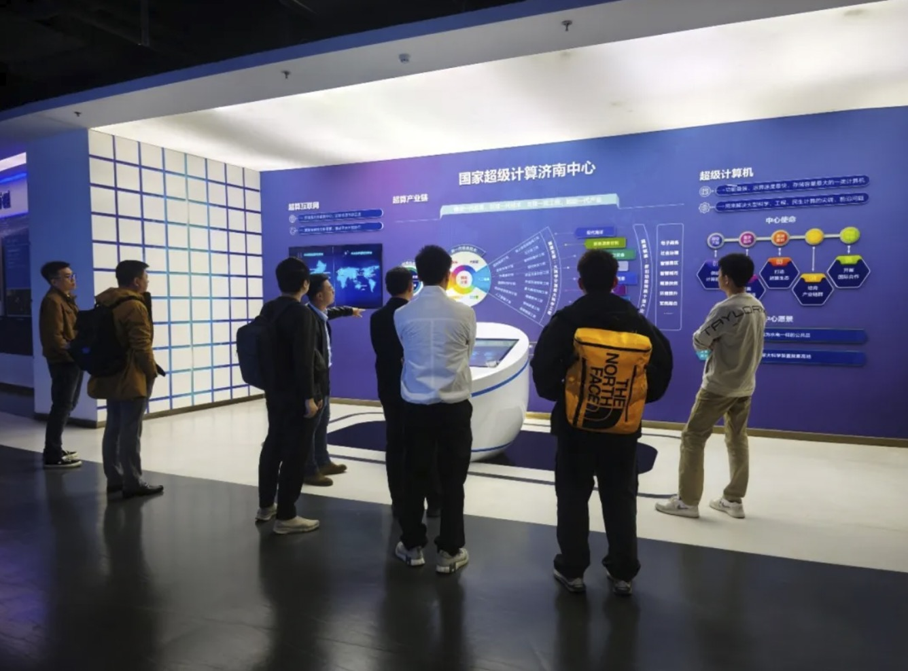
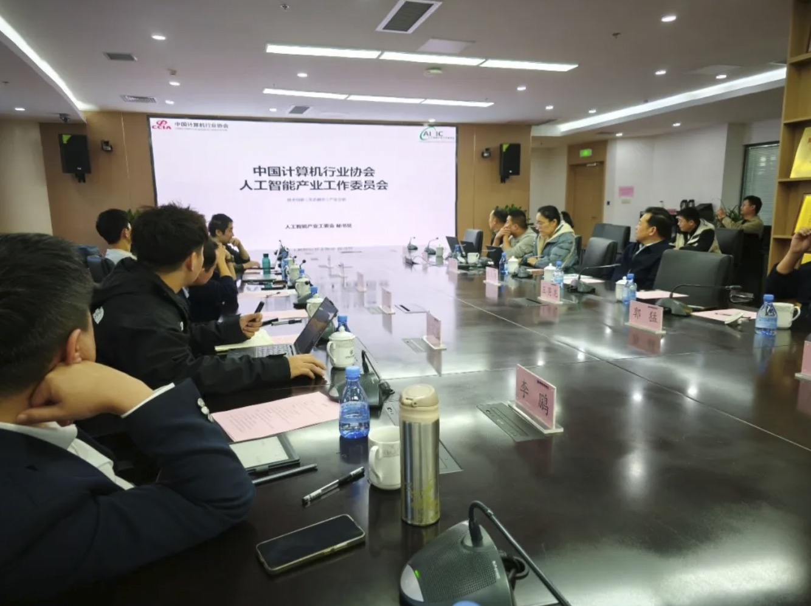

[English](./README.en.md) · [文章目录](../../README.md) · [官网阅读](https://www.theriseunion.com/zh/blog/riseunion-nscc-jn-1.html)

# 引领创新：AI 产业工委会与济南超算中心达成深度合作

睿思智联 · 2025/01/01 08:00（北京时间）

人工智能产业工委会与济南超算中心开展战略合作，睿思智联作为技术支持方，通过Rise VAST平台助力超算中心提供高效AI算力服务，推动超算资源在AI领域创新应用。

摘要：AI 产业工委会与济南超算中心建立战略合作关系，睿思智联作为技术支持方，将通过 Rise VAST 平台助力超算中心提供更高效的 AI 算力服务。这次合作将推动超算资源在 AI 领域的创新应用，促进产业发展。

2024 年 10 月 23 日，人工智能产业工作委员会与国家超级计算济南中心进行交流研讨。

工委会的成员单位北京睿思智联科技有限公司、中科加禾北京科技有限公司的专家领导参加了此次交流活动。双方围绕算力异构管理与协同工作进行了相关经验分享，对合作交流进行探讨。

会上，人工智能产业工委会秘书处焦宏麟对工委会的近期工作成果及工作计划等进行介绍。中科加禾北京科技有限公司首席运营官臧路对以编译技术为核心的国产算力生态构建进行了技术交流，北京睿思智联科技有限公司副总裁杨世琪对AI异构算力资源池化工作进行经验分享。

国家超级计算济南中心主任助理郭猛介绍，济南中心在超算领域有着深厚的技术积累和经验，期望加强与工委会的合作，推动AI算力异构协同工作取得进一步的发展与突破。

> 原文: [人工智能产业工作委员会与国家超级计算济南中心举行交流研讨会](https://mp.weixin.qq.com/s/ygwo6t_ui7gLjoQaHFfEwQ)

---

[在睿思智联官网阅读本文](https://www.theriseunion.com/zh/blog/riseunion-nscc-jn-1.html) · [浏览更多文章](https://www.theriseunion.com/zh/blog.html)
